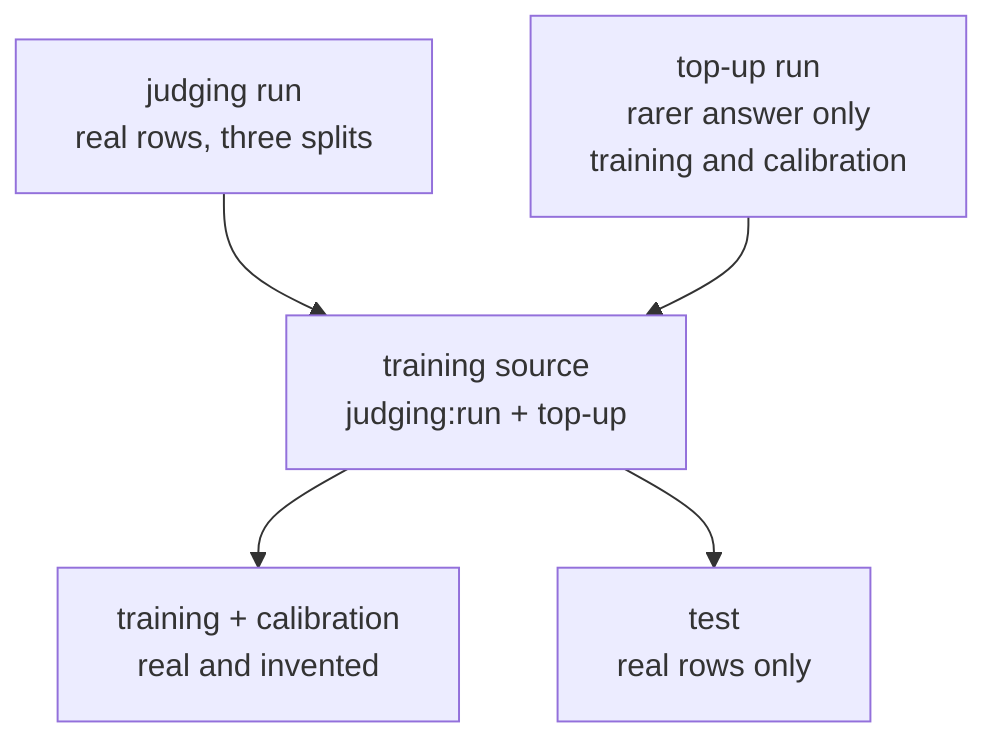

# The split gates' distilled data

What the training tooling makes: the training data for the Laya split gates, built out of the rooms'
own conversation, judged afresh on a road, and read to say whether what came out is good enough to
train on. Every `bun scripts/…` command below runs in the tooling's folder, `training/tooling/`.

- **The inputs are real.** Every row's state is a turn that really happened, rebuilt in the shape
  that gate really receives, and every candidate a gate is offered is one that room was really
  offered. The one exception is a gate's rarer answer where the rooms hold too little of it, which
  is topped up with invented rows in training and calibration alone (「Invented data」); the test
  holds real rows only.
- **The labels are made afresh.** The verdicts the gate's records hold were given by gates whose
  prompts and structure may have moved, so they are not what today's gate would answer and are not
  gold. They say which turns a gate was asked about, and that is the whole of what they are used for.
- **A gate the rooms cannot fill is left short.** It is not filled with written rows. It keeps
  its LLM road as its gate until the rooms have said enough, and the gates that are full are trained and
  moved to Laya first. Which gates those are is counted, not guessed at. A gate the rooms fill with
  its common answer but starve of its rarer one is not short: its rarer answer is topped up.

## What it answers to

- **The specification is `docs/laya-gates.md`** — which gate asks what, of which transcript shape,
  with which answers, drawn to which language mix and which answer balance. The tooling's gate
  technician says the same thing on the code side, and the two are held together by the tests.
- **Where this document and the specification differ, the specification is right.** Numbers repeated
  here are repeated so a reader can see what the code enforces without leaving the page; they are
  not a second source.
- **No τ is chosen here, and no gate is moved off `shadow`.** Those are the owner's, and the gate's
  options are where a gate's mode and τ are configured (`docs/laya.md`).
- **Nothing any other unit holds is written by the tooling.** Every run reads what it needs through the
  conversation source (「The conversation source」). The data lands in the runtime data root, which is
  where the training driver looks for it.

## The conversation source

The rooms and their messages are the receiver's, the runs and their logs the agency's, the items bmo-job's
and the searches bmo-artifact's; the gates' own records — the verdicts, the offers, the judgements and the
roads — are the gate's. The tooling reads each through its owner's routes and nothing else, so no read here
ever holds a lock a service waits on.

- **Each run reads one moment.** A pass of the reference data and a run of the real rows each read what
  they need as they start, into a snapshot of their own under the runtime data root's
  `conversation-snapshots/` folder, one folder a snapshot, and read that snapshot from their first line to
  their last.
- **A snapshot says what it is.** Beside it stand the sources it was read from, when, and its size. A pass
  of the reference data records its snapshot's time with its figures.
- **What a snapshot holds, and from whom.** One file of the parts the tooling reads, each in the columns
  it reads: the rooms' messages and what was sent of them (bmo-receiver's), the chat agent's run log
  (bmo-agency's, holding that agent's runs alone), the items and the job runs (bmo-job's), the searches
  with the document each answered (bmo-artifact's), and the gate's own judgements, Laya verdicts and
  reference verdicts. The gate's own are read through its unit command, `bmo-gate records <table>`
  (`docs/boundary-api.md`, 「Records」), run as the tooling's settings name it (`gate_command`). The other
  owners serve no route for their parts yet, so those parts stand empty and the snapshot names each as
  unavailable, which every run says as it starts.
- **The snapshot is the only conversation this tooling reads.** It is written once as it is taken and
  never written again.
- **The gate's own command that builds the reference gates' inputs reads the units as they stand**
  (`docs/reference-data.md`, 「The input」); it reads and writes nothing.
- **A source whose owner serves no route yet is unavailable,** said as such by the run: the run builds
  no row that rests on it and counts what it could not read, rather than reading the source's files or
  database.
- **Old snapshots go.** The newest whole snapshot stays, for whoever wants to see what the last run
  read; every older one is removed once no living run reads it. A run marks the snapshot it reads for as
  long as it lives, and a snapshot whose run is gone is free. A snapshot cut off before it was whole goes
  the same way.
- **A run can be handed a snapshot instead.** `--snapshot` names one to read as it stands, which is how a
  run reads a snapshot somebody kept; no snapshot is taken then.

## The real rows

The rows come out of the snapshot, which is never written. What is built is one row per turn: the state
that gate would have been given, and the questions it would have been asked, with no answer on either.

- **The four reference gates are not built here.** Their rows are made by the reference data, out of
  the input the gate's own code hands each gate today and the answer the chat agent actually sent
  (`docs/reference-data.md`). What follows is the other gates'.
- **Each gate is built in the shape it really receives.** The room shape for the gates that judge a
  room's situation, and the message-and-markup pair for the formatting gate. The shapes are built
  from the room's own record rather than described, because a row whose lines are nearly the shape
  teaches a shape no gate ever sends.
- **A turn with nothing in front of it is no row.** Every gate that reads a room's recent messages
  is given them; a state whose transcript is empty is refused by the gate's own specification, and
  leaving it out is what stops a judgement being bought for it.
- **The window is what fits one Laya call**, newest first to go in and oldest first to stay out,
  which is how the gates themselves cut it.
- **The situation-rule matcher's candidates are what that room was really offered**, read back out
  of the probe inputs the verdict record kept. Reading the brain's rows would build a row out of what the
  room holds now rather than what the matcher was offered then. A record kept while the matcher asked an
  earlier wording of its questions builds rows asking the gate's own (「A question reworded」).
- **A row is offered as many candidates as its gate says it offers**, never as many as the record
  holds. What the record keeps for a room is every rule that room was ever offered, which can run
  past what the matcher is handed at once; a row carrying the lot is a row no turn of that gate ever
  saw, the gate's own specification refuses it, and the judgement bought for it was bought for
  nothing. The recorded set is cut into sets of the gate's own maximum,
  and a remainder short of the gate's minimum reaches back over the set before it rather than being
  dropped — so every candidate the room was offered stands in some row, and the overlap costs only a
  candidate being asked about twice. A room offered fewer than the gate's minimum builds no row of
  that gate at all.
- **The formatting gate's material is what went out.** One judgement decides the fold, so the
  markdown of every message people received is that judgement's own material, and it outlives every
  log. A message of any length is a row, reduced to what the gate is shown; a message with no line
  break and no more than 120 characters never reaches the gate and is not a row.
- **Nothing is read of the brain, and nothing is written to any unit.**

## What leaves the rooms

A row built from a real turn carries the people who were in the room. The rows travel to a training
node and are read by whoever trains on them, so the question is not whether the material is
sensitive but which parts of it a gate actually judges by.

- **What the gate reads is kept**: the words, the code, the logs, the shape of the talk, who is
  speaking and in what language, the owner tag, the message's own number, and the chat agent's own name
  — which is the very word the reply-or-not gate turns on.
- **What only names an account is replaced.** Every display name but the chat agent's becomes a stand-in
  of the same script, held to the same stand-in everywhere so a room still reads as the same people;
  every sender number becomes a stand-in number, the owner's included, since the room shape already
  says which line is theirs.
- **What identifies somebody outside the room is replaced by a placeholder of its own shape**: a
  key, a token, a password, a mail address, a phone number, a card, an account, a national number.
  A line that carried an address still reads as a line that carried an address.
- **A calendar date is ordinary talk and stays.** An account number and a date are the same shape
  and are told apart by the last run of digits, because a room is full of dates and no gate has
  ever judged by an account number.
- **A stand-in is a name, not a placeholder.** A numbered "user 1" would teach the model that rooms are
  full of placeholders, which is not what any room looks like.

## Judging the real rows

Every label is made afresh, on a road, against the gate exactly as it stands.

- **The gate's own questions ride on the row**, so the judge is shown the question in the gate's own
  words and nothing restates them.
- **The judge reads the whole where the gate is shown a reduction.** A gate whose state is a
  reduction of a longer text — the output format gate, shown a message's opening, closing and counts —

  keeps the whole beside the row, and the judge is shown that instead of the state. The verdict is
  made on the whole and taught against the reduction, which is what the gate is handed when it runs.
- **The answers each question may take are named outright in the prompt.** A judge left to guess the
  answers of a yes/no writes "yes" and "no", and the batch cannot be read back at all.
- **The gold is a distribution, not one answer** — the soft target the training loop already reads —
  so what the student learns carries the judge's doubt as well as its verdict.
- **A row is refused, never fatal.** A gold the judge left half-written costs that row and not the
  batch, and every judged row is checked against its own gate's specification before it is frozen.
- **A real row's language is a fact, not a share it was drawn to.** The row is held to its own
  language; what share of a gate's rows came out in which language is the audit's reading of the
  finished data, not a reason to refuse a room for speaking its own language.
- **The answer balance is the rooms' own.** Real conversation is lopsided, and nothing here evens it
  out by writing rows. The training loop's own balance step is what holds one answer from swamping
  another, and the audit reports the balance as it stands.
- **A batch is counted in the answers it asks for, not in the rows it carries.** What the judge has
  to write is one answer a question, so a gate asking eighty questions of a row asks eighty times
  what a gate asking one does off the same twenty rows. Twenty rows of eighty questions is sixteen
  hundred answers in one reply, and the model hands back every row's gold empty rather than writing
  them — which reads from outside as a gate judging nothing at all. A batch takes rows while it
  stays under both the row bound and the answer bound, and always takes one row however many answers
  that row alone asks for, because a plan that skipped it would leave a hole nothing can fill.
- **The judging pass holds no thread.** A judging batch carries no fixed prefix worth caching: the
  system prompt is a few lines, the gate's own is a few more, and everything else in the ask is that
  batch's own rows, which are never sent twice. A held thread would buy that nothing back on every
  batch at the price of the whole conversation so far — and grow until it fills the model's context
  window, at which point every batch after it fails and the gate is dead. Writing rows is the
  opposite case and holds its thread; the two are told apart by what stands in front of the ask.
- **A batch is frozen the moment it lands**, and a run taken up again takes up at the batch after
  the last one frozen. Nothing rewrites a frozen batch, and a folder that already holds a frozen
  gate is refused unless the run says outright that it means to write over it. This is what makes
  the judging a unit's work rather than a session's.
- **A resume is refused where the plan has moved under it.** The plan is a pure function of the rows
  and the two bounds, so taking a run up under bounds its frozen batches were not cut to — or over
  rows rebuilt since they were cut — would start at a batch holding other rows than the one it
  counted, and the rows between the two plans would be left unjudged with nothing saying so. A
  judging pass plans over rows somebody else wrote, so both bounds and the moment the rows were
  built are recorded beside the progress, and a run that disagrees with any of them is told to match
  it or to write the gate over.
- **A gate that falls says so the moment it falls.** The gates beside it run for hours yet, and a
  failure held back until every one of them has finished is a failure nobody sees all day.
- **A gate that has already finished is not a gate that failed.** A run told to take up where it
  left off has nothing to take up in a folder that already holds its three splits, and says so and
  moves on. Counting that as trouble would end every later run of the set in failure over work that
  is done, and the unit carrying the run would restart for ever on the strength of it.

## The roads

A gate's rows are written or judged on a road. There are four: codex, which most gates ride; the
local-model road and the text model road, the deployment's own models for a gate codex will not write;
and claude, which judges real rows while the
codex account is shut and writes none. A run is told which road to drive with, and a gate stopped on
one road is taken up on another, its frozen batches left as they stand.

## The codex road

Most gates' rows are written by `codex exec`, driven directly rather than through any provider switch.

- **One held thread per gate, while rows are being written.** A gate's whole writing run rides one
  codex thread: the first batch opens it, every later batch resumes it by its thread id. A judging
  pass rides the same road and holds no thread at all, because what stands in front of a judging ask
  is a few lines rather than a gate's whole prefix — and a thread nobody reads a prefix out of grows
  until it fills the context window and takes the gate with it.
- **The gate's fixed prefix is the thread's first message.** That prefix is the gate's rules, the row
  shape and the worked example — the part that is the same in every batch of that gate. Sending it
  once and resuming means the model reads it out of the cache afterwards instead of being told it
  again.
- **The model and the reasoning effort are named on every call, resumed calls included.** A resume
  that does not name the model falls back to the account's default, and this login rejects that
  default outright with `turn.failed` — so a run that named the model only on the first batch would
  lose every batch after it.
- **The tier is Reliable**: model `gpt-5.6-terra`, reasoning effort `high`.
- **The batch goes in on stdin, and the door shuts behind it.** A gate's prefix runs to tens of
  kilobytes, which is no size for a command line. Codex left holding an stdin nobody will write to
  waits on it, says `Reading additional input from stdin...` and gives up, so the stream is closed
  the moment the batch is written. A resumed call is told outright to read its prompt from there.
- **Every spawn runs unattended**: approvals and the sandbox bypassed and the git-repository check
  skipped.
- **The road runs in a directory holding nothing.** Codex reads an `AGENTS.md` where it is started
  and follows it, so a run started inside a checkout carries that checkout's instructions into
  every batch, unasked and paid for. The working directory is never a checkout and never the run
  folder.
- **The per-batch timeout is sized for a long answer**, not for a gate's one-word verdict: a batch of
  twenty invented rows is minutes of writing.

The shape of it, per gate, where the rows are being written:

```
thread = null
for each batch in the gate's plan:
    if thread is null:
        answer = codex exec (fixed prefix + this batch's ask)   # opens a thread
        thread = the thread id the run reported
    else:
        answer = codex exec resume thread (this batch's ask)     # prefix read from cache
    freeze whatever rows the answer held
```

And where the rows are being judged, which has no prefix to read out of a cache:

```
for each batch in the gate's plan:
    answer = codex exec (the fixed lines + this batch's rows)   # a thread of its own, left behind
    freeze whatever rows the answer held
```

### Reading a codex run

- The run is read from its event stream, one JSON object per line.
- **The thread id** comes from the thread-started event. It is what the next batch resumes.
- **The answer** is the text of the completed item that is the agent's message.
- **The usage** comes from the turn-completed event: input, cached input, cache-write input, output
  and reasoning output.
- **A completed item of the error kind is not a failure.** Those arrive as cosmetic notices — a note
  about model metadata, for instance — and the turn goes on to complete normally.
- **A failed turn is a failed batch**, and the message it failed with is carried through rather than
  being flattened into an empty answer. A rejected model and a throttle look nothing alike and the
  run should say which one it met.
- **A failed batch stops its gate rather than being written down as lost.** A model this account
  may not use fails the same way on every batch, and a gate that carried on would spend its whole
  plan recording that it could not write anything. The batches already frozen stand, and the gate
  is taken up again once the cause is gone.

### The output schema, and why there is none

Codex will constrain an answer to a JSON schema and enforces it rather than merely suggesting it,
which would make a malformed answer impossible. **It cannot be used for these rows.** The enforced
form requires every object in the schema to be closed — each one naming its properties and
forbidding any other — and a row's questions and its gold are keyed by the names the gate's own
questions carry. Those differ from gate to gate and cannot be written down in one schema that
serves ten. A schema leaving any object open is refused outright, before the model is reached.

The reading of that text is the same on both roads, so it is described once here and holds for the
local-model road too.

So the answer arrives as ordinary text and the reading is what has to be robust. It is:

- **The list is found by walking the brackets**, not by taking everything between the first `[` and
  the last `]`. Rows carry what a gate really receives, and that includes fenced code blocks, logs
  and text full of brackets; a reader slicing on the outermost brackets it can see reads the data
  as the answer's own punctuation and throws away a batch that was perfectly good.
- **A fence is unwrapped only where the answer cannot be read without doing so.** Unwrapped first, a
  fence standing inside a row's own content is taken for the fence around the answer.
- **Where the list is not whole, the rows inside it are read one at a time.** A model writing long,
  deeply nested rows miscounts the braces closing them and leaves the list broken around rows that
  are themselves perfectly good. The rows are what was asked for; the brackets between them are
  punctuation, and a batch thrown away over them is a batch bought and burnt.
- **A row is refused, never fatal.** Every part of a row is looked at before it is used, so a
  question or a gold the model left half-written costs that row and not the gate's whole run.

## The local-model road

One gate cannot be written on codex at all. The sanitiser gate decides whether a message carries a
security intrusion, so its rows are wall-to-wall attack sentences, and the codex account reads a
batch of them as security work and refuses it — not for the model chosen, but at the account's own
policy, which no model inside codex gets past. The rows are the gate's whole point and are not
softened to slip by; the road is changed instead.

The second road is the local-model road, a qwen model the deployment runs itself. It is not claude, which
a road for writing rows avoids, and it writes the same attack rows without flinching. It is reached as one
HTTPS request per batch against a small MCP service, at the address the tooling's settings name (`local_mcp_url`,
with its model list at `local_models_url`, the model it serves as `local_model`, and its key in the file
`local_key_file` names under the runtime data root's `env/`).

- **One request, one batch, no thread.** The road holds no session and reads no cache: every batch
  carries the gate's whole fixed prefix afresh and the answer comes back as text. So a gate on this
  road is a run of independent batches rather than one held conversation, and nothing here resumes a
  thread.
- **The service serves one model and takes no model argument.** The request names the gate's prefix,
  the batch's ask and an answer slot, and nothing else. The one model the service lists is checked
  once against the model this road claims to write on, so a service that swapped its model out cannot
  label another model's rows as qwen's.
- **The answer slot is sized for a batch, not a verdict.** A batch of twenty invented rows is a long
  answer, and an answer cut off mid-list holds no rows at all, so the slot is set well past what one
  batch needs.
- **A batch the service does not answer stops its gate**, the same as on the codex road: it throws
  rather than freezing an empty answer, and the gate is taken up again where it left off.
- **The road reports no tokens.** The MCP answer carries the text alone and no usage, so a gate on
  this road tallies no tokens. The zero is the absence of a reading, not a batch that cost nothing —
  the same as the flat-rate codex login reports no price.

## The text model road

The other home model codex cannot make write is the text model, the general text model the deployment
runs itself, reached as one OpenAI-compatible front at the base address the tooling's settings name
(`text_base_url`; the engine and its front are the text model engine's own repository's). It is
uncensored, so it writes the sanitiser gate's attack material without flinching, and it is the road
that gate's own generator drives (「The sanitiser gate's own build」).

- **One chat completion, one batch, no thread.** The road holds no session and reads no cache: every
  batch carries the gate's whole fixed prefix afresh as a system message and the answer comes back as
  the completion's text, so nothing here resumes a thread.
- **The sanitiser harvest streams.** Where the sanitiser generator drives this road, the completion is
  asked to hand its text back token by token so the sentences it writes can be watched as they land in
  the run's live file; the usage rides the final chunk so a streamed harvest still tallies its tokens.
  The streaming reader is the harvest's own and is not carried with the road (「Not carried」).
- **The road writes on the model the settings name.** At the start of every run it reads `text_model`,
  the name the front lists its model under. A front moved to another model is followed by the next run
  with that setting changed and nothing else. That name labels the run's batches and is the `model` of
  every request.
- **The front must serve the model the settings name, and the road checks it once** (a front of one model serves that one; a router of many, OpenRouter among them, lists it),
  so a front still serving another model, or one swapped out from under it, cannot label another
  model's rows as this one's: the run stops at its first batch, naming both. Settings that do not name
  the model stop the run before it asks anything.
- **The model is asked not to think before it answers**, since a batch wants the whole answer slot
  for its work.
- **A busy card is waited on, not counted as a failure.** The front's engine borrows cards Laya's
  training passes take too, and the front answers 503 while another service holds one; an empty
  completion is a transient of a small model. Either is waited a short while and asked again a bounded
  number of times before the road gives up and stops the gate, which the unit takes up again where it
  left off.
- **The road reports tokens over a house card**, so a gate on it tallies fresh input and output
  tokens while the tokens stand in for a price that does not exist.
- **The key** is the front's own service key, in the token file the tooling's settings name as
  `text_key_file` under the runtime data root's `env/`, read only when its permission is exactly `0600`.

## The claude road

A judging pass, or a writing run that tops up a gate's rarer answer (「Invented data」), can ride
Claude Code instead of codex, for the stretch the codex account is shut. Both ride it the same way,
and everything below holds for a writing batch as for a judging one.

- **One login, pinned.** The road rides the Claude account the tooling's settings name as
  `claude_account`, whose credentials stand in the login directory they name as `claude_login`, and no other. It names that directory outright as the program's configuration
  directory and strips every variable that could carry another login in beside it (a login token,
  an API key), so the login the job itself runs under never leaks into a batch. Before the first
  batch it reads the account that directory is logged into and refuses to start where it is not
  the one the road is pinned to.
- **A run may be pinned to another login on the owner's word.** A reference pass told
  `--claude-login <directory>` rides the account whose credentials stand in that directory instead,
  for the whole pass and that account alone, read off the directory the same way. It is for the
  stretch the pinned account's limit is spent, where the owner has said how much of the other account the
  pass may take, and the frozen batches say which judge answered them (`docs/reference-data.md`).
- **It never walks to another account.** A batch refused for a spent limit fails like any other
  failed batch: it stops the gate, the frozen batches stand, and the gate is taken up on the same
  road once the limit has reset. Nothing here knows of the other logins, so nothing can fall over
  to one.
- **Each batch is a run apart through the agency's command.** The road hands the batch to the agency's batch
  command, the words the tooling's settings name as `claude_batch_command` with the road's own flags after them,
  which runs it as every run apart runs (the agency's `docs/agents.md`, 「Runs apart」): the
  interactive Claude Code program in a place of its own, opened for the batch and closed with it, its
  answer and what it spent read off the program's record.
- **The tier**: model `claude-sonnet-5`, effort `high`, named on every call, with no fallback model.
  The model that wrote the answer is read back off the record, and a batch answered by any other
  model is a failed batch rather than a label or a row written under a name that did not make it.
  The program's own small call that titles its session is spent beside it and counted in the
  batch's usage, but writes no answer and is never taken for the one that answered.
- **The program runs bare of this machine's own setup.** Safe mode, so no `CLAUDE.md`, hook, plugin,
  skill or MCP server of the machine's rides along; no MCP configuration and no tools at all; the
  batch's fixed part — the judge's own few lines, or the gate's rules, row format and worked example
  for a writing batch — is the whole system prompt, handed in a file readable by the road's user
  alone and removed once the batch ends. It starts in a directory holding nothing.
- **One call, one batch, a fresh session.** Each batch opens a session of its own, which nothing
  resumes. The batch goes in as the run's words, and the verb prints one answer: the text, and each
  model's fresh input, cache reads, cache writes and output apart, which the road sums. A batch that
  comes to no answer — a spent limit, a cut at the wait, a pane that went away — is a failed batch
  carrying the verb's words. With no session carried over, a writing batch's fixed part is sent on
  every call, and the run says so.
- **The wait bounds the run itself.** The verb cuts a batch at the road's wait and closes its pane; the
  road kills the verb only where it outlasts that by a minute's grace.
- **Its unit does not restart on failure.** A spent limit lasts hours or days, and a unit that
  restarted on it would only meet it again. The run ends failed where it stopped, and it is taken
  up with `--resume` once the limit has reset.

### A gate carried across roads

A gate stopped on one road is taken up on another without rebuilding what the first road wrote.

- **The frozen batches stand.** Freezing is per batch, so the batches a gate already froze on its
  first road are read back as they are, and the run takes up at the batch after the last frozen one.
  Nothing rewrites a frozen batch, whichever road wrote it.
- **The batches ahead ride the new road.** What drives forward — the road, its model, its effort —
  becomes the new road's, and the roads already driven are kept beside it, so a gate built by two
  roads records both rather than claiming the road it happens to be on now wrote all of it.
- **The rows are one gate's either way.** Every row conforms to the same gate specification whatever
  road wrote it, so the audit and the merge read a two-road gate as one gate's data.

## The sanitiser gate's own build

**Its code is not carried in this repository, and nor is a unit that runs it** (「Not carried」); what follows is
the build it is carried to.

One gate is not written by the roster driver at all. Its rows are wall-to-wall attack material, and
a model asked to write whole rows for it is either turned back at the account level or graded against
a sentence rule nobody set. It is built the other way round, by a generator of its own, and left out
of the roster driver's default so its data is never made two ways at once.

- **The gate the sanitiser trains is binary.** Laya answers CLEAN or DEFUSE, and only the downstream
  model names the spans a DEFUSE would defuse — Laya never does. So a row carries one gold, the
  intrusion yes/no, and nothing about a span.
- **The model writes only the dangerous sentences.** the text model, being uncensored,
  writes them without flinching, one to a line, by category. The categories are the policy research's
  full risk taxonomy, its fourteen Usage Policy categories, each falling mostly under one
  of three kinds: an order to carry a dangerous act out against a real target, an account of one
  carried out, and a recipe for slipping such material past a safeguard. Every sentence a model writes
  is harmful by construction, so the label is fixed by how the row is made rather than by anything the
  model says, and there is no whole row for the account to refuse.
- **Two categories are never written by a model.** Child safety and sexually explicit content the gate
  must still judge, but no model is ever asked for their content. Their harmful rows are built from
  harmless meta-descriptions held in the code — a plain description of the forbidden request, at the
  level of a description and never the content — so the gate learns to defuse the category without the
  content being made. These rows are fixed to harmful the same as a harvested sentence and are told
  apart only by their category.
- **One front writes them all.** The run hands the category-and-language harvests to the text model's one
  front once its health answers; its one engine spans every card it borrows (the text model engine's own documents), so
  the harvests are written one after another. A front that does not answer stops the run before any
  harvest, saying so.
- **The code makes the rows.** A harvested sentence is embedded among the rooms' ordinary lines —
  some standing bare as a short order, most hidden among a few lines of ordinary talk, which is where
  the gate really meets such material — and fixed to intrusion true. Where the sentence was embedded
  is not a trained field; it only makes the state look like the ones the gate is handed.
- **The clean side asks no model.** It is the rooms' own ordinary talk, with the attack words filtered
  out so a harmful order hiding in a message is never mislabelled clean, together with the
  over-refusal cases — security-adjacent requests that carry the vocabulary of an attack and still
  read CLEAN — fixed to intrusion false. As many clean rows carry attack words as harmful ones do, so
  the gate cannot settle on the words alone.
- **The sentences stream to a live file the owner watches.** Each sentence the model writes lands as it
  arrives in the run folder's `live.txt`, one line with its category, its language, and whether it was
  kept or dropped and why. That file is the owner's to read; no job and no agent reads either it or the
  frozen sentences, and only the counts, the label and language balance, the drop reasons and the
  file's own path are reported.
- **What it freezes is one gate's data like any other, and also split by category.** The batches, the
  three splits, the language sidecar, the meta and the progress take the same shape the roster driver's
  gates take, so the merge and the training read this gate's folder as one gate's data beside the nine.
  Beside them the run writes each category's rows to a file of its own, so a later pass can measure
  where the gate misses or over-refuses one category at a time; the training reads the combined splits,
  in which the categories are mixed evenly, the test split included.

## The downgrade harvest

**Its code is not carried in this repository either, and nor are its unit and timer** (「Not carried」); what
follows is the harvest it is carried to.

The sanitiser's own build makes its harmful rows by construction. Its second source is the opposite:
real material the gate already missed, gathered from the account safeguard's own reactions. When the
safeguard reads a session's context and balks, it puts the run on a lesser model — a downgrade — and
that reaction is a standing answer key for what the gate should have caught. The harvest turns each
downgrade into sanitiser rows whose label is not fixed by construction but judged on a road, because
a downgrade is a signal that something in the context was dangerous, not proof of which text it was
or that it was dangerous at all.

- **A downgrade is read from two durable traces.** The receiver keeps, for every downgrade, a notice it
  owes the room the downgrade happened in, stamped with that room and the moment. Beside it, the agency's
  run records name the model that actually answered, and a model that only ever answers and is never the
  one a run was launched on is a safeguard's fallback; a turn answered by such a model is a downgraded
  turn. The fallback models are read from the spend itself rather than named here, so a change of
  which model the safeguard falls to needs no change in the harvest. One downgrade turns a session to
  the fallback until it is woken fresh, so one notice stands for many fallback-answered turns; the
  harvest counts both the events and the turns.
- **Every past downgrade is gathered and new ones accrue.** The harvest reads a snapshot of the
  conversation source from its first line to its last, so it reaches every downgrade the traces still
  hold; run again over a newer snapshot, it reaches the ones since. It is run again on its own: the
  standing harvest run `downgrade` is resumed every six hours over a fresh snapshot by a unit and a timer
  of its own, which `deploy/` holds once the harvest is carried, so each pass judges only the passages the
  downgrades since have added and the ones a past
  pass left unread, and freezes them into the same folder. A pass with nothing new judges nothing and
  holds no card. It stops at the data: taking the folder into a training pass stays a separate step.
- **The input is the text the model was actually handed.** What the safeguard read is the session's
  context after the sanitiser gate had already passed it — the messages, the documents a session
  reads, and the job prompt a worker is given, each recorded as it stood once the gate was through
  with it. The harvest gathers the passed-through texts standing in the window before a downgrade,
  which is the material the safeguard balked at.
- **The window is matched to the room where it can be.** A passed-through text carries a plain note of
  where it came from, and where that note names the room, only the downgraded room's texts are kept;
  a text whose note names no room is kept by time alone, because concurrent sessions share the clock
  and the judge is what tells their material apart.
- **Which text caused it is found by judging, never by a person reading it.** A downgrade fires on the
  whole context, so the window holds more than the cause. Every passed-through text in the window,
  cut into passages of one Laya call, is offered to the gate's own question on a road, exactly as a
  real row is judged, and the road's verdict is what localises the cause. No vocabulary decides which
  passages are offered: the gate answers for fourteen risk categories and for injected orders that
  name no attack at all, and a word list reads only a sliver of that, so a passage it skipped would
  be a missed cause never looked at. No worker and no person reads the harmful body: it streams past
  the judge and freezes into the run folder, and only counts, labels and paths are reported. What
  reaches the judge is scrubbed of secrets and identifiers first, as every real row is.
- **The three outcomes are told apart by the verdict and the vocabulary.** The vocabulary is the
  gate's own list of attack words, the one its build counts clean rows against. For each downgrade:
  - **Harmful** — at least one passage in its window is judged to carry what the gate's question asks
    about. Those passages become DEFUSE rows: material the gate was handed and let through.
  - **Over-refusal** — no passage is judged harmful, yet the window carries the vocabulary of an
    attack. This is a legitimate request that reads like one — remote administration of the owner's
    own machine, a tunnel that runs commands, work on the gate's own attack data, and their kind — and
    the safeguard over-reacted. The passages that carry the vocabulary become CLEAN rows, so the gate
    learns not to defuse the words alone.
  - **Cause unknown** — no passage is judged harmful and none carries the vocabulary, or the window
    holds no passed-through text at all. The causing text was not recovered, so the downgrade is set
    aside, counted and left out of the data rather than guessed at.
- **What is kept is the verdict and the vocabulary, passage by passage.** A passage judged harmful is
  kept as DEFUSE and one judged clean that carries the vocabulary as CLEAN, whatever window it stood
  in. A passage judged clean without the vocabulary is recorded as judged and not kept: it is ordinary
  text the gate's own build already covers, and in a window whose cause was not found it may be the
  cause the judge missed.
- **The road is a home model, not the account.** The judging rides the same uncensored home text
  model the sanitiser's own build uses, because the account that would be asked to judge attack
  material is the one whose safeguard produced these downgrades in the first place. On that road the
  batches are spread over every text-model node whose front answers its health, one batch in hand a
  node, and a node that does not answer is named and left out. The claude road stands in for a judging
  pass while that account is shut.
- **What it freezes is one gate's data like any other.** The harvest writes a sanitiser gate folder
  of its own — its three splits, the language sidecar, the meta — so the merge and the training read
  it as sanitiser rows beside the built-apart generator's, and a training pass takes it in as a
  top-up of the gate's real, missed material without touching the test split of the main data.

### Resuming the harvest

The home model judges slowly and shares its card, so a harvest is stopped part way — when the card is
wanted for something else — and taken up later from where it stood, without re-judging or re-asking
the account for anything it already settled.

- **The saved data says what is already judged.** The frozen splits are the authoritative record of
  the passages a past pass kept, and beside them the folder keeps a record of every verdict the judge
  gave, kept or not, written as each batch lands; a resume reads both, skips those passages, and judges only
  the ones still unjudged — the ones the judge never read and the downgrades gathered since. A stop
  leaves both standing, so what was judged is never lost to a stop.
- **A stop may leave the raw batches in a mix**, where a run wrote over part of an earlier run's
  batches before it was stopped, and a stop before a pass's end leaves kept rows frozen in batches the
  splits never took in. So a resume rebuilds one consolidation batch from the saved splits and the
  batches' rows the splits lack, each passage once, and clears the rest, leaving the frozen batches in
  step with the saved dataset before it judges anything more.
- **Stopping saves without judging.** The harvest can be told to freeze only — to settle the saved
  splits into a clean, consistent, resumable folder and report the tally so far — touching no road
  and holding no card, which is how a stop hands the card back at once.
- **A busy card stops a batch, not the run.** The judging road waits out a busy card and asks again a
  bounded number of times; a batch that still fails is left for a later round or counted unread, and
  the batches already frozen stand. A passage the judge never read is counted, never taken for clean.

## Not carried

Six of the tooling's files stand outside this repository until the owner decides how they move: carried by
hand, or left out for good.

- **The sanitiser gate's own build** (「The sanitiser gate's own build」): its generator, the generator's
  test, and its script `scripts/laya-sanitize.ts`. They hold the harm categories and what the model is told
  to write for each, the meta-descriptions of the two categories no model writes, and the over-refusal and
  attack-word lists. No unit in `deploy/` builds the gate either, as the downgrade harvest has none: the
  roster driver turns the gate back, so a unit asking the driver for it could only fail.
- **The downgrade harvest** (「The downgrade harvest」): its module, the module's test, and its script
  `scripts/laya-downgrade.ts`. They sort the passages a downgrade window holds by the same attack vocabulary.
  Its unit `bmo-gate-downgrade` and the timer that resumes it are not in `deploy/` either, so no deployment
  enables a run that cannot start.
- **Why.** That material is not reproduced by an automated build, so a person carries it or it stays out.
- **What stands without them.** The sanitiser gate's specification — its question, its answer balance and
  its worked row — is the gate technician's, carried with the rest of the gates, and the roster driver turns
  the gate back as built by a harvest this repository does not carry. Nothing carried imports the six. The
  text model road's streaming reader and the conversation reads only the downgrade harvest made (its
  notices, the models launched and answered, the texts the sanitiser passed) went with them.

## A run

A run is a name, a set of gates, a number of rows per gate and a batch size.

- **The gates the roster driver writes run at once**, one per thread, one per folder — the nine, the
  tenth, the sanitiser gate, being built apart by its own generator into the same folder's gate slot. Nothing
  a gate writes is read or written by another.
- **A gate another run is writing is left out.** One run folder can be driven by two runs at once —
  sanitiser on its own road beside the other nine on codex — and the run that is not writing a gate
  is told to leave it out, so neither ever asks for the other's batch. A run names the gates it
  leaves out rather than the ones it keeps, because what it is for is "the rest of them" and a list
  of the rest is a second roster to keep in step with the first.
- **Rows per gate defaults to what the specification asks for.** The driver does not invent a
  different number; a smaller one is asked for by hand, which is what a smoke run does.
- **A batch is frozen the moment it lands**, so nothing the model has already answered is asked for
  twice.
- **Progress is written after every batch**, which is what makes a run readable from outside while
  it is still going and resumable per gate if the driver itself dies. A dead driver costs no more
  than the batches that were in flight.
- **A full run is carried by a unit of its own**, because it is a day's work — far longer than any
  session, terminal or job that might start it. The unit always resumes and never overwrites, so a
  crash, a failure or a reboot takes up at the batch after the last one frozen. It writes its own
  log beside the data, and the log belongs with the run rather than with whoever started it.
- **A gate that cannot be written at all fails the same way however often it is tried**, so the
  unit gives up after a bounded number of tries in an hour and stays failed where that can be seen,
  rather than asking for the impossible all day.
- **Rows asked for is set by the floors, not by habit.** The floors are what the specification
  fixes; the number of rows is only a means to them, and it is chosen so that the smallest split
  still clears its floor once the gate's refusals are allowed for. A gate that comes up short is
  built again asking for more.
- **A gate that falls over costs only itself.** The other nine keep writing, what the fallen one
  had frozen stands, and the run says which gates did not finish.
- **How many gates run at once is a count held, not a roster cut into groups.** A gate that finishes
  is replaced by the next one waiting. Cut into fixed groups, the run stands on the slowest gate of
  each group while the ones that finished sit idle beside it — and the gates are nothing like the
  same size, one running to thousands of batches and another to eighty.
- **Starting a gate over takes away what stood in its folder first.** Freezing reads every batch
  present, so a batch of the replaced run left behind would land in the replacement's dataset —
  and a gate rebuilt because it missed its bars would carry the very rows that missed them.

## A run folder

Everything a run makes stands under one folder named for the run.

- **`gates/<gate>/`, one per gate** — that gate's own frozen batches, its three splits, its language
  sidecar, its generation meta and its progress.
- **`dataset/`** — every gate merged into one dataset, which is the folder the training driver is
  given.
- **Inside a gate's folder**: `batches/` holding one file per landed batch, beside the raw text of
  any batch worth looking at afterwards — one nothing could be read out of, one whose list came
  back broken and had its rows read out singly, and one that read perfectly well and left no row
  standing. The last of those matters as much as the first: a gate that comes back empty has to be
  answerable for, and the answer is the only thing that says whether the model wrote nothing, wrote
  the wrong shape, or wrote rows the gate refused. Then `train.jsonl`, `calibration.jsonl` and `test.jsonl`;
  `languages.jsonl` naming each row's language bucket; `synth.meta.json` with that gate's figures
  and token tally; `progress.json` with how far it got and which thread it rode.
- **The merged folder holds the same three splits and the same two sidecars**, with every gate's rows
  in them together and one meta whose gate list covers all of them. Every row in it asks its gate's own
  wording of its questions, whichever wording it was written in (「A question reworded」).
- **The merge refuses to stitch two different runs together.** Rows asked, batch size and split
  shares must agree across the per-gate metas, or there is no single dataset to make — those are the
  shape every gate was cut to. The road, the model and the effort are not among them: they belong to
  a gate, and a gate built apart may ride another road while the others ride codex on purpose. Every
  road any gate was written on is gathered onto the merged meta, so a dataset built across roads says
  so plainly rather than reading as though the first gate's road wrote all of it.
- **Nothing in the merged folder marks it as a rehearsal**, so the training driver reads it as the
  real data it is. The mark travels two ways — a meta file of its own, and a mark on the rows —
  and a gate carrying either is kept out rather than quietly turning the whole dataset into a
  rehearsal.
- **A gate's folder holding rows that are not that gate's is refused.** Each gate freezes only its
  own, so rows of another gate mean two runs have been mixed, and that is said rather than merged.
- **No row goes in twice.** Where a row id stands twice, one copy goes in and the double is
  counted and reported, because a dataset holding a row twice weights it twice in training.
- **A gate short in any one of the three splits is named by the merge**, not found out by a
  training run failing on it. The training driver refuses such a gate outright and trains the
  rest, so a dataset short anywhere trains nine gates and reports the tenth as a fault.
- **A run folder never lands inside this checkout.** A frozen dataset is runtime data, and what sits
  untracked in a checkout is one `git clean` from gone. A bare run name resolves under the shared
  runtime data root; an absolute path is taken as given.
- **The training driver is handed the merged folder by absolute path**, because a bare name means
  something else to it.

## Resuming, and not writing over

- **A resumed run takes up at the batch after the last one frozen.** The batch plan is a pure
  function of the gate, the rows wanted and the batch size, so a resumed run asks for exactly what
  the dead one would have asked for next.
- **A gate is written by one living process at a time.** Where two runs share a run folder, both
  read the same last frozen batch and both take up at the one after it: the same batch is bought
  from the model twice, and the answer that lands second is written over rows that were already
  good. So a gate is claimed before it is written and the claim is given up when the gate finishes
  or falls over. A gate a living process already holds is refused, and the refusal names what holds
  it. A claim whose process is gone is no claim, and the next run takes it.
- **What stands in the folder settles where a gate takes up, not the count the dead run kept of
  itself.** A run killed between freezing a batch and recording that it did leaves a count one
  behind the batches on disk, and a resume trusting the count would buy that batch from the model a
  second time and write the answer over rows that were already good.
- **Counting stops at the first batch missing rather than counting files.** A gap means the batches
  past it were written against some other plan, and taking them would leave a hole nothing can fill.
- **The rows a batch kept and the lost answers beside it are read back off the files.** What a batch
  refused and what it cost were only ever in the count, so a batch the count never heard of takes
  those with it — and they are left missing rather than guessed at.
- **Every file a stopped run leaves for the next one is written whole or not at all**, by writing
  beside the real name and renaming onto it. A resumed run treats what stands on disk as fact, and a
  half-written file would be a lie it has no way to catch.
- **A folder that already holds a frozen dataset is never written over unless the run says outright
  that it means to.** A dataset is what a training run's figures are bound to for as long as anyone
  believes them.
- **A folder holding a half-written run is refused too**, and the refusal names both ways out:
  continue it, or start it over.

## A gate whose question moved

A gold answers the question its row carried when it was judged. A gate whose question, its answers,
the rooms it stands in or the shape of its input have moved keeps none of its rows: an old gold says
nothing about the new question, and since a row's id is the hash of its state and its questions, no
old row is ever one of the new ones.

- **The gate is rebuilt whole, never topped up.** Mixing the old rows in would teach the old question
  under the new one's words.
- **It is rebuilt in a run folder of its own**, never in the folder the other gates share. Building
  rows writes the build moment onto the run, and every gate's frozen batches in that folder are bound
  to it: rebuilding one gate there would refuse every other gate's resume.
- **The rows are counted before any judgement is bought.** The count says whether the rooms hold
  enough of the gate's material under its new question to clear the floors at all.
- **The gate's rows in the shared folder stay where they are** and answer the old question. A
  checkpoint trained on them is not put in service for the gate; the one trained from the new folder
  is.

In order, with the rebuilt gate's own run name:

1. `bun scripts/laya-real.ts --gate <gate>` — the count, writing nothing.
2. `bun scripts/laya-real.ts <run> --gate <gate>` — the unjudged rows, in the run's own folder.
3. The judging, which is hours and is carried by a unit rather than a session: from this checkout,
   `systemd-run --user --unit bmo-gate-judge-<run> --same-dir -E PATH="$PATH" -p Restart=on-failure
   bun scripts/laya-judge.ts <run> --gate <gate> --road codex --batch 20 --resume`. It always
   resumes, so a restart takes up at the batch after the last one frozen, as the standing unit does.
   On the claude road the same line is written with `--road claude` and without the restart, as
   that road asks (「The claude road」).
4. The readings that close a run, on that run: `bun scripts/laya-merge.ts <run> --gate <gate>` for
   the merged folder, `bun scripts/laya-audit.ts <run>/dataset --gate <gate>` for the verdict, since
   the audit reads split files and the run's root holds none, and `bun scripts/laya-ledger.ts <run>`
   for the ledger. The audit's floors are the finished dataset's; the training reads a judging run
   against its own, lower floor (`docs/training.md`, 「When a gate is trained」), so a gate the audit
   sends back may still be trained from this folder.
5. The training: `bun scripts/laya-train.ts judging:<run> --gate <gate>`, a source whose curve is
   its own (`docs/training.md`, 「A pass」).
6. The checkpoint into service with `bun scripts/laya-serve.ts <gate>/<run>/step-<n> --gate <gate>`
   (`docs/laya-server.md`).

## A question reworded

A question whose words changed while its meaning stood — the same question in another language — has not
moved: a gold answering one wording answers the other, and the gate's rows stay. Laya's questions are English
(`docs/laya-gates.md`), and rows written while they were Korean are read that way.

- **A row is read in its gate's own wording.** The merge, the audit and a training pass's copy of a gate's
  rows — and the real rows and the reference rows, as they are built — read each question against the gate's wording in `prompts/tooling/laya-synth.toml` and against the
  earlier wordings of the same question that `prompts/tooling/laya-wordings.toml` lists for that gate. A
  question opening with an earlier wording is read with the gate's own in its place and its candidate named
  by the gate's own candidate word; the candidate's slug and index line after it stay as written. A choice
  question carries the gate's own options. A row already asking the gate's wording is left as it is.
- **Nothing on disk is rewritten.** A gate's batches and split files keep the words they were written in;
  what is read off them — a merged dataset, an audit, a pass's copy — carries the gate's own. So rows in two
  wordings under one gate merge into one dataset keyed by that gate.
- **A writing run reads the gates' words once, as it starts.** A run started before the wording changed
  goes on writing the earlier one until it is taken up again, and writes the gate's own after that; both
  read the same.
- **A reworded row keeps its id and its split.** Both were fixed where the row was made, from the words it
  was made with, so a row held out for the test stays held out and a pass counts no row twice.
- **A wording the list does not hold is not the gate's.** The audit refuses its row as asking something
  else, as it refuses any row whose question is not the gate's.
- **The list holds a wording only of the same question.** A question whose meaning moved has its gate
  rebuilt (「A gate whose question moved」), never a line in the list.

## The bars a gate must clear

Two readings, and a gate must pass both. Three of the figures are read off what the model wrote
before anything was filtered, and two off a sample of what survived freezing — the generator refuses
a bad row before it freezes, so the frozen rows always conform and only the pre-filter figures say
whether the model was any good.

| Figure | Read off | Passes at |
|---|---|---|
| yield | what was written | at least 0.70 |
| format breaks | what was written | at most 0.10 |
| repeats | what was written | at most 0.05 |
| answer drift | the frozen sample | at most 0.05 |
| language drift | the frozen sample | at most 0.05 |

And the floors, counted over all of a gate's rows: at least 4,000 training rows, at least 1,000
carrying the rarer answer, at least 1,000 held out for evaluation.

- **The two drifts are held to the finished dataset's tolerance.** A looser one exists for a
  hundred-row sounding, where a language drawn to five per cent cannot be hit at all and the figure
  measures the instrument rather than the data. A full run is not that, and its own tolerance
  governs it.
- **No sixth figure is computed.** Every one of these already comes out of the audit, and inventing
  another would be setting a bar the specification did not set.
- **A gate that misses any of them is built again**, and only that gate. The others stand.
- **The verdict names what missed and by how much**, so a gate sent back is sent back for a reason
  somebody can act on. Each of the three floors is named on its own, because a gate short of
  training rows and a gate short of held-out rows are put right by different things.
- **The reading ends badly when any gate missed**, so the rebuild can be driven off the verdict
  rather than off somebody having read it.
- **A reading that judged no gate has not passed either.** A folder holding no frozen gate — a run
  that never got that far, or a path a letter out — leaves the reading with nothing to say about
  the bars, and saying nothing must not come back reading as yes. It ends badly and says which
  folder it found nothing in.
- **A gate whose run left no meta does not pass.** The three figures read off what the model wrote
  stood only in that meta, so without it they are not zero and not cleared — they cannot be read
  at all, and a gate nobody can judge has not been judged.

## The ledger

Per gate, for the run: rows written and rows kept; the three split counts; batches done and batches
lost; refusals broken out by reason; the token tally with fresh input and cached reads kept apart;
the road, the model and the effort that wrote it; and the wall time.

- **The road, the model and the effort are the gate's, not the run's.** A run whose gates did not
  all ride one road did not all ride one model either, so each gate's row names what wrote it and
  the head of the ledger names every model and every road the run used rather than picking one of
  them and calling it the run's. A gate carried across roads names both, in the order they drove it.
- **The ledger is read while a run is still going.** A frozen gate reads off its meta; a gate still
  writing reads off its progress, which has carried its model, its effort and its road since its
  first batch landed. A run of gates is a day's work and the road one of them is on is the very
  thing a reading taken in the middle of it is for, so leaving it unsaid until the gate freezes
  answers the question a day after it was worth asking.
- **Whether a thread is held is settled by the road driving now.** A gate taken off a thread-holding
  road onto one that holds none is not riding a thread, and a thread id its earlier road left behind
  in its progress does not make it one.

- **Fresh input and cached reads are separate figures.** Codex reports an input count that already
  includes the cached part, so the fresh figure is that count less the cached one. Added together
  instead, every cached batch would read as though it had been paid for in full — which is the
  opposite of what holding a thread per gate achieves.
- **There is no price in the ledger, and the ledger says so, road by road.** No road charges per
  token: codex rides a flat-rate ChatGPT login, the claude road a flat-rate Claude subscription
  login, and the local-model road a card of the deployment's own. Each road the run was driven on names what stands
  behind its counts, and the tokens stand in for a price that does not exist.
- **A road that reports no price announces it** rather than writing a zero somebody finds later and
  reads as free.
- **Batches planned are the plan the gate is driven by.** A judging pass cuts its plan from the rows
  standing in the gate's folder under its row and answer bounds, a writing run from the rows it was
  asked for, so a judging gate reads done against the batches it will actually ask for rather than
  against the build's cap on rows. The status reading counts the same way.
- **A gate that never started is left out of the ledger**, not entered as a row of zeroes. A row of
  zeroes reads as a gate that ran and produced nothing, which is a different thing entirely.
- **The run's wall time is the run's own**, from its first gate starting to its last one
  finishing. Gates written beside each other take the time of the longest, not the sum, and a
  ledger adding them together would report ten hours for a run that took one.

## Invented data

A model is given what a gate asks and writes the inputs and the answers together, against
`docs/laya-gates.md` — the split gates, each with its input, its question, its answers and its
asymmetry, and the language mix and answer balance its rows are drawn to. The shape it writes is the
shape the training reads. The rows keep the languages the gates meet: a question's wording as the
gate asks it, the conversation in the rooms' own mix, and a candidate's slug and index line in English,
since those come from the brain, which holds its table of contents in English.

**The one use of it today is topping up a rarer answer.** A gate the rooms fill with its common
answer can still hold its rarer one a few times in a hundred, and a checkpoint trained on that
learns to give the common answer to everything. The rooms cannot be made to give the rarer answer
more often, so it is written instead, beside the real rows:



- **A top-up run writes only the rarer answer and holds nothing out for the test.** Every batch leans
  on that one answer, and its rows split between training and calibration alone. The gate is
  measured on its real test rows and on nothing written, so a figure it earns is a figure about the
  rooms.
- **A top-up row looks like the real rows beside it** — their length, what their transcript holds and
  where it ends, how the speakers are marked — so the only thing setting it apart is its answer.
  A written row shorter or tidier than the real ones teaches its own look instead, and the gate
  learns to spot an invented row rather than a leak. So a gate says what each field of its state
  holds and how long its real states run, and the prompt carries both.
- **Its audit reads what the writing did, not what the gate owes.** The yield, the format breaks, the
  repeats, the sample's conformance and the languages are the top-up's own; the answer balance and
  the three floors are the finished gate's, which a run of one answer and no test misses by what it
  is, and they are read on the source it tops up.
- **It is a run of its own**, apart from the judging run it tops up, and the training reads the two
  together as one source (`docs/training.md`, 「Where the data comes from」). The judging run is left
  exactly as it was judged.
- **It rides any writing road**, and the claude road while codex is shut (「The claude road」).
- **A gate that does not run yet** has decided nothing, so the rooms hold nothing of it at all; the
  same road can write the whole of its data, drawn to its answer balance. No gate's data is built
  that way today: a gate the rooms cannot fill waits for them.

- **One gate rides one session** on codex. The gate's rules, the row format and its worked example
  are the system prompt and never move while that gate is being written, so every batch after the
  first reads them out of the prompt cache. The local-model and claude roads keep no session and send the
  whole prefix afresh on every call, and a run on either says so rather than leaving a cache-read of
  zero to be explained later.
- **A run that dies is resumed, not restarted.** The batch plan is fixed by the gate, the rows
  wanted, the batch size and the answer a top-up leans on, so a resumed run asks for exactly what the
  dead one would have asked next.
- **Every row is refused unless it answers its own gate**: the gold naming exactly the answers the
  question declares, the row fitting one Laya call, the transcript in the shape that gate really
  receives, and the language the batch asked for. What was refused and why is counted in the meta.
- **Nothing invented is measured on.** A topped-up gate is measured on its real test rows. For the
  gates with no code there is nothing else to measure on, and what stands in for a verification
  there is a sample audit against the specification rather than agreement with a record that does
  not exist.
- **What audits it** is `bun scripts/laya-audit.ts`, which reports two shares and they are not the
  same one. The first is read off the run's own meta and says what share of everything the model
  wrote survived the generator, which is what says whether the model was any good. The second is
  read off a fresh sample of the frozen rows and says whether what was kept still answers its own
  gate. Beside them stand the answer balance and the three languages against what that gate is drawn
  to, and whether the row floors are met.

## Running it

- `bun scripts/laya-real.ts` — count what the rooms hold for each gate in a fresh snapshot, and, given a
  run name, write each gate's unjudged rows into that run's folders. With no run name it counts and writes
  nothing, which is how a build starts: the count is what says which gates can be trained now and
  which are still short. It needs the owner's and the chat agent's own numbers, from the tooling's settings
  (`owner_id`, `agent_id`) or from `--owner` and `--agent`; `--snapshot` reads a kept snapshot instead of taking one.
- `bun scripts/laya-judge.ts` — judge those rows on a road, freezing each batch as it lands and
  writing the three splits when a gate is done. A batch is bounded two ways, `--batch` in rows and
  `--answers` in the answers those rows ask for, and the tighter of the two settles it. `--resume`
  takes up at the batch after the last one frozen and is refused where either bound has moved since;
  without `--overwrite` it writes nothing into a folder that already holds a frozen gate. A full run
  is hours and is carried by the unit `bmo-gate-judge`, never by a session.
- `bun scripts/laya-synth.ts` — write the gates' rows, one codex thread and one folder each. How
  many write at the same time is given, so one gate can be rebuilt on its own or all ten run
  together. It writes its own log beside the data. `--top-up <answer>` makes it a top-up run of
  that one answer with nothing held out for the test, and `--road claude` puts it on the claude
  road.
- `bun scripts/laya-status.ts` — how far a run got: batches done against planned, rows kept, lost
  batches, refusals by reason, the road each gate is riding and whether it is still riding a thread.
  It reads the folders and attaches to nothing, so it answers while a run is still going.
- `bun scripts/laya-merge.ts` — the per-gate folders into the one dataset folder. `--growing` takes
  the gates still being judged as well, each cut at the whole batches it has frozen so far, and
  writes nothing into any gate's folder; it is the same cut a training pass reads a judging run by
  (`docs/training.md`, 「Where the data comes from」).

- `bun scripts/laya-audit.ts` — the figures per gate, and the verdict against the bars.
- `bun scripts/laya-ledger.ts` — the ledger for a run.

Each takes `--help` and says what it wants.

A full run is not started by hand. It is the systemd user unit `bmo-gate`, whose unit file stands in
`deploy/` and which the testbed's deployment links into the user's own unit directory from the deployed
release:

- `systemctl --user start bmo-gate` begins it, or takes it up again where it stopped.
- `systemctl --user status bmo-gate` says whether it is still going.
- `bun scripts/laya-status.ts <run>` says how far it got, which is the reading to use while it is
  going, since the unit's own state says only that it is running.

When it has finished, the three readings that close a run are the merge, the verdict and the
ledger, in that order. A gate the verdict names is built again on its own and the three are run
once more.

What happens to the rows afterwards — the passes that train the gates while their judging still
runs, the nodes they are trained on, how a killed run is taken up again, where the checkpoints

are collected, the tables a pass is judged on, and the rehearsal the machinery is tried against —
is `docs/training.md`. The server the trained checkpoint is
served from, and the loop and the settings it is trained with, are `docs/laya-server.md`.
