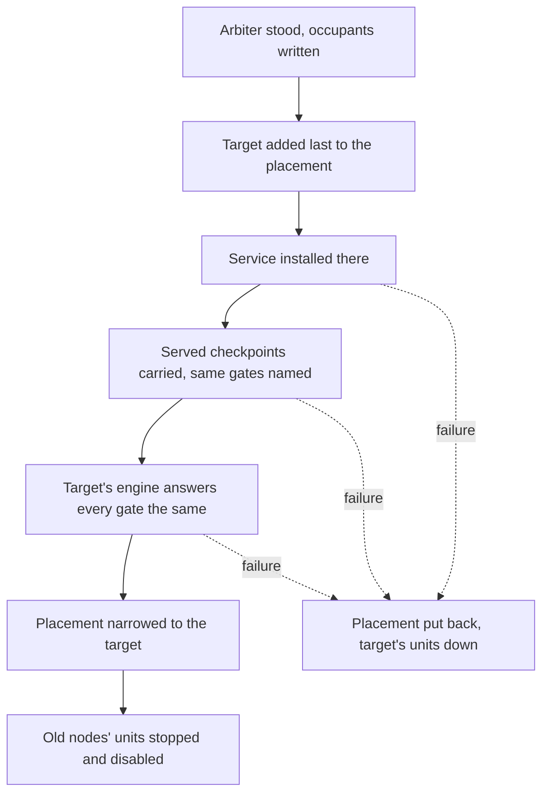

# The Laya service

Laya's gate checkpoints served on the nodes its placement names, each behind an MCP server and an
OpenAI-compatible API built the way a local model service is commonly built: an engine bound to the
node's loopback, a front beside it that is the only port leaving the
machine, and a key on everything but the health. One relay on the operations machine hands every call to the
first of those nodes that can take it. This repository holds the service whole — the engine, the front,
the units, the node setup, the relay, the installer and the command that puts a checkpoint in service.
The gates hold the client that asks it and the configuration of which gate asks (`docs/laya.md`).

## The placement

- **Which nodes are the service's** is `placements/laya-service.json` under the data root on the
  operations machine: a list of nodes in the order they are asked, each with
  - `node`, the registered name of a node in the node unit's node list (the node unit's `docs/nodes.md`);
  - `listen`, the loopback address on the operations machine its tunnel lands on, one of its own;
  - `cardModels`, where given, the most checkpoints the engine lets onto that node's card at once,
    below what the card itself takes (「The engine」); absent, the card alone decides;
  - `hostCopy`, where given, `pinned` or `mapped`: how the checkpoints wait in that node's host memory
    (「The engine」), for a machine whose memory other work of its own comes first; absent, the machine
    decides.
- **What the placement does not say** is read from the node at every install: whether its machine is a
  person's desktop and its card's size (the arbiter's `docs/node-arbiter.md`, 「What the install reads」), and whether its row
  in the node unit's node list reserves it for another service, which refuses it.
- **The first node answers; each one after it answers only while the ones before it cannot** (「The
  relay」). The placement is state, written for the nodes as they stand, and no node name, address or
  account lives anywhere else in this repository.
- **How a node is reached** is the node list's: its connection type and its address are read from
  the node unit's `bmo node list --target <node>`, at every run, and a console node is driven
  through the node console by its agent's name, an ssh node by a batch
  login with its key; either runs a command in bash, whatever the account's own shell is (the node unit's `docs/nodes.md`, 「A node's shell」).
  A node whose login answers in Windows PowerShell runs no bash and is refused before anything is
  sent to it.
- **Who reads it:** the installer, the command that puts a checkpoint in service and the relay,
  at every run; the relay at every call. Each refuses a missing or malformed placement with a message naming the file and the
  shape it expects, and none falls back to a node of its own choosing.
- **Moving the service** is one command that changes the placement, installs, carries the checkpoints
  and switches (「Moving the service」).

## The machines

- **Which machine the service stands on, and with which card, is not written here.** The placement
  names its node, and the node unit holds the machines and their cards (the node unit's documents).
- **The service's node:** every checkpoint it serves stands on the card between decisions, and leaves
  it only for another occupant of the node: Laya's training, or the voice where it is installed there
  (the node unit's documents). A claimant's task may run on it and comes first (「The card arbiter」).
  Where the node is the operations machine itself, its placement entry keeps the checkpoints mapped
  (`hostCopy`), since that memory is the services' own and every worker's, and the node is registered in
  the node list as an ssh node on its own loopback. Laya's training may stand on it as well, below the
  service and giving way to it (「Training on a service node」). The tunnel takes the same road as any
  node's, dialling the public name and coming back to the bridge; on the operations machine, the same
  machine.
- **Measured on 3, 4 and 8 October 2026,** decisions of a gate through the relay on the operations machine:

  | Where | First decision | Decisions one after another | Decisions five seconds apart |
  |---|---:|---:|---:|
  | the operations machine, every checkpoint resting on its RTX 3080 | 20 to 135 ms | 19 ms | 45 ms |
  | a service node, the text model's share on the card beside it | 118 to 148 ms | 26 to 28 ms | 100 to 105 ms |
  | a desktop node, on an RTX 3080 | 755 ms | 23 ms | 648 ms |

- **No node stands behind it.** Where the placement's node cannot answer — its card a claimant's past
  the client's wait — the relay answers 503 and every gate on Laya asks its own fallback LLM
  (`docs/laya.md`, 「A gate whose provider is Laya」).
- **A node the placement left is a standby:** its service units are stopped and disabled, so they do
  not come back with the machine; its install and checkpoints are left where they stand, and putting
  the service back is `card-master place laya --to <node>` (「Moving the service」). A node reserved for
  another service takes it back only once that service is taken off it (the arbiter's `docs/placement.md`,
  「Placing the services」); a node under WSL stands its units only while WSL runs.
- **The account** is the node's own login, as its row in the node list names it.
  Everything the service is made of stands in it, and none of it asks for sudo. Linger is on for the
  account, so the units stand after a reboot with nobody logged in.
  - The installation: `~/bmo-laya` (the engine and its venv), `~/bmo-llm` (the front, the tunnel's
    dial and their venv), and the card arbiter's `~/bmo-card` (the arbiter's `docs/node-arbiter.md`).
  - What outlives any installation: the checkpoints in `~/.local/share/bmo-laya/checkpoints`, the store
    `weights/checkpoints.toml` declares under `node_store`, which `~/bmo-laya/checkpoints` links to; the engine's dumps of them in `~/.cache/bmo-laya/dumps` where
    the node keeps its copies mapped; the settings and the key in `~/.config/bmo-llm` and
    `~/.config/bmo-laya`.

## The engine

- **What it is:** the Laya decision server of `runtime/laya-server/server.py` (`docs/laya-server.md` for its
  two calls, how it holds one checkpoint per gate and how the card is shared among them), unchanged,
  in `~/bmo-laya` on the venv the node setup builds there. It is the same venv, on the same uv
  Python, that a training node's setup builds.
- **Where it listens:** `127.0.0.1:7431`. It never leaves the node: the front is the only way to it.
- **Its token** is the service key, read as `LAYA_TOKEN` from the environment file. The engine checks
  it on both of its calls even behind the front, because the node carries a second login account and its
  loopback is open to every process on the machine.
- **Which checkpoint answers which gate** is `LAYA_CHECKPOINTS` in `~/.config/bmo-laya/env` on the
  node (`docs/laya-server.md`, 「Which checkpoint answers which gate」). The checkpoints stand under
  `~/bmo-laya/checkpoints/<training gate>/<run>/step-<n>`, the layout of the collection on the operations machine,
  through the link to the store outside the installation.
- **Where the checkpoints wait:** in host memory, from the moment each is loaded, pinned or mapped from
  a dump as the node's machine decides (`docs/laya-server.md`, 「Host copies」). The installer writes
  `LAYA_HOST_COPY=mapped` into the environment file of a node whose machine is a person's desktop,
  whose memory is the desktop's first and shared with the voice; every other node keeps them pinned,
  unless its placement entry's `hostCopy` says otherwise, which stands over the machine's choice either
  way. The
  checkpoints stand on the card under the shared lock, as many as it takes, the host copies being where
  they wait while they are off it; they are taken off and the lock let go when another occupant asks for
  the card (`docs/laya-server.md`, 「Sharing the card」).
- **How many checkpoints are on the card at once** while the engine holds it: as many as the card takes
  beside the decision room and what it keeps free for others, counted from the card's own size at
  load (`docs/laya-server.md`, 「Sharing the card」), and never more than `LAYA_CARD_MODELS`, which the
  unit sets to 8 and a placement entry's `cardModels` lowers. Under WSL a card asked for more memory
  than it has does not fail the allocation, it pages the card out over the bus and the decision
  crawls, so the engine's own making of room never starts: the installer writes
  `LAYA_CARD_KEEP_FREE_MIB=2048` for a desktop's card, and on a desktop node's RTX 3080, the card it
  carried before, that took 4, about 5.2 GB, which left the decision room and the desktop theirs.
  The batch is held to the card's free memory besides.
- **How long the card is kept between calls:** until another occupant asks for it. While calls are in
  hand it carries on as long as the node's queue says the next stands first; with none in hand it rests,
  and gives way the moment anybody else asks (`docs/laya-server.md`, 「Sharing the card」). The arbiter
  bounds a turn in use while anybody waits, well inside the twenty seconds a claimant's task gives a holder, and
  a voice line or a song has its turn between two calls. A decision that needs more room than the card
  has left has the least recently asked checkpoints taken off for it, and they go back on once the card
  rests.
- **The lock it takes** is `LAYA_GPU_LOCK`, the unit setting naming `~/.gpu.lock` in the node's own account.

## The shared card lock

A node's one card is shared by every service that runs a model there, on the operations machine Laya, its
training and the voice unit, and by the card arbiter, which holds the card for the desktop and for the
claimants its rules name (「The card arbiter」). They take turns by one lock, and a service that has the card keeps its model on it until
another asks for the card.

- **The lock:** an exclusive `flock` on `~/.gpu.lock` in the node's account, the same path for every service on that node, opened with create so whoever comes first
  makes it. The file's content means nothing.
- **Taken before anything goes on the card:** a model's weights, a decision's or a generation's
  working memory. A service that has not got the lock puts nothing on the card.
- **Let go only once everything is off the card:** the weights dropped and the process's CUDA
  allocator cache emptied, so what the holder used is free for the next one. What a process may keep
  on the card without the lock is its CUDA context alone, a few hundred MiB that cannot be let go
  short of ending the process.
- **Held while its model rests there, and given up when asked:** a holder holds it through one use
  however long that use is, keeps it with its model on the card once the use ends, and lets go as soon
  as the arbiter says another occupant asks for the card (the arbiter's `docs/node-arbiter.md`, 「Resting」).
- **A process that dies lets go of it,** since the kernel drops a flock with its last open file, so
  a crash never leaves the card locked.
- **Waiting is each service's own choice.** The lock says only who is on the card:
  - Every occupant but a claimant's task asks the node's card arbiter for its turn first and waits in its
    queue, in the order the node's occupants give (the arbiter's `docs/node-arbiter.md`, 「The hold」).
  - Laya waits inside a call for its queue turn for as long as its caller holds the connection, and is
    never answered held. Only a card taken outright — a claim standing, or no place for the engine — is
    answered 503 at once, with no `Retry-After`, and the relay asks the next node (「The relay」); the
    last node's 503 reaches the gate, whose client reads it as a busy card and goes the way its gate goes
    then, at once (`docs/laya.md`). What bounds a long queue wait is the front's thirty seconds
    and, before them, the asking gate's own patience.
    Laya's own start waits for its turn and the lock with no bound, to load and try its checkpoints,
    since it answers nothing before that anyway.
  - The voice and the songs choose for themselves whether they wait, and how long, in their own
    documents.
- **What a holder may assume:** no other service that follows the lock runs on the card while it
  holds the lock, so it may use the whole card less the other services' contexts and what the desktop
  keeps.
- **A claimant's task and the desktop take the lock first.** The card arbiter takes it for as long as a
  claimant's task runs on the node, or the desktop uses the card, so a Laya call meanwhile is answered 503 at once,
  as for any card taken outright, and a voice line waits as it chooses. A service still keeping the lock twenty seconds
  after a claimant's task started is ended (the arbiter's `docs/node-arbiter.md`).

### The card arbiter

Every node of the service carries the card arbiter (the arbiter's `docs/node-arbiter.md`), which the installer puts there
before the service and which keeps the card lock's rules for whoever is not a service of the deployment's.

- **On the operations machine** it keeps the claimant rule; on a service node where the service stands
  by, the claimant rule and the text model's lending; on a desktop node where it stands by too, the
  claimant rule and the desktop rule, since that machine is a WSL desktop.
- **While it holds the card,** every Laya call there is answered 503 at once, as for any card taken
  outright, and the relay asks the next node. A decision in hand when the desktop takes the card finishes on it:
  a decision takes a fraction of a second, and the arbiter never ends Laya for the desktop.
- **What it says:** one log line when it takes the card and why, and one when it gives it back, in
  the journal of `bmo-card.service`.

## The front

One process on `127.0.0.1:8010`, the only port that leaves the node. It speaks to the engine with the
service key and to nothing else.

| Path | Key | What it does |
|---|---|---|
| `/health` | none, or bearer | without the key, 200 `{"status":"ok"}` when the engine answers its own health and 503 when it does not; with the key, the engine's own health whole |
| `/decide` | bearer | passed through to the engine: the gate's own call, answered exactly as the engine answers it; a caller that hangs up has the call to the engine closed at once, so the engine drops it from the card's queue |
| `/v1/models` | bearer | one model per gate served, named by the gate, with its checkpoint |
| `/v1/chat/completions` | bearer | one decision in the OpenAI chat shape (below) |
| `/mcp` | bearer | MCP over Streamable HTTP, stateless, JSON responses |

- **The key check:** every path but `/health` takes `Authorization: Bearer` with the service key,
  compared in constant time. A refusal is a bare 401 that repeats nothing of the request. `/health`
  given a wrong key answers as it does given none.
- **Stateless MCP:** every request stands alone. `initialize` and `tools/list` answer, and a bare
  `tools/call` with no `initialize` before it answers too.
- **Nothing of a request is logged:** no header and no body reaches a log line, in the front or the
  engine.
- **The engine not answering** — stopped, restarting, or still loading its checkpoints — is a 503
  on every path that needs it, at once, since its port refuses or does not take the connection
  within five seconds.
- **The engine holding a call** past thirty seconds without answering is a 504 on every path that
  needs it, saying that Laya did not answer in time, and the front hangs up on the engine, which then
  drops the call unasked if it has not reached it yet (`docs/laya-server.md`, 「The server」). A
  decision takes under a second, so only a line stuck behind something wrong meets the
  bound, and the 504 lets a caller tell a wait that ran out from an answer that went wrong.

### The model a caller names is the gate

A Laya decision is made by the gate's own checkpoint, so a caller never chooses a model: it names the
gate, and the gate's checkpoint answers. `/v1/models` lists the gates the engine serves as models,
each with `owned_by` `laya` and the checkpoint it is answered by. A gate no checkpoint serves is
refused by the engine as not served (404), whichever path asked.

### The OpenAI-compatible call

- **The request:** `model` is the gate; the last `user` message is the state, as text; `questions` is
  the named questions in the engine's own shape (`docs/laya-server.md`), carried as an extra field of
  the body — the OpenAI clients' `extra_body`. A request with no questions is refused as one the
  front cannot read (400).
- **The answer:** a `chat.completion` with one choice whose message content is the engine's own
  answer as JSON — `answers`, the tokens it read and `ms` — and a usage of zero tokens.
- **Streaming is not offered:** a decision is one answer made at once, so `stream: true` is refused
  (400) rather than dressed as a stream.
- **A refusal** keeps the engine's status (400, 404, 500 or 503), or the front's own 503 or 504, and
  carries the engine's reason in the OpenAI error shape, `{"error": {"message", "type", "code"}}`.

### The two tools

- **`laya_decide`** takes `gate`, `state` (text, an object or a list) and `questions`, asks the gate's
  checkpoint, and answers with the engine's answer as JSON text content. A refusal is a tool error
  carrying the engine's status and reason.
- **`laya_gates`** takes nothing and answers with the gates served and each one's checkpoint, which
  is what a session attached by MCP needs before it can name a gate.
- **No text-model tools are built:** a tool that wraps one fixed prompt around a text model asks a
  text model, and Laya is not one. What it answers is a decision about a state against named questions,
  which is what `laya_decide` asks.

## The units

All are systemd user units in the node's account. Each restarts itself on any exit, starts with
`default.target`, and reads `~/.config/bmo-llm/env`, which must exist. Linger is on for the account,
so they stand after a reboot with nobody logged in.

- **`bmo-llm-laya.service`** — the engine. It also reads `~/.config/bmo-laya/env`, the one place the
  gates are given their checkpoints, where one stands.
- **`bmo-llm-front.service`** — the front, started after the engine and wanting it.
- **`bmo-llm-tunnel.service`** — the reverse tunnel below.
- **`bmo-card.service`**, the card arbiter's own unit, stands beside them, installed first
  (the arbiter's `docs/node-arbiter.md`). The engine's unit declares itself to it as `BMO_CARD_SERVICE=laya`.
- **`bmo-llm-watch.service`**, the card's watch whose rules the arbiter keeps, is stopped, disabled and
  removed by the install wherever it still stands.

One more unit stands on the operations machine, in the account there: **`bmo-laya-relay.service`**, the
relay, the `laya-relay` binary, below. It runs out of this repository's deploy tree and carries the
`binary` mark, so the testbed's deployment links it, enables it and restarts it only where its binary
changed (the testbed's `docs/deploy.md`, 「The unit links」). No install touches it. The tunnel's door
beside it is the node unit's (「The tunnel」).

## The relay

- **Where the gate asks:** the relay's own listen on the operations machine, written `<relay>` below, the
  address the gate's `[laya]` setting names. It is the `laya-relay` binary, `crates/laya-relay` in this
  repository, and passes every path of the front through, so a caller sees one service whichever node
  answers.
- **Each call goes to the placement's nodes in order,** each at its own tunnel's listen, and the
  first answer that is not a refusal to take it is the call's answer.
- **What moves a call on to the next node:** no connection, a 503 — the engine stopped or loading,
  its card taken outright or without room — or no answer within ten seconds, a wait for the card's
  queue that long included, which the node drops once the relay hangs up. The last node is given
  forty seconds instead, past the front's own thirty, so its own 504 reaches the caller.
- **What comes back as it came:** every other answer — a decision, a 400, 401, 404, 500 or 504 —
  since another node would answer it the same way, and the last node's 503.
- **Its connections to the nodes stay open between calls:** a node's listen is the far end of an SSH
  tunnel, where a connection opened for each call would cost tens of milliseconds. A caller that
  leaves still closes the connection its call was on.
- **The same call twice is safe:** every call the service takes is a decision or a reading that
  changes nothing, so the relay reads a call's body whole before its first ask and sends it again
  as it is.
- **Which nodes are up:** the relay asks every node's open `/health` every five seconds, three
  seconds each. A node whose last answer was not 200 is asked after every node whose last answer was,
  so a node that is off costs a call nothing and a hung tunnel at most one wait.
- **What it says:** every answer carries `x-laya-node`, the node that gave it. A call no node took is
  answered 503 naming each node with why. One log line when a node comes up or goes down, and nothing
  of a call.
- **A caller that leaves** closes the relay's call to the node at once, so the node's front lets
  the call's turn at the card go.
- **An answer is read whole and handed back whole;** the front offers no stream (「The
  OpenAI-compatible call」), so none is cut short.
- **Changing the order** is the placement changed; the relay reads the file again when it changes,
  with no restart. A placement that turns unreadable is said once, and the order read before it
  stands.
- **Its settings** are the unit's defaults. The data root the placement stands under is `BMO_DATA_DIR`, or
  `--data-root`, which the unit sets; with neither it refuses to start. `LAYA_RELAY_LISTEN` moves the listen, and
  `LAYA_RELAY_NEXT_WAIT_MS`, `LAYA_RELAY_LAST_WAIT_MS`, `LAYA_RELAY_PROBE_EVERY_MS` and
  `LAYA_RELAY_PROBE_WAIT_MS` the four waits above, for a test that cannot spend seconds on each.
  A port of 0 is one the system chooses, named in the line the service prints as it starts listening; its contract test starts it so, and reads the port from that line.
- **Its check** is its contract test under `tests/`, which asks the binary over stand-in engine fronts on
  loopback, case by case as this section states it.

## The tunnel

- **Each node dials the operations machine; the operations machine never dials a node.** A node on the
  inner network, as the text model's are, has no path from the operations machine to it. A desktop node
  on the home network takes the same road, so every node of the service stands up the same way.
- **That network lets only HTTPS out.** A connection to an SSH port anywhere is opened and then
  carries nothing — the operations machine's forwarded SSH port and github.com's alike — while HTTPS passes, which
  is how a console node's agent reaches its hub.
- **So the node dials the house over HTTPS, and SSH rides inside it.** The tunnel unit holds an `ssh -N`
  connection to the operations machine whose bytes travel in a WebSocket to the tunnel's public name,
  `TUNNEL_URL` in the node's environment file: ssh's ProxyCommand is `runtime/front/ws-dial.py`, run on the
  front's venv, which opens that WebSocket with
  the service key as its bearer and pipes ssh's input and output through it.
  - The ssh asks for one remote forward: the node's own listen on the operations machine, `TUNNEL_LISTEN` in
    the environment file as the placement names it, to the front's `127.0.0.1:8010`. It fails
    outright if the forward cannot be made, and sends keepalives.
  - It logs in as `TUNNEL_LOGIN`, the account and host on the operations machine, and checks the operations
    machine's host key against a pinned `~/.config/bmo-llm/known_hosts` under `TUNNEL_HOST`, the name the key is
    pinned under, never by trust on first use. No unit file names a host, an account or an address: every one is
    the environment file's.
  - Only the front's port crosses; the engine's never leaves the node.
- **The way in on the home side** is the service's own:
  - the tunnel's public name, a DNS record pointing at the home's public address, which reaches the
    proxy through the router;
  - a proxy host for that name: WebSocket upgrade on, the zone's certificate, and long read and send
    timeouts, forwarding to the door's port on the operations machine. Its nginx config is the template
    `runtime/front/tunnel-proxy.conf`, filled with the names the deployment uses;
  - the operations machine's firewall opening the door's port to the proxy's address alone;
  - **the door,** the node unit's `llm-bridge` (the node unit's `docs/llm-bridge.md`), listening on that
    port. It takes a WebSocket only when its bearer is the key of a service that rides the door, and
    then pipes it both ways to the operations machine's own SSH; anything else is refused before a byte
    reaches SSH. The door's list of keys stands under the data root's `env/`, one key file's path a
    line, and the Laya service's installer adds its own. Every node service rides the door with its own
    key and its own listen on the operations machine.
- **The operations machine's end** is one entry in the account's `authorized_keys` for the node's tunnel key, which
  is an ed25519 key made on the node with no passphrase and kept at `0600`. The entry allows nothing but
  port forwarding (`restrict,port-forwarding`), lets the key listen only on the node's own listen
  (`permitlisten`), and forces `/usr/sbin/nologin` as its command. A remote forward lands on
  the operations machine's loopback and on nothing wider.
- **Each node answers at its own listen on the operations machine,** with the five paths above, and the relay
  answers for all of them at `<relay>`, the address a Claude Code session attaches
  with `claude mcp add --transport http laya <relay>/mcp --header "Authorization: Bearer …"`.
- **The public name is the tunnel's door, never the service's.** What answers on it is the bridge, and
  what the bridge reaches is SSH, which still asks for the node's tunnel key under the restricted entry.
- **Why the service is reached inside the house:** every caller — the gate, this repository's own
  training tooling, and a Claude Code session — runs on the operations machine, where the tunnels land. A public name, a proxy host
  and a certificate in front of the service would stand in front of no caller.
- **Why the key is still checked:** both ends of the tunnel are shared. The node carries a second login
  account, and the operations machine's loopback is open to every process on the machine.

## The key

- **One key is the whole service's:** the Laya token the gate asks with, the token file under the data
  root's `env/` the gate's `[laya]` setting names: 32 random bytes as hex, kept at `0600`. The installer
  makes it once if there is none, never overwrites one, and refuses one found with any other
  permission rather than using it, since it may already have been read.
- **What checks it:** the bridge on the operations machine for the tunnel's WebSocket, where it stands in the
  door's list, the front for every call but the open health, and the engine behind the front.
- **On the node it lives only in `~/.config/bmo-llm/env`,** at `0600`, as `LLM_KEY` for the front and the
  tunnel's dial and `LAYA_TOKEN` for the engine. That environment file is the only place it has on
  the node.
- **The gate and the door read it** from its file for each request and hold it nowhere else.
- **It appears nowhere else:** no document, log line, response, unit file, command line, test
  fixture or table row. A check that needs it sends a header built from the file, never the key
  written into a command.

## Installing and updating

`bun scripts/llm-install.ts [--node <node>]` from this checkout on the operations machine puts the service on
its nodes or updates it there: every node of the placement in its order, or the one named. The card
master runs it for one node when the service is placed (「Moving the service」), after standing the
node's card arbiter, which this install does not stand.
It reads the placement first and stops where there is none, and reads each node's connection and role
from the node list (「The placement」): a console node is reached through the node console, an ssh node by
a batch login, a file carried by the console's `upload` or `scp` as the node's connection type has it. A node
whose row reserves it for another service is refused before anything reaches it. For each node, in
order, it:

1. Reads the node's machine: whether it is a desktop, and its card (the arbiter's `docs/node-arbiter.md`, 「What the install
   reads」).
2. Makes the key on the operations machine if there is none.
3. Makes the service's folders on the node, and the gates' settings file `~/.config/bmo-laya/env` naming no
   gate where there is none. An existing settings file is never overwritten. Makes the checkpoint
   store `~/.local/share/bmo-laya/checkpoints`, moves into it a checkpoint folder standing in
   `~/bmo-laya` itself, and links `~/bmo-laya/checkpoints` to it.
4. Builds the node's environment file — the key, the node's own listen as `TUNNEL_LISTEN`, the tunnel's public
   name as `TUNNEL_URL`, the login on the operations machine as `TUNNEL_LOGIN` and the name its host key is pinned
   under as `TUNNEL_HOST`, the three as the tooling's settings name them (`docs/training.md`, 「The tooling and
   its settings」), its
   `cardModels` as `LAYA_CARD_MODELS` where the placement gives one, on a desktop's machine
   `LAYA_HOST_COPY=mapped` and `LAYA_CARD_KEEP_FREE_MIB=2048`, and the entry's `hostCopy` as
   `LAYA_HOST_COPY` where it gives one — in a private `0600` file, carries it
   across, then deletes the local copy. The key never rides a command line.
5. Uploads the front's files from `runtime/front/` into `~/bmo-llm`, and the engine's — `server.py`, `turn.py`,
   `bench.py`, `pyproject.toml` and `node-setup.sh` from `runtime/laya-server/` — into `~/bmo-laya`.
6. Runs the node setup detached with `setsid nohup`, because a console hub stops a streamed command
   after five minutes, and waits for its last line: `LLM-SETUP-DONE ok`, or `LLM-SETUP-DONE failed:<step>`
   naming the step. The setup installs uv if it is missing, builds or repairs the front's venv and
   installs its packages, then runs the engine's own setup in `~/bmo-laya` and requires its
   `LAYA-SETUP-DONE ok`. The engine's setup installs the pinned laya, torch and transformers on uv's
   Python 3.12, torch built for the CUDA the node's driver runs, which uv reads from the driver. Running
   it again changes nothing that already stands.
7. Makes the node's tunnel key if there is none and reads back only its public half.
8. Adds the restricted `authorized_keys` entry on the operations machine, or rewrites the entry of the same key
   where it names another listen, and leaves it alone where it already says the same.
9. Names the key's file in the door's list, which the bridge reads for each connection, so nothing
   on the operations machine is restarted.
10. Pins the operations machine's host key in the node's `known_hosts` from the operations machine's own host key file.
11. Installs the engine's, the front's and the tunnel's units, reloads the user manager and enables
    and restarts them, and stops, disables and removes the card's watch where it still stands.
12. Waits until the node's own listen answers `/health` on the operations machine — which it does only once the
    engine has loaded and tried every checkpoint it names.

Once every node asked for is done, it waits until `<relay>/health` answers through the relay, which reads
the placement again by itself. The relay's unit is the testbed's deployment's to link and restart
(「The units」).

The name, the proxy host and the firewall opening are made once, and the installer leaves them alone:

- the tunnel's public name, a DNS record in the deployment's zone pointing at the home's public address;
- the proxy host for that name — forwarding to `<operations machine address>:<door port>`, the zone's
  certificate, WebSocket upgrade — with `runtime/front/tunnel-proxy.conf` filled and written under that
  host, then the proxy's configuration checked and reloaded;
- the operations machine's firewall rule opening `<door port>` to `<proxy address>` alone.

## Putting a checkpoint in service

`bun scripts/laya-serve.ts <training gate>/<run>/step-<n> [--gate <gate>] [--node <node>]` carries one
collected checkpoint from the collection on the operations machine (`docs/training.md`, 「Checkpoint naming and
collection」) to every node the placement names, in its order, or to the one named, so every node
answers a gate with the same checkpoint.

- **The carrying:** the checkpoint is packed here as one tar and hashed, and crosses in parts of
  96 MB, since a console hub turns away a request body past 128 MB. On the node the parts
  are joined, checked against the hash, unpacked under a partial name and only then given their own,
  so a transfer cut short leaves nothing that reads as a checkpoint. A 647 MB checkpoint crosses in
  about a minute and a half. One already standing under that name is left as it is.
- **Naming it for a gate** is `--gate`: the gate's pair in `LAYA_CHECKPOINTS` is written, or
  replaced, and every other pair is left as it was; the engine is restarted and the command waits
  until its health names the gate with that checkpoint. Which checkpoint a gate is answered by is
  the owner's choice, as its mode and τ are; without `--gate` the checkpoint is only carried.
- **The collection is rotated after naming** (`docs/training.md`, 「Rotating the collection」): the
  new checkpoint is recorded as the gate's, and the one it replaced stays to roll back to.
- **Releasing a gate** is `bun scripts/laya-serve.ts --release <gate> [--node <node>]`, for a gate no
  longer asked: its pair in `LAYA_CHECKPOINTS` is taken out and every other pair is left as it was,
  the engine is restarted and the command waits until its health no longer names the gate. The
  checkpoint stays where it was carried, on the node and in the collection, and no rotation follows,
  so nothing of it is removed; a node without the pair is left as it is and not restarted.
- **A restart is a gap** of about fifteen seconds a checkpoint, during which the engine does not
  answer and the relay asks the next node; the nodes are restarted one after another, each waited
  for, so the gap is never every node's at once.

## Moving the service

`card-master place laya --to <node>` on the operations machine moves the service (the arbiter's `docs/placement.md`,
「Placing the services」): to a machine that has just been given a card, or away from one that lost
it. The card master stands the node's arbiter and keeps the node's occupants; what is the Laya
service's own is done by its adapter, `bun scripts/laya-adapter.ts`, declared in `weights/laya.card.toml`
and run from that folder as the tooling's `training/tooling/scripts/laya-adapter.ts`.



- **`install`** puts the service on the node the master names:
  - the node's entry as it stands in the placement, its bound and host copy with it, else one at the
    lowest free loopback port after the relay's; the placement written as the master's placed
    nodes, the target last, so while it is installed the relay asks it only where every other node
    cannot answer;
  - the installer's own steps (「Installing and updating」);
  - where another placed node serves gates: read from the first that answers both its gates'
    settings file and its engine's keyed health, every checkpoint it serves carried from the
    collection the way a single one is put in service (「Putting a checkpoint in service」), its gates'
    settings file written on the target as it stands, and the target's engine restarted and waited
    for until its own keyed health names every gate with the same checkpoint.
- **`uninstall`** writes the placement as the master's placed nodes, the node left out, and stops and
  disables the node's engine, front and tunnel units, so they do not come back with the machine. Its
  install, its checkpoints and its card arbiter stay. The relay reads the placement again at its next
  call and no longer asks the node.
- **`start`, `stop` and `health`** act on the node's three units and its engine's keyed health at its
  own listen; **`placed`** reads the placement's nodes.
- **A failure before the narrowing** is the master's to undo: it runs `uninstall` on the target with
  the placement as it stood, which puts the placement back and takes the target's units down. The
  old nodes answered throughout.

## Training on a service node

- **A service node trains Laya only giving way.** Laya's training and measurement run only on the
  nodes the training placement names (`docs/training.md`), and the Laya node commands refuse every
  other node. A training run holds a card for hours, so on a node that is the service's too it
  declares itself `laya-train`, which the node's occupants stand below `laya` and `voice`, and gives the
  card back whenever the engine or the voice asks for it (the arbiter's `docs/node-arbiter.md`, 「Giving way」).
- **The engine gives the card to the run when the run asks for it:** with no decision in hand the
  engine only rests on the card, so it takes its checkpoints off and lets go, and asks to rest on the
  card again, which it is granted once the run ends or gives way and the card stands free
  (`docs/laya-server.md`, 「Sharing the card」).
- **What it costs the service:** a decision asked while a run holds the card waits for the run to let
  go, longer than the gate's client waits out on the operations machine (the node unit's documents), so the
  first decisions of a burst go to their gates' fallback LLM and the
  ones after are Laya's. A voice line waits as long, within the minute it waits for the card. Once
  let go, the run comes back only after the card has stood quiet for thirty seconds, so a burst of
  decisions or a briefing finds the card free.
- **The calibration of a finished run,** which measures the checkpoint serving its gate beside it, gives
  way the same, after the batch of sixteen questions in hand.
- **Making a service node a training node** takes, in order:
  1. Stand `laya-train` below `laya` and `voice` in the node's occupants (the arbiter's `docs/node-arbiter.md`, 「The
     occupants」).
  2. Add the node to the training placement (`docs/training.md`, 「The nodes」).
  3. Restate this document and `docs/laya-server.md`.

## The checks

Run on the operations machine, in this order, with `<relay>` the relay's address and `<the key file>` the
Laya token file. The key is read from its file into a header and never written into the command:

```sh
key() { printf 'Authorization: Bearer %s\n' "$(cat "<the key file>")"; }
mcp=(-H 'content-type: application/json' -H 'accept: application/json, text/event-stream' -H 'mcp-protocol-version: 2025-06-18')
```

1. **Health, without a key:** `curl -s -D - <relay>/health` answers 200 and nothing
   more, with `x-laya-node` naming the first node of the placement; the same asked of a node's own
   listen answers for that node alone.
2. **Health, with the key:** `curl -s -H @<(key) <relay>/health` names every gate with
   its checkpoint and where it is, `pinned`, `mapped` or `card`, and whether the engine holds the card lock;
   between calls every gate is `pinned` or `mapped`, as the node keeps them, and the lock is not held.
3. **The model list:** `curl -s -H @<(key) <relay>/v1/models` lists the served gates.
4. **The MCP handshake:** an `initialize` posted to `/mcp` answers with the server's capabilities,
   and `tools/list` names `laya_decide` and `laya_gates`.
   `curl -s -H @<(key) "${mcp[@]}" -d '{"jsonrpc":"2.0","id":1,"method":"initialize","params":{"protocolVersion":"2025-06-18","capabilities":{},"clientInfo":{"name":"check","version":"1"}}}' <relay>/mcp`
5. **A tool call:** a bare `tools/call` of `laya_decide` for a served gate answers with the
   decision as text content.
   `curl -s -H @<(key) "${mcp[@]}" -d '{"jsonrpc":"2.0","id":1,"method":"tools/call","params":{"name":"laya_decide","arguments":{"gate":"output-format","state":"Please move tomorrow'"'"'s deployment to another time.","questions":{"q":{"type":"noul","instructions":"Is this message a request to change a schedule?"}}}}}' <relay>/mcp`
6. **The same answers as the checkpoints give anywhere else:** `runtime/laya-server/bench.py --url
   <relay> --token-file <the key file> --gates <every served gate>` asks each gate in
   turn, and a decision's probabilities match what the same checkpoint answers on any other machine
   to the precision the card computes at.
7. **The way past a node:** with the first node's engine stopped, or its card held by its arbiter, a
   decision through the relay is answered by the next node, which `x-laya-node` names, and with no
   node behind it is answered 503 at once, which the gate reads as a busy card where the last node's engine
   said so and as Laya out of reach otherwise.

