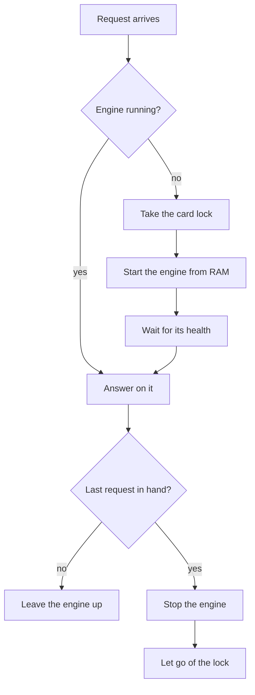

# The text model on n5

A general text model served on n5 behind an OpenAI-compatible front, on a card it holds only while a
request is being answered. It is no part of Laya and nothing asks it on its own: BMO has no provider
and no gate pointed at it, and connecting one is 하스's decision. This repository holds it whole —
the front, the units, the node setup and the installer.

## The model

- **What answers:** Qwen3.8-27B RVN Heretic Abliterated, the file `RVN-Q4_K_M-multilingual-mtp.gguf`
  of `0bserverx/Qwen3.8-27B-Heretic-Abliterated-Uncensored-GGUF`: 16,998,720,992 bytes, checked
  against the repository's own SHA-256 before it is given its name.
- **Why this file:**
  - The model answers conversations, not gates, so its quality comes before its speed. Four bits is
    the size 하스 set for it; two bits lose too much of the model.
  - `RVN` names the model, a refinement of the Heretic abliteration, and not a quantisation of its
    own. Its tensors are ordinary llama.cpp quantisations (`Q4_K` and `Q6_K`) of the `qwen35`
    architecture, which upstream llama.cpp reads, so no special build is needed.
  - The `-multilingual` family is calibrated on a corpus of many languages rather than English
    alone, which is what Korean wants.
  - The `-mtp` twin carries the model's own MTP draft head in a 65th block, so speculative decoding
    needs no second file. Its main tensors are byte for byte those of the plain file.
- **Its shape:** 64 main blocks, three of every four a Gated DeltaNet block and every fourth a full
  attention block, then the MTP block. The FFN weights are 9.9 GiB of the 15.8 GiB, 143 to 165 MiB a
  block; the token embeddings (0.67 GiB) are read on the CPU whatever else is placed where.
- **Where it stands:** `~/n5-llm/models/` on n5.
- **It does not fit the card whole,** so the FFN weights of its last blocks are computed by the CPU
  from host memory (「The engine」).

## The engine

- **What it is:** upstream llama.cpp's `llama-server`, built on n5 with CUDA for the card's
  architecture (sm_89) at the commit the node setup pins, under `~/n5-llm/build/llama.cpp`.
- **Where it listens:** `127.0.0.1:8021`, and only while a request is being answered. The front is
  the only way to it.
- **What it runs with:**
  - every block on the card except the FFN weights (`ffn_up`, `ffn_gate`, `ffn_down`) of the last
    42 main blocks, 22 to 63, which stay in host memory and are computed by the CPU on 8 threads;
  - the model file mapped rather than read, so the CPU's part is computed straight from the pages
    the front keeps locked (「How it holds the card」);
  - flash attention on, and no fitting of settings to the card at start, so a card without room
    fails at once rather than quietly running on a smaller context;
  - a context of 32,768 tokens, with the K and V cache in `q8_0`;
  - one slot, so requests that overlap are answered one after another by the same engine;
  - MTP speculative decoding with two draft tokens (`--spec-type draft-mtp`), which
    `N5_LLM_MTP=off` in the front's environment turns off;
  - no warmup run at start, since the request waiting on the start is the warmup.
- **Why 42 blocks:** it is one more than the fewest that answer. With 40 the engine starts with
  409 MiB of the card free and then fails its first request for want of card memory; 41 answers with
  511 MiB free; 42 leaves 675 MiB. Without MTP the head and its context leave the card, and 36 blocks
  are enough.
- **Why the CPU computes the part that does not fit,** rather than the card after copying it up for
  every token: one token reads every weight once, and the CPU reads its 6.3 GiB share from RAM at
  about 30 GB/s while the card's link carries it at 11.5 to 12.8 GB/s (「The machine」). Copying
  the share up and computing it on the card runs at 2.0 t/s without MTP and 3.3 to 3.5 t/s with it,
  against 4.6 and 6.4 t/s for the CPU. Overlapping the copy of one chunk with the compute of the one
  before gains nothing, since the card computes a chunk in under a thirtieth of the time its copy takes.
- **Prompts:** a prompt of 32 tokens or more is computed on the card in steps of 512 tokens, the
  CPU's weights copied up once a step, at about 450 tokens a second; a shorter one is computed by the
  CPU.
- **Thinking:** the model thinks before it answers unless the request's
  `chat_template_kwargs` carries `enable_thinking: false`, which the embedded chat template reads.

## How it holds the card

The engine is a process that lives for as long as requests are in hand, and the weights wait in
locked host memory between them.



- **Where the weights wait:** the front maps the model file and locks every page of it in RAM with
  `mlock` when it starts, and keeps it locked for as long as it runs. The engine maps the same file,
  so its start reads the card's weights from those locked pages, never from the disk, and computes
  the CPU's part from them in place.
- **Why mapped and not read into the engine:** an engine that reads the CPU's part into its own
  memory takes 5.0 seconds to start instead of 2.2 and generates more slowly (5.5 t/s against 6.4).
- **Why locked pages and not pinned memory:** pinned memory belongs to the process that allocated it,
  and the process that puts the weights on the card is a fresh engine each time. Locked page-cache
  pages are shared by every process that maps the file.
- **The card lock** is `/home/labuser/.gpu.lock`, taken with an exclusive `flock` before the engine
  starts and let go only after it has exited, which is when the card is empty of it. The protocol is
  the one n6's services follow (`docs/llm-server.md`, 「The shared card lock」).
- **Waiting for the lock:** a request that finds the lock held elsewhere waits for it up to sixty
  seconds, which covers another service's single use, and is then answered 503, saying the card is
  busy.
- **When the engine goes:** the moment the last request in hand ends — answered, refused, or cut off
  by its caller — with no idle time. A request that arrives while it is going waits for it to be gone
  and starts it again.
- **A card another process has filled** makes the engine fail its start; the request is answered 503,
  saying the card had no room, and the lock is let go.

### What shares n5's card

- **BMO's voice server** stands on n5 as a unit of its own, off the voice node list, so nothing asks
  it (BMO's `docs/voice-plan.md`). Between lines it holds only its CUDA context, about 220 MB. The
  build it runs follows the card lock once BMO's next deployment brings it up to date; until then a
  line it is asked for loads its model beside whatever is on the card.
- **Laya's training passes** use n2 to n5 (`docs/training.md`). A pass reads a card's free memory
  right before each gate and takes a card with room for one, which n5's card has whenever no request
  is in hand; a gate trains for up to hours and does not take the card lock. While one trains on n5,
  every request here is answered 503.

## The front

One process on `127.0.0.1:8020`, the only port that leaves n5.

| Path | Key | What it does |
|---|---|---|
| `/health` | none, or bearer | without the key, 200 `{"status":"ok"}` once the model's pages are locked; with the key, the whole state below |
| `/v1/models` | bearer | the one model, answered without starting the engine |
| `/v1/chat/completions` | bearer | passed to the engine, streamed or whole as asked |
| `/v1/completions` | bearer | passed to the engine, streamed or whole as asked |

- **The key check:** every path but `/health` takes `Authorization: Bearer` with the service key,
  compared in constant time. A refusal is a bare 401 that repeats nothing of the request.
- **The state `/health` gives with the key:** the model file and how many of its bytes are locked,
  whether the engine is stopped, waiting for the card lock, starting, running or stopping, how many
  requests are in hand,
  whether the front holds the card lock, how long the last start and the last stop took, and the
  engine's settings.
- **The model's name** in `/v1/models` is the file's name without `.gguf`. The engine answers
  whatever `model` a request names, since it serves one.
- **Nothing of a request is logged:** the front's log carries the engine's starts and stops with
  their durations, and why a start failed. The engine's own log goes to the front, which keeps only
  its last few kilobytes for saying why a start failed and writes none of it anywhere.

## Settings and units

- **The settings file** is `~/.config/n5-llm/env` on n5, `0600`: the service key as `LLM_KEY`. The
  installer writes it whole.
- **An engine setting changed on the node** — `N5_LLM_MTP`, `N5_LLM_CONTEXT`,
  `N5_LLM_DRAFT_TOKENS`, `N5_LLM_CPU_FFN_BLOCKS` (how many of the last main blocks keep their FFN
  on the CPU), `N5_LLM_THREADS` — goes in a drop-in of the front's unit (`systemctl --user edit
  n5-llm-front`), which the installer leaves standing.
- **`n5-llm-front.service`** runs the front, which starts and stops the engine as its own child. It
  allows the process to lock 16 GiB of memory.
- **`n5-llm-tunnel.service`** holds the tunnel below.
- Both are systemd user units in n5's `labuser` account, restarting on any exit and started with
  `default.target`. Linger is on for the account, so they stand after a reboot with nobody logged
  in.

### The memlock limit

- **The front must lock the whole model,** 15.8 GiB, and the user manager's own limit on n5 is
  about 7.8 GiB, one eighth of the RAM, which a unit cannot raise past.
- **So the user manager of `labuser` is given 16 GiB, once, by hand with sudo:** a drop-in
  `/etc/systemd/system/user@1000.service.d/memlock.conf` setting `LimitMEMLOCK=16G` for every later
  start of the manager, and `prlimit --memlock=17179869184:17179869184` on the running manager, so
  the change holds without restarting it and the units under it.
- **The node setup checks the limit** and stops with `memlock` where the manager's is below the
  model's size.

## The door

n5 sits on the same network as n6 (192.0.2.20/23), which lets only HTTPS out, so its tunnel is n6's
in everything but its names (`docs/llm-server.md`, 「The door」):

- `n5-llm-tunnel.service` holds `ssh -N` to main-host inside a WebSocket to
  `wss://llm-tunnel.ahas.io/`, dialled by the same `ws-dial.py` with n5's own service key as its
  bearer, asking for one remote forward: main-host's `127.0.0.1:18020` to the front's
  `127.0.0.1:8020`.
- n5's own tunnel key, made on n5 at `~/.config/n5-llm/tunnel_ed25519`, stands in main-host's
  `authorized_keys` with the same restrictions as n6's, allowed to listen on `127.0.0.1:18020` alone.
- main-host's host key is pinned in `~/.config/n5-llm/known_hosts` under the name `main-host`.
- **The service answers at `http://127.0.0.1:18020/v1` on main-host**, which is the base URL an
  OpenAI client is given, with the key below as its API key.

## The key

- **The service's own key** is `$BMO_DATA_DIR/env/n5-llm.token` on main-host (without
  `BMO_DATA_DIR`, `~/.local/share/bmo/data/env/n5-llm.token`): 32 random bytes as hex at `0600`,
  made once by the installer, never overwritten, and refused where its permission is anything else.
- **It is n5's door key as well:** the installer names its file in the door's list, so the bridge
  takes n5's tunnel with it (`docs/llm-server.md`, 「The door」).
- **On n5 it lives only in the settings file.** It appears in no document, log line, response, unit
  file, command line or test fixture.

## Installing and updating

`bun scripts/n5-llm-install.ts` from this checkout on main-host, run again to update. It is n6's
install in everything but what it carries (`docs/llm-server.md`, 「Installing and updating」):

1. Makes the key on main-host if there is none.
2. Makes the service's folders on n5.
3. Carries the settings file across in a private `0600` file.
4. Uploads the front, the units, the node setup and the tunnel's `ws-dial.py` into `~/n5-llm`.
5. Runs the node setup detached and waits for `N5-LLM-SETUP-DONE ok`, or
   `N5-LLM-SETUP-DONE failed:<step>` naming the step. The setup builds the front's venv on uv's
   Python, builds llama.cpp at its pinned commit where the built engine is not that commit's, fetches
   the model in sixteen ranges at once where it is missing and checks its hash, and checks the memlock
   limit. What already stands is left alone.
6. Makes n5's tunnel key if there is none and reads back its public half.
7. Adds the restricted `authorized_keys` entry on main-host unless it is already there.
8. Names the key in the door's list and restarts the bridge.
9. Pins main-host's host key in n5's `known_hosts`.
10. Installs the two units, reloads the user manager and enables and restarts them.
11. Waits until `http://127.0.0.1:18020/health` answers on main-host.

The one step it does not make is the memlock drop-in above, which needs sudo.

## What it was measured at

Measured on 30 September 2026 on n5, at temperature 0 with thinking off. The figures are the engine's
own timings, run by hand on n5 with the served settings and started afresh for each setting; those
through the front are marked so.

### The machine

- **Card:** RTX 4070, 12,282 MiB. No display is driven from it, so between requests it holds only
  the voice server's context, 218 MiB.
- **Its link:** PCIe 3.0 x16 (8 GT/s), which the card drops to its first generation while idle.
  Pinned host memory copies to the card at 12.8 GB/s and back at 13.0 to 13.2 GB/s; ordinary pageable
  memory copies up at 10.7 to 11.4 GB/s.
- **CPU:** i9-9900KF, 8 cores and 16 threads.
- **RAM:** 62 GiB, four 16 GB DDR4-2666 modules (Samsung M378A2G43MX3-CTD) in two channels, running at
  their rated 2,666 MT/s; the modules carry no faster profile. Several threads read it at 30 to
  34 GB/s.

### Generation

Q4_K_M at a context of 32,768 tokens and 8 threads unless the row says otherwise.

| Setting | Short answer, 349–435 tokens | Long answer, 800 tokens |
|---|---|---|
| FFN of the last 42 blocks on the CPU, MTP with 2 draft tokens (served) | 6.40 t/s | 7.19 t/s |
| The same with 1 draft token | 6.15 t/s | 6.38 t/s |
| The same with 3 draft tokens | 5.85 t/s | 6.88 t/s |
| The same with n-gram drafting beside MTP (`draft-mtp,ngram-mod`) | 6.44 t/s | 7.14 t/s |
| The same with 42 blocks spread evenly over the 64 | 6.54 t/s | not measured |
| The same on 6 threads | 5.65 t/s | not measured |
| The same on 16 threads | 6.22 t/s | not measured |
| The same with the CPU's part read into the engine's own memory | 5.47 t/s | not measured |
| MTP off, FFN of the last 36 blocks on the CPU | 4.63 t/s | 4.63 t/s |
| Whole blocks split instead: the first 27 main blocks on the CPU (`-ngl 38`), MTP 2 | 6.06 t/s | 6.99 t/s |
| Context of 16,384 tokens, FFN of 38 blocks on the CPU, MTP 2 | 7.14 t/s | 7.83 t/s |
| The CPU's part copied to the card every token and computed there, MTP off | 2.02 t/s | not measured |
| The same, MTP 2 | 3.33 t/s | not measured |
| The same, MTP 3 | 3.47 t/s | not measured |
| ik_llama.cpp, FFN of 46 blocks on the CPU, MTP 2 | 6.67 t/s | 7.12 t/s |
| IQ2_XS, every block on the card, MTP 2 | 47.0 t/s | 66.1 t/s |

- **The prompts:** the short answer is three paragraphs about spring in Seoul, the long one an
  account of Korean holidays. Four more questions (rent, a word problem, the word 눈치, a polite
  message) run at 6.85 to 9.44 t/s served and 51.5 to 67.4 t/s on IQ2_XS, and a Python function with
  its tests at 8.83 and 64.4 t/s.
- **MTP gains most where its drafts are accepted,** which is higher in longer and more predictable
  text; with the CPU's part read once per pass, a pass that checks two drafted tokens costs little
  more than one that checks none.
- **Copying the CPU's part to the card** is llama.cpp's own offload of host weights, lowered to one
  token (`GGML_OP_OFFLOAD_MIN_BATCH=1`). A copy of 6 GiB from pinned memory in 160 MiB chunks takes
  561 ms and the card's work on it 15 ms; overlapping the two on two buffers takes 548 to 570 ms a
  pass, so no engine that streams the part can pass about 1.8 passes a second on this link.
- **DFlash2** (`z-lab/Qwen3.8-27B-DFlash2-GGUF`, Q4_K_M, 1.1 GB) drafts for the base Qwen3.8-27B;
  on this model its drafts are accepted 4 to 5 times in a hundred on a short answer and a quarter of the time on a summary, and with its own weights and
  context on the card 54 to 62 blocks' FFN must go to the CPU. It generates 1.1 to 1.3 t/s.
- **ik_llama.cpp** reads the model and its MTP head, but its MTP context needs four more blocks'
  FFN on the CPU, it copies the CPU's part into its own pinned memory at every start (4.3 seconds
  instead of 2.2), and it takes a request's `chat_template_kwargs` only with `--jinja`.

### Prompts and the first token

| | Served Q4_K_M | IQ2_XS |
|---|---|---|
| Engine start, from the locked pages to its first health | 2.2–2.3 s | 2.1 s |
| A prompt of 25 tokens, computed by the CPU | 1.8 s (13.6 t/s) | 0.2 s |
| A prompt of 37 to 63 tokens | 1.1 s | 0.2 s |
| A prompt of 5,476 tokens | 12.1 s (451 t/s) | 5.6 s (974 t/s) |

- **Through the front, from main-host,** the first token comes 3.3 to 4.1 seconds after the request,
  the engine's start included, and the rest at 6.4 t/s for the short answer and 7.2 t/s for the long;
  IQ2_XS gave its first token in 2.0 to 2.3 seconds.
- **The engine's stop** takes about 0.35 seconds, after the answer has reached the caller.

### Card and memory

- **While an answer is made,** the card holds 11,565 to 11,607 MiB of its 12,282, the voice
  server's context included, which leaves 675 MiB free; IQ2_XS held 11,143 to 11,183 MiB.
- **Between requests** no engine process is on the card, and the card holds only the voice server's
  context; the front itself never opens the card.
- **The front locks 17.0 GB** (the whole file), and its resident set is the same. A running engine
  shows 16.3 GB resident, almost all of it the same locked pages mapped again.

## The checks

Run on main-host. The key is read from its file into a header and never written into the command:

```sh
key() { printf 'Authorization: Bearer %s\n' "$(cat "${BMO_DATA_DIR:-$HOME/.local/share/bmo/data}/env/n5-llm.token")"; }
```

1. **Health, without a key:** `curl -s http://127.0.0.1:18020/health` answers 200 and nothing more.
2. **Health, with the key:** `curl -s -H @<(key) http://127.0.0.1:18020/health` shows the whole model
   locked, the engine stopped and the lock not held between requests.
3. **A request:** `curl -s -H @<(key) -H 'content-type: application/json' -d '{"messages":[{"role":"user","content":"안녕"}],"max_tokens":64,"chat_template_kwargs":{"enable_thinking":false}}' http://127.0.0.1:18020/v1/chat/completions`
   answers, and `nvidia-smi` on n5 afterwards shows no engine process on the card.
