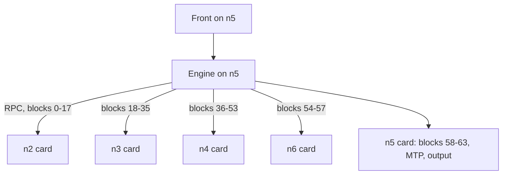
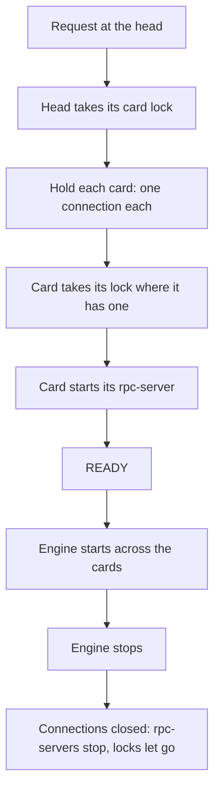
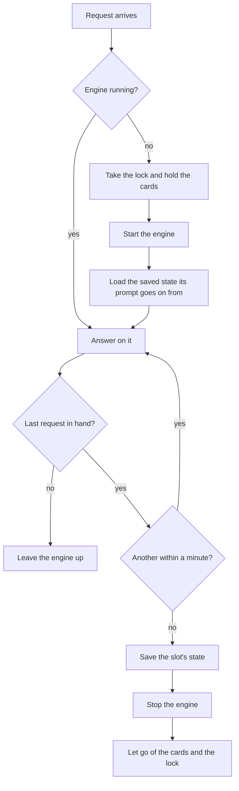

# The text model: Qwen ARA 27B on n5 and the cards it borrows

A general text model served behind an OpenAI-compatible front. One engine answers, on **n5, the
head**, whose front is reached from main-host through its tunnel door. The engine lays the model's
weights and the KV store of the whole context across five cards: the head's own and four it borrows
over the inner network, from n2, n3, n4 and n6. Nothing of it is computed by a CPU but the token
embeddings' lookup. It holds the cards only while requests are in hand and for a short idle time after.

It is no part of Laya, and BMO's gateway is the only thing of BMO's that asks it (BMO's
`docs/own-llm.md`); the sanitiser gate's data run drives it too. This repository holds it whole: the
front, the card holder, the units, the node setup, the engine's patches and the installer.

## What it runs as

| | |
|---|---|
| Name in this repository's documents | Qwen ARA 27B |
| Weights | Qwen3.8-27B RVN Heretic Abliterated, 64 main blocks and an MTP block |
| File | `RVN-Q4_K_M-multilingual-mtp.gguf` of `0bserverx/Qwen3.8-27B-Heretic-Abliterated-Uncensored-GGUF`, 16,998,720,992 bytes |
| Quantisation | Q4_K_M, four bits, its imatrix calibrated on many languages |
| Context | 1,048,576 tokens, YaRN stretching the trained 262,144 by 4 |
| KV store | `q4_0`, the main model's and the MTP head's, all of it on the cards |
| Cards | five RTX 4070 12 GB: n2, n3, n4 and n6 over llama.cpp's RPC backend, n5's own last |
| Drafting | the model's own MTP head, two draft tokens |
| Model id the front gives | `RVN-Q4_K_M-multilingual-mtp`, the file's name |

## The model

- **What answers:** the file above, checked against the repository's own SHA-256 before it is given
  its name, under `~/n5-llm/models/` on the head. The cards hold no file: the head sends each its
  blocks (「The cards it borrows」).
- **Why this file:**
  - Four bits is the size the five cards hold whole with the full context's store and the
    reservations beside it (「Where everything lies」). The model's own GGUF repository gives it, so
    nothing is quantised here.
  - Q4_K_M rather than IQ4_XS, the other four-bit file there (1.4 GB smaller), since the cards have
    room for the larger and better of the two.
  - The `-multilingual` family is calibrated on a corpus of many languages rather than English
    alone, which is what Korean wants.
  - The `-mtp` twin carries the model's own MTP draft head in a 65th block, so speculative decoding
    needs no second file.
  - `RVN` names the model, a refinement of the Heretic abliteration; its tensors are ordinary
    llama.cpp quantisations of the `qwen35` architecture, which upstream llama.cpp reads.
- **Its shape:** 64 main blocks, three of every four a Gated DeltaNet block and every fourth a full
  attention block (blocks 3, 7, … 63), then the MTP block. Only the sixteen full attention blocks and
  the MTP block keep a KV store: 1,152 MiB each for the whole context in `q4_0`, 4 GiB each in f16.
- **Thinking:** the model thinks before it answers unless the request's `chat_template_kwargs`
  carries `enable_thinking: false`, which the embedded chat template reads.

## Where everything lies



- **The split:** the engine gives each card a share of the 65 blocks and the output, in the order
  n2, n3, n4, n6 and n5 itself: 18, 18, 18, 4 and 8. A card keeps the KV store and the recurrent
  state of the blocks it holds, so its store is its count of full attention blocks.
- **What each card holds** while an answer is made, measured with the full context's store
  allocated:

  | Card | Blocks' weights | KV store | Compute buffer | Card in use of 12,282 MiB |
  |---|---|---|---|---|
  | n2 | 4,039 MiB | 4,608 MiB (4 blocks) | 1,576 MiB | 10,551 MiB |
  | n3 | 3,859 MiB | 5,760 MiB (5 blocks) | 1,576 MiB | 11,513 MiB |
  | n4 | 3,877 MiB | 4,608 MiB (4 blocks) | 1,576 MiB | 10,389 MiB |
  | n6 | 910 MiB | 1,152 MiB (1 block) | 1,576 MiB | 4,356 MiB, Laya's and the voice's contexts included |
  | n5 | 2,833 MiB | 2,304 MiB (2 blocks) and the MTP head's 1,152 MiB | 1,576 MiB and the MTP head's 3,153 MiB | 11,253 MiB |

- **Why five cards:** the weights take 15.4 GiB on the cards and the store of the whole context
  18 GiB with the MTP head's, beside a compute buffer every card reserves for a batch over the whole
  context. Four cards (n2 to n5) leave no room for those reservations; n6's card, shared with Laya
  and BMO's voice, is the fifth.
- **Why n6 takes the least:** its card is shared outside the lock (「What shares the cards」), so its
  share is what leaves the other services their room: 4,356 MiB in use leaves about 7.9 GB free,
  which is more than Laya takes at once with one checkpoint and its decision, and more than the 7 GB
  BMO's voice asks for before it speaks a line.
- **Why `q4_0` and not `q8_0`:** the store of the whole context is 34 GiB in `q8_0` and 18 GiB in
  `q4_0`. `q8_0` fits only with every card full and a sixth card added, and without the MTP head:
  n2 to n6 and an RTX 3070 on a WSL machine of the same network, with the three-bit IQ3_XXS file,
  started and answered (「What it was measured at」), but leaves n6 no room for Laya or the voice.
- **Why n5 is the head:** its front keeps the main-host port and the key every caller already
  holds. A head needs the model file locked in its RAM (「The memlock limit」), and n5's 62 GiB hold it
  beside the voice server's.

## The engine

- **What it is:** upstream llama.cpp's `llama-server` on the head and its `ggml-rpc-server` on each
  card, one build on every node, made with CUDA for the cards' architecture (sm_89) and the RPC
  backend at the commit the node setup pins, with two patches of this repository's applied
  (「The patches」), under `~/n5-llm/build/llama.cpp`.
- **Where it listens:** `127.0.0.1:8021` on the head, and only while it runs. The front is the only
  way to it.
- **What it runs with:**
  - the four borrowed cards named with `--rpc` in the order above, and the split as each one's
    share with `-ts`, the head's own card last;
  - every block on a card, the MTP block included, with 8 CPU threads for the token embeddings'
    lookup, which the CPU does whatever else is placed where;
  - the model file mapped rather than read, so the engine's start reads the head's blocks straight
    from the pages the front keeps locked;
  - flash attention on, and no fitting of settings to the cards at start, so a card without room
    fails at once rather than quietly running on a smaller context;
  - a context of 1,048,576 tokens, and past the trained 262,144 YaRN scaling by their ratio, 4, with
    the trained context as YaRN's original;
  - the K and V store in `q4_0` on the cards, the MTP head's too (`-ctkd`, `-ctvd`);
  - prompts computed 256 tokens at a time (`-ub 256`), since every card reserves a mask for the whole
    context as wide as that;
  - one slot, so the whole context is one request's and requests that overlap are answered one after
    another by the same engine;
  - MTP speculative decoding with two draft tokens (`--spec-type draft-mtp`), which
    `N5_LLM_MTP=off` in the front's environment turns off;
  - the slot folder `~/n5-llm/slots/` as the place its slot is saved to and restored from
    (`--slot-save-path`, 「The slot's state between engines」);
  - no warmup run at start, since the request waiting on the start is the warmup.
- **Its start** takes about 30 seconds: the head hashes every block it sends, and each card reads its
  blocks from its own cache rather than over the network (「The cards it borrows」). The first start
  after a card's cache is emptied takes about 150 seconds, the blocks crossing the network once.

### The attention over a long store

- **The f16 copy:** the CUDA kernels that compute a prompt's batch read the store in f16, so a
  quantized store is first copied whole into f16 in the card's compute buffer, and every card
  reserves that copy for a batch over the whole context at start: 4 GiB a card, which no card here
  can spare beside its share.
- **The limit:** `GGML_CUDA_FA_F16_MAX_KV`, 262,144, names the longest store whose attention goes to
  those kernels. A batch over a longer store goes to the vector kernel, which reads the quantized
  store where it lies, and each card reserves only the f16 copy of a store at the limit, 1 GiB. The
  head's engine and every card's rpc-server read it from their settings, since each card chooses and
  reserves for its own blocks.
- **An answer's tokens** go to the vector kernel at every length, as upstream sends them.
- **How fast:** a prompt is read at 190 to 290 tokens a second at any length measured up to 43,000
  tokens, the vector kernel and the f16 kernels alike, since the network between the cards is what
  each batch waits on (「What it was measured at」).

### The patches

Both are files of this repository, applied by the node setup on the pinned commit; a stamp beside
the build names the commit and the patches.

- **`llama-fa-f16-limit.patch`** gives the limit above: the CUDA backend's choice of kernel sends a
  batch over a quantized store past the limit to the vector kernel, and the room it reserves for a
  graph over the whole context is the f16 copy of a store at the limit, since a shorter store still
  goes to the kernel that reads f16 and its room is not reserved again.
- **`llama-rpc-slot-pieces.patch`** keeps a saved slot where it lies (「The slot's state between
  engines」): two RPC commands that write a range of a tensor to a file on the rpc-server's own disk
  and read it back, queued to every card at once; a sequence's state file written with the ranges on
  an RPC card as pieces, each kept by its card under the file's name and a number, and only the
  piece's name, its card's address and its size in the file itself; and the state file's version
  raised, so a file of another build is refused rather than read wrongly.

## The cards it borrows



- **The holder:** `card.py` on each card node, one process waiting on its node's address on the inner
  network, port 50051, and holding nothing while nobody asks.
- **A hold:** the head's front opens one connection to each card and asks `HOLD` with its service
  key. The card takes its node's card lock where it has one (waiting up to sixty seconds), starts
  `ggml-rpc-server` on its address, port 50052, answers `READY`, and keeps both for as long as the
  connection stays open. When the connection closes, however it closes, the rpc-server is stopped,
  which empties the card, and the lock is let go. A card that is held already, or whose lock stays
  held, answers `BUSY` with the reason, and the head answers its request 503.
- **One card held by one head at a time,** so a second hold is refused while the first stands.
- **The pieces it keeps:** the rpc-server writes and reads slot pieces in `~/n5-llm/slots/` on its
  node, and `DROP` with the key and slot file names removes those files' pieces.
- **The tensor cache:** the rpc-server is started with its cache on (`-c`) in `~/n5-llm/rpc-cache/`, so
  a block the head has sent before is read from the card node's own disk at the next start; the first
  start sends every borrowed block over the network once.
- **Which lock:** n2, n3 and n4 take `/home/labuser/.gpu.lock`, the lock their cards are taken in turns
  by. n6 takes none: Laya never waits for its lock, so a hold of it would refuse every Laya call while
  the engine runs, and n6's share is sized to leave Laya and the voice their room instead
  (「Where everything lies」).
- **The inner network only:** both ports listen on the node's own address on 192.0.2.0/23 and no
  other. Every node's firewall denies incoming connections and lets that network in, and nothing
  opens either port to anything else. The RPC protocol has no key of its own; the holder's key and
  the rpc-server standing only while held are what stand in front of it.

## How it holds the cards

The engine is a process that lives for as long as requests are in hand and a minute after, and the
weights wait between them in the head's locked RAM and on the card nodes' disks.



- **Where the head's weights wait:** the front maps the model file and locks every page of it in RAM
  with `mlock` when it starts, and keeps it locked for as long as it runs. The engine maps the same
  file, so its start reads the weights from those locked pages, never from the disk.
- **Why locked pages and not pinned memory:** pinned memory belongs to the process that allocated it,
  and the process that puts the weights on the cards is a fresh engine each time. Locked page-cache
  pages are shared by every process that maps the file.
- **The card lock** is `/home/labuser/.gpu.lock` on n5, taken with an exclusive `flock` before the
  cards are held and let go only after the engine has exited and the cards are let go. The protocol is
  the one n6's services follow (`docs/llm-server.md`, 「The shared card lock」).
- **Waiting for a lock:** a request that finds the head's lock or a card's held elsewhere waits for
  it up to sixty seconds, which covers another service's single use, and is then answered 503,
  saying which card is busy.
- **When the engine goes:** sixty seconds after the last request in hand ends (answered, refused, or
  cut off by its caller), unless another comes in first, which is answered on the running engine.
  A conversation's next turn comes seconds after the last, and the idle minute spares it the start;
  it is short of the minutes the shared lock lets a holder sit idle. `N5_LLM_IDLE_S` in the front's
  environment sets it. A request that arrives while the engine is going waits for it to be gone and
  starts it again.
- **A card that has no room** makes the engine fail its start; the request is answered 503, saying a
  card had no room, and the cards and the lock are let go.

### The slot's state between engines

The engine's KV store and recurrent state go with it when it stops, and a prompt of tens of thousands
of tokens takes minutes to compute again. So the front saves the slot's state before it stops the
engine and loads a saved state into the next engine before it passes the request on, and each card
saves and loads its own part on its own disk.

- **Where a state lies:** the head's file in `~/n5-llm/slots/` on n5 holds the tokens, the head's own
  card's part, and for every range on a borrowed card the name of the piece that card keeps; each
  card's pieces lie in `~/n5-llm/slots/` on its own node. Only commands cross the network, and every
  card writes or reads its pieces at the same time.
- **What a file is reused by:** the Gated DeltaNet blocks keep one recurrent state, the one after the
  last token, which cannot be taken back to an earlier token. A running engine goes back through the
  context checkpoints it keeps in memory, but a file holds the state at its last token alone. So a
  file is reused only by a request whose prompt carries the file's whole token sequence at its start
  and goes on past it; a request that parts from it anywhere, one token before its end included, is
  computed from its first token.
- **Where the saved state ends:** a conversation's next request does not carry the answer the way the
  engine made it, since the chat template renders a past answer its own way. So the front first takes
  the slot back to its last request's prompt without that prompt's last three tokens, the opening of
  the generation prompt, which the next request of the same conversation carries whole. It does so by
  sending the engine that shortened prompt with nothing to generate: the engine goes back to the
  checkpoint it made four tokens before the prompt's end and computes one token.
- **A way back that would cost more,** with the checkpoint missing or the prompt not the one the
  slot holds, is given ten seconds and then hung up on; the engine drops it once the batch it is
  computing is done, and whatever the slot then holds is saved. The file's head says which tokens it
  holds, so what it holds is always what it is chosen by.
- **How the front knows a prompt's tokens:** it asks the running engine to render a chat request
  through its template and to tokenise the result, or to tokenise a completion's prompt, the way the
  engine does for the request itself. The tokens are held in memory only while the request is in hand.
- **The files' names:** each save is named by the time it was made, in hexadecimal nanoseconds, and a
  card's pieces of it by that name, a dot and a number. A save removes every file whose whole
  sequence begins its own (the same conversation's earlier turns), with their pieces on every card,
  so a conversation keeps its latest file. Nothing is removed for its age.
- **A save that fails** leaves no file: the engine clears the file's mark where a card did not write
  its piece, and the front removes it and its pieces.
- **The choice at start:** once the engine answers its health, the front reads the heads of the files
  and loads the longest one the request's prompt carries whole and goes on past; with none, the slot
  starts empty. A request that arrives while the engine runs is answered on the slot as it stands.
- **What a file holds:** the attention blocks' KV store for its tokens and the recurrent state. The
  MTP head's own store is not in it; the head's drafts after a load are accepted as they are after a
  fresh prompt.
- **A load that fails,** a piece missing or a card holding other blocks than when it was saved, is
  written to the front's log, the slot is emptied, and the request is answered as if there were no
  file.

### What shares the cards

- **Laya's training passes** use n2 to n5 (`docs/training.md`), under the card lock of each. A pass
  takes a card with room for a gate, which a node's card has whenever the engine is not running; a
  gate trains for up to hours and holds that node's lock the whole time. While one trains on any of
  n2 to n5, the engine cannot hold that card, and every request waits its sixty seconds and is
  answered 503; a gate that wants a card the engine holds waits for the engine's idle minute to end.
- **n6's card** is shared by Laya's decisions, BMO's voice and BMO's songs, each under n6's lock
  (`docs/llm-server.md`, 「The shared card lock」). The engine's share of it stands beside them while
  it runs, outside that lock, and is sized to leave them their room.
- **BMO's voice server** also stands on n3, n4 and n5 as a unit of its own, off the voice node list,
  so nothing asks it (BMO's `docs/voice-plan.md`). Between lines it holds only its CUDA context, about
  220 MB, which the cards' shares leave room for.

## The front

One process on `127.0.0.1:8020` on the head, the only port that leaves n5.

| Path | Key | What it does |
|---|---|---|
| `/health` | none, or bearer | without the key, 200 `{"status":"ok"}` once the model's pages are locked; with the key, the whole state below |
| `/v1/models` | bearer | the one model, answered without starting the engine |
| `/v1/chat/completions` | bearer | passed to the engine, streamed or whole as asked |
| `/v1/completions` | bearer | passed to the engine, streamed or whole as asked |

- **The key check:** every path but `/health` takes `Authorization: Bearer` with the service key,
  compared in constant time. A refusal is a bare 401 that repeats nothing of the request.
- **The state `/health` gives with the key:** the model file and how many of its bytes are locked,
  whether the engine is stopped, waiting for the card lock, holding the borrowed cards, starting,
  running, idle, saving or stopping, how many requests are in hand, whether the front holds the lock
  and how many cards, how long the last start and the last stop took, how many slot files there are
  and their bytes, the last save's and the last load's tokens, bytes and time, and the engine's
  settings, the cards and their shares among them.
- **The model's name** in `/v1/models` is the file's name without `.gguf`. The engine answers
  whatever `model` a request names, since it serves one.
- **Nothing of a request is logged:** the front's log carries the engine's starts and stops with
  their durations, the slot's saves and loads with their token counts, bytes and durations, and why a
  start, a hold, a save or a load failed. The engine's own log goes to the front, which keeps only its
  last few kilobytes for saying why a start failed and writes none of it anywhere.

## Settings and units

- **The settings file** is `~/.config/n5-llm/env` on each node, `0600`, written whole by the
  installer:
  - on the head: the service key as `LLM_KEY`, its main-host port as `LISTEN`, `N5_LLM_ROLE=head`,
    the borrowed cards as `N5_LLM_CARDS` (each card's address and share), its own share as
    `N5_LLM_SHARE`, and `GGML_CUDA_FA_F16_MAX_KV`;
  - on a card node: the head's key as `LLM_KEY`, `N5_LLM_ROLE=card`, its address as `CARD_ADDRESS`,
    its lock as `CARD_LOCK` (empty on n6), and `GGML_CUDA_FA_F16_MAX_KV`.
- **The cards, their shares and the limit** are declared once, a card to an entry, in the installer
  (`src/n5-llm-install.ts`); a node added or a share changed is an entry there and an install.
- **An engine setting changed on the head:** `N5_LLM_MTP`, `N5_LLM_CONTEXT` (YaRN follows it past
  the trained context), `N5_LLM_KV_TYPE` (`q4_0` by default), `N5_LLM_DRAFT_TOKENS`, `N5_LLM_UBATCH`,
  `N5_LLM_IDLE_S`, `N5_LLM_THREADS` — goes in a drop-in of the front's unit
  (`systemctl --user edit n5-llm-front`), which the installer leaves standing.
- **`n5-llm-front.service`** on the head runs the front, which starts and stops the engine as its own
  child. It allows the process to lock 16 GiB of memory, room for the whole model file.
- **`n5-llm-tunnel.service`** on the head holds the tunnel below.
- **`n5-llm-card.service`** on each card node runs the holder, which starts and stops the rpc-server
  as its own child. A card node runs neither of the head's units, and the head none of the card's.
- All are systemd user units in each node's `labuser` account, restarting on any exit and started with
  `default.target`. Linger is on for the account, so they stand after a reboot with nobody logged in.

### The memlock limit

- **The head's front must lock the whole model,** 15.8 GiB, and a user manager's own default limit
  is about 7.8 GiB, one eighth of the RAM, which a unit cannot raise past.
- **So the user manager of `labuser` is given 16 GiB on the head, once, by hand with sudo:** a drop-in
  `/etc/systemd/system/user@1000.service.d/memlock.conf` setting `LimitMEMLOCK=16G` for every later
  start of the manager, and `prlimit --memlock=17179869184:17179869184` on the running manager, so the
  change holds without restarting it and the units under it. n2 to n5 all carry it; a card node needs
  none.
- **The node setup checks the limit** on the head and stops with `memlock` where the manager's is
  below the model's size, so a head whose limit was never raised fails the install at that step and
  says so.

### The build tools

- **Building the engine needs `cmake`, `ninja` and the CUDA toolkit (`nvcc`) on every node.** These
  are host packages, installed once by hand with sudo (`apt-get install cmake ninja-build`; the CUDA
  toolkit is already there for training and for Laya). n2 to n6 carry them.
- **The node setup checks for them** before it builds and stops with `cmake-missing`, `ninja-missing`
  or `nvcc-missing` where one is absent. A node whose engine is already built at the pinned commit
  with the current patches skips the build and the check both.

## The door

The nodes sit on the same network as n6, which lets only HTTPS out, so the head's tunnel is n6's in
everything but its names and its port (`docs/llm-server.md`, 「The door」). Only the head has one.

- `n5-llm-tunnel.service` holds `ssh -N` to main-host inside a WebSocket to
  `wss://llm-tunnel.ahas.io/`, dialled by the same `ws-dial.py` with the service key as its bearer,
  asking for one remote forward: `127.0.0.1:18020` on main-host to the front's `127.0.0.1:8020`.
- The head's own tunnel key, made on it at `~/.config/n5-llm/tunnel_ed25519`, stands in main-host's
  `authorized_keys` with the same restrictions as n6's, allowed to listen on its one port alone.
- main-host's host key is pinned in `~/.config/n5-llm/known_hosts` under the name `main-host`.
- **The front answers at `http://127.0.0.1:18020/v1` on main-host**, which is the base URL an OpenAI
  client is given, with the service key as its API key.

## The key

- **The service key** is `$BMO_DATA_DIR/env/n5-llm.token` on main-host (without `BMO_DATA_DIR`, under
  `~/.local/share/bmo/data/env/`): 32 random bytes as hex at `0600`, made once by the installer, never
  overwritten, and refused where its permission is anything else.
- **It is the tunnel's door key as well:** the installer names its file in the door's list, so the
  bridge takes the head's tunnel with it (`docs/llm-server.md`, 「The door」).
- **It is what the cards answer to:** each card node's settings carry it, and a hold or a drop
  without it is refused.
- **On a node it lives only in the settings file.** It appears in no document, log line, response,
  unit file, command line or test fixture.

## Installing and updating

`bun scripts/n5-llm-install.ts` from this checkout on main-host, run again to update. With no
`--node` it stands every card node and then the head; `--node <이름>` does one.

- **A card node,** in order:
  1. Reads the head's key on main-host, making it if there is none.
  2. Makes the service's folders on the node.
  3. Carries the card's settings file across in a private `0600` file.
  4. Uploads the holder, its unit, the node setup and the engine's patches into `~/n5-llm`.
  5. Runs the node setup detached and waits for `N5-LLM-SETUP-DONE ok`, or
     `N5-LLM-SETUP-DONE failed:<step>`. The setup builds the venv on uv's Python and llama.cpp at
     its pinned commit with the patches, where the built engine is not that commit and those
     patches'.
  6. Stops and removes a head's units if the node carries them, installs the card's unit, reloads the
     user manager and enables and restarts it.
  7. Waits until the holder listens on the node's address, asked of the node itself, since main-host
     is not on the inner network.
- **The head** goes through n6's install in everything but what it carries (`docs/llm-server.md`,
  「Installing and updating」): the key, the folders, the settings file, the front, the units, the node
  setup and the patches; the setup, which also fetches the model in sixteen ranges at once where it is
  missing, checks its hash and checks the memlock limit; the tunnel key, its `authorized_keys` entry,
  the door's list and the bridge; main-host's host key; the units; and the front's health on
  main-host.

The steps it does not make are the host packages and the head's memlock drop-in above, which need
sudo and are done by hand.

## What it was measured at

Measured on 1 October 2026, at temperature 0 with thinking off, through the engine's own timings on
the head unless an item says it came through the front.

### The machine

- **Cards:** RTX 4070, 12,282 MiB, on each of n2 to n6; CUDA sees 11,874 MiB of it and 11,711 free
  before anything is put on it. A card's rpc-server takes 163 MiB of it for its CUDA context.
- **CPU and RAM:** i9-9900KF, 8 cores and 16 threads, and 62 GiB on every node.
- **The inner network:** 1 Gb/s Ethernet between the nodes, about 0.5 to 1.2 ms a round trip.

### Prompts and answers

| | Served Q4_K_M, KV `q4_0`, five cards |
|---|---|
| The engine's start, the cards held and their blocks read from their caches | 29.6 s |
| The first start, every borrowed block sent over the network | 150 s |
| A prompt of 70 tokens and its 17-token answer | 39.3 t/s reading, 24.8 t/s answering |
| A prompt of 20,865 tokens | 289 t/s, the answer at 19.5 t/s |
| A conversation of 42,827 tokens, through the front | 232.5 t/s, 187 s with the start, the answer at 20.1 t/s |
| A short chat request through BMO's gateway, with the start | 35 s, the answer at 15.6 t/s |

- **The prompts** asked which colour and door stood on one of numbered lines, and each answer was
  right.
- **The vector kernel past the limit** read a prompt of 20,865 tokens at 226 t/s on the three-bit
  file where the f16 kernels read one of 42,826 at 231 t/s, so the kernel past the limit costs a
  prompt little at these lengths; the network between the cards is what bounds them both.

### The slot's state, measured

- **A conversation of 42,824 tokens, through the front:** saved at the idle minute's end in 0.19
  seconds, 113 MB in the head's file and about 243, 289, 243 and 59 MB of pieces on n2, n3, n4 and
  n6. Its next turn started the engine again, loaded the state in 0.12 seconds, computed only its 45
  new tokens, in 4.9 seconds, and answered right, 35.8 seconds from the request.
- **A state of 20,884 tokens:** saved in 0.15 seconds, 62 MB in the head's file and 142, 163, 142
  and 34 MB of pieces; loaded in 0.06 seconds.
- **A saved state's size** is about 22 KB a token in all, 2.6 KB of it in the head's file and the rest
  in the cards' pieces: about 23 GB for the whole context, every card's part on its own disk.

### `q8_0` on six cards

With the three-bit `RVN-IQ3_XXS-multilingual-mtp.gguf`, MTP off and the f16 limit at one cell, the
whole context's store in `q8_0` (34,816 MiB) went on n2 to n6 and the RTX 3070 of a WSL machine on
the same network (its share 581 MiB of weights and 2,176 MiB of store): the engine started and
answered a short prompt at 9.5 t/s and a prompt of 6,275 tokens at 246 t/s, both right. n6 then read
9,578 MiB in use, the RTX 3070 6,427 of its 8,192, and every other card 9,079 to 9,911.

## The checks

Run on main-host. The key is read from its file into a header and never written into the command:

```sh
key() { printf 'Authorization: Bearer %s\n' "$(cat "${BMO_DATA_DIR:-$HOME/.local/share/bmo/data}/env/n5-llm.token")"; }
```

1. **Health, without a key:** `curl -s http://127.0.0.1:18020/health` answers 200 and nothing more.
2. **Health, with the key:** `curl -s -H @<(key) http://127.0.0.1:18020/health` shows the whole model
   locked, the engine stopped, and neither the lock nor any card held between requests.
3. **A request:** `curl -s -H @<(key) -H 'content-type: application/json' -d '{"messages":[{"role":"user","content":"안녕"}],"max_tokens":64,"chat_template_kwargs":{"enable_thinking":false}}' http://127.0.0.1:18020/v1/chat/completions`
   answers, and `nvidia-smi` on n2 to n6 shows the engine's parts while it runs and none a minute
   after.
4. **The slot's state:** health with the key after the idle minute shows the last save and a slot
   file for the request, and the same card nodes carry its pieces in `~/n5-llm/slots/`; the same
   request sent again shows a load of all but its last three tokens.
5. **The cards on the inner network:** `ss -ltn` on each card node shows port 50051 on its own address
   alone, and 50052 only while the engine runs.
