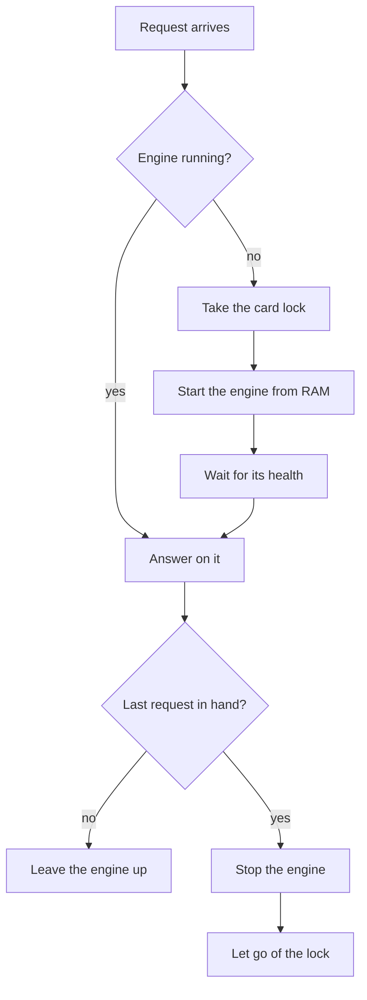

# The text model on n5

A general text model served on n5 behind an OpenAI-compatible front, on a card it holds only while a
request is being answered. It is no part of Laya and nothing asks it on its own: BMO has no provider
and no gate pointed at it, and connecting one is 하스's decision. This repository holds it whole —
the front, the units, the node setup and the installer.

## The model

- **What answers:** Qwen3.8-27B RVN Heretic Abliterated, the file `RVN-IQ2_XS-multilingual-mtp.gguf`
  of `0bserverx/Qwen3.8-27B-Heretic-Abliterated-Uncensored-GGUF`: 9,541,912,032 bytes, checked
  against the repository's own SHA-256 before it is given its name.
- **Why this file:**
  - `RVN` names the model, a refinement of the Heretic abliteration, and not a quantisation of its
    own. Its tensors are ordinary llama.cpp quantisations (`IQ2_XS`) of the `qwen35` architecture,
    which upstream llama.cpp reads, so no special build is needed.
  - IQ2_XS is the size chosen for a 12 GB card: with its MTP head and a context of 32,768 tokens
    the running engine leaves about 1.1 GB of the card free.
  - The `-multilingual` family is calibrated on a corpus of many languages rather than English
    alone, which matters most at two bits for Korean.
  - The `-mtp` twin carries the model's own MTP draft head (about 0.42 GiB), so speculative decoding
    needs no second file. Its main tensors are byte for byte those of the plain file.
- **Where it stands:** `~/n5-llm/models/` on n5.
- **Why not Q2_K, the next size up:** it is slower and holds less context. Without MTP it fits a
  context of 16,384 tokens and generates 35.3 t/s; its MTP twin fits no more than 8,192 tokens and
  generates 39.2 t/s (「What it was measured at」).

## The engine

- **What it is:** upstream llama.cpp's `llama-server`, built on n5 with CUDA for the card's
  architecture (sm_89) at the commit the node setup pins, under `~/n5-llm/build/llama.cpp`.
- **Where it listens:** `127.0.0.1:8021`, and only while a request is being answered. The front is
  the only way to it.
- **What it runs with:**
  - every layer on the card, flash attention on, and no fitting of settings to the card at start, so
    a card without room fails at once rather than quietly running on a smaller context;
  - a context of 32,768 tokens, with the K and V cache in `q8_0`;
  - one slot, so requests that overlap are answered one after another by the same engine;
  - MTP speculative decoding with two draft tokens (`--spec-type draft-mtp`), which
    `N5_LLM_MTP=off` in the front's environment turns off;
  - no warmup run at start, since the request waiting on the start is the warmup.
- **Thinking:** the model thinks before it answers unless the request's
  `chat_template_kwargs` carries `enable_thinking: false`, which the embedded chat template reads.

## How it holds the card

The engine is a process that lives for as long as requests are in hand, and the weights wait in
locked host memory between them.



- **Where the weights wait:** the front maps the model file and locks every page of it in RAM with
  `mlock` when it starts, and keeps it locked for as long as it runs. The engine maps the same file,
  so its start reads the weights from those locked pages, never from the disk.
- **Why locked pages and not pinned memory:** pinned memory belongs to the process that allocated it,
  and the process that puts the weights on the card is a fresh engine each time. Locked page-cache
  pages are shared by every process that maps the file.
- **The card lock** is `/home/labuser/.gpu.lock`, taken with an exclusive `flock` before the engine
  starts and let go only after it has exited, which is when the card is empty of it. The protocol is
  the one n6's services follow (`docs/llm-server.md`, 「The shared card lock」).
- **Waiting for the lock:** a request that finds the lock held elsewhere waits for it up to sixty
  seconds, which covers another service's single use, and is then answered 503, saying the card is
  busy.
- **When the engine goes:** the moment the last request in hand ends — answered, refused, or cut off
  by its caller — with no idle time. A request that arrives while it is going waits for it to be gone
  and starts it again.
- **A card another process has filled** makes the engine fail its start; the request is answered 503,
  saying the card had no room, and the lock is let go.

### What shares n5's card

- **BMO's voice server** stands on n5 as a unit of its own, off the voice node list, so nothing asks
  it (BMO's `docs/voice-plan.md`). Between lines it holds only its CUDA context, about 220 MB. The
  build it runs follows the card lock once BMO's next deployment brings it up to date; until then a
  line it is asked for loads its model beside whatever is on the card.
- **Laya's training passes** use n2 to n5 (`docs/training.md`). A pass reads a card's free memory
  right before each gate and takes a card with room for one, which n5's card has whenever no request
  is in hand; a gate trains for up to hours and does not take the card lock. While one trains on n5,
  every request here is answered 503.

## The front

One process on `127.0.0.1:8020`, the only port that leaves n5.

| Path | Key | What it does |
|---|---|---|
| `/health` | none, or bearer | without the key, 200 `{"status":"ok"}` once the model's pages are locked; with the key, the whole state below |
| `/v1/models` | bearer | the one model, answered without starting the engine |
| `/v1/chat/completions` | bearer | passed to the engine, streamed or whole as asked |
| `/v1/completions` | bearer | passed to the engine, streamed or whole as asked |

- **The key check:** every path but `/health` takes `Authorization: Bearer` with the service key,
  compared in constant time. A refusal is a bare 401 that repeats nothing of the request.
- **The state `/health` gives with the key:** the model file and how many of its bytes are locked,
  whether the engine is stopped, waiting for the card lock, starting, running or stopping, how many
  requests are in hand,
  whether the front holds the card lock, how long the last start and the last stop took, and the
  engine's settings.
- **The model's name** in `/v1/models` is the file's name without `.gguf`. The engine answers
  whatever `model` a request names, since it serves one.
- **Nothing of a request is logged:** the front's log carries the engine's starts and stops with
  their durations, and why a start failed. The engine's own log goes to the front, which keeps only
  its last few kilobytes for saying why a start failed and writes none of it anywhere.

## Settings and units

- **The settings file** is `~/.config/n5-llm/env` on n5, `0600`: the service key as `LLM_KEY`. The
  installer writes it whole.
- **An engine setting changed on the node** — `N5_LLM_MTP`, `N5_LLM_CONTEXT`,
  `N5_LLM_DRAFT_TOKENS` — goes in a drop-in of the front's unit (`systemctl --user edit
  n5-llm-front`), which the installer leaves standing.
- **`n5-llm-front.service`** runs the front, which starts and stops the engine as its own child. It
  allows the process to lock 16 GiB of memory.
- **`n5-llm-tunnel.service`** holds the tunnel below.
- Both are systemd user units in n5's `labuser` account, restarting on any exit and started with
  `default.target`. Linger is on for the account, so they stand after a reboot with nobody logged
  in.

### The memlock limit

- **The front must lock the whole model,** about 8.9 GiB, and the user manager's own limit on n5 is
  about 7.8 GiB, one eighth of the RAM, which a unit cannot raise past.
- **So the user manager of `labuser` is given 16 GiB, once, by hand with sudo:** a drop-in
  `/etc/systemd/system/user@1000.service.d/memlock.conf` setting `LimitMEMLOCK=16G` for every later
  start of the manager, and `prlimit --memlock=17179869184:17179869184` on the running manager, so
  the change holds without restarting it and the units under it.
- **The node setup checks the limit** and stops with `memlock` where the manager's is below the
  model's size.

## The door

n5 sits on the same network as n6 (192.0.2.20/23), which lets only HTTPS out, so its tunnel is n6's
in everything but its names (`docs/llm-server.md`, 「The door」):

- `n5-llm-tunnel.service` holds `ssh -N` to main-host inside a WebSocket to
  `wss://llm-tunnel.ahas.io/`, dialled by the same `ws-dial.py` with n5's own service key as its
  bearer, asking for one remote forward: main-host's `127.0.0.1:18020` to the front's
  `127.0.0.1:8020`.
- n5's own tunnel key, made on n5 at `~/.config/n5-llm/tunnel_ed25519`, stands in main-host's
  `authorized_keys` with the same restrictions as n6's, allowed to listen on `127.0.0.1:18020` alone.
- main-host's host key is pinned in `~/.config/n5-llm/known_hosts` under the name `main-host`.
- **The service answers at `http://127.0.0.1:18020/v1` on main-host**, which is the base URL an
  OpenAI client is given, with the key below as its API key.

## The key

- **The service's own key** is `$BMO_DATA_DIR/env/n5-llm.token` on main-host (without
  `BMO_DATA_DIR`, `~/.local/share/bmo/data/env/n5-llm.token`): 32 random bytes as hex at `0600`,
  made once by the installer, never overwritten, and refused where its permission is anything else.
- **It is n5's door key as well:** the installer names its file in the door's list, so the bridge
  takes n5's tunnel with it (`docs/llm-server.md`, 「The door」).
- **On n5 it lives only in the settings file.** It appears in no document, log line, response, unit
  file, command line or test fixture.

## Installing and updating

`bun scripts/n5-llm-install.ts` from this checkout on main-host, run again to update. It is n6's
install in everything but what it carries (`docs/llm-server.md`, 「Installing and updating」):

1. Makes the key on main-host if there is none.
2. Makes the service's folders on n5.
3. Carries the settings file across in a private `0600` file.
4. Uploads the front, the units, the node setup and the tunnel's `ws-dial.py` into `~/n5-llm`.
5. Runs the node setup detached and waits for `N5-LLM-SETUP-DONE ok`, or
   `N5-LLM-SETUP-DONE failed:<step>` naming the step. The setup builds the front's venv on uv's
   Python, builds llama.cpp at its pinned commit where the built engine is not that commit's, fetches
   the model in sixteen ranges at once where it is missing and checks its hash, and checks the memlock
   limit. What already stands is left alone.
6. Makes n5's tunnel key if there is none and reads back its public half.
7. Adds the restricted `authorized_keys` entry on main-host unless it is already there.
8. Names the key in the door's list and restarts the bridge.
9. Pins main-host's host key in n5's `known_hosts`.
10. Installs the two units, reloads the user manager and enables and restarts them.
11. Waits until `http://127.0.0.1:18020/health` answers on main-host.

The one step it does not make is the memlock drop-in above, which needs sudo.

## What it was measured at

Measured on 30 September 2026 on n5 (RTX 4070 12 GB, i9-9900KF, 62 GiB RAM), at temperature 0 with
thinking off, every request from main-host through the tunnel and starting the engine afresh.

### Generation

| Setting | Short answer, 212–377 tokens | Long answer, 800 tokens |
|---|---|---|
| MTP off | 40.6 t/s | 40.6 t/s |
| MTP on, 1 draft token | 50.7 t/s | 57.9–59.9 t/s |
| MTP on, 2 draft tokens (served) | 48.6–48.7 t/s | 64.2–69.6 t/s |
| MTP on, 3 draft tokens | 42.7–43.3 t/s | not measured |
| Q2_K, MTP off, 16K context | 35.3 t/s | not measured |
| Q2_K, MTP on, 8K context | 39.2 t/s | not measured |

- The short answer is three paragraphs about spring in Seoul; the long ones are an account of Korean
  holidays and a Python function with its tests. How much MTP gains depends on how many drafted
  tokens are accepted, which is higher in longer and more predictable text.
- The short answers with one and three draft tokens and both Q2_K rows were measured on the engine
  run by hand on n5 with the same settings, not through the front.

### Time to the first token

- **2.0 to 2.3 seconds from the request to the first token**, the engine's start included.
- **The engine's start** from the locked pages to its first health is 2.0 to 2.1 seconds of that; the
  prompt of 27 to 36 tokens takes 140 to 190 ms.
- **Its stop** takes about 0.23 seconds, after the answer has reached the caller.

### Card and memory

- **While an answer is made,** the card holds 11.1 to 11.2 GB with MTP on and 10.2 GB with it off,
  the voice server's context included.
- **Between requests** no engine process is on the card, and the card holds only the voice server's
  context, 218 MiB; the front itself never opens the card.
- **The front locks 9.32 GB** (the whole file) and its resident set is 9.36 GB. A running engine adds
  about 1.1 GB resident, part of it the same locked pages mapped again.

## The checks

Run on main-host. The key is read from its file into a header and never written into the command:

```sh
key() { printf 'Authorization: Bearer %s\n' "$(cat "${BMO_DATA_DIR:-$HOME/.local/share/bmo/data}/env/n5-llm.token")"; }
```

1. **Health, without a key:** `curl -s http://127.0.0.1:18020/health` answers 200 and nothing more.
2. **Health, with the key:** `curl -s -H @<(key) http://127.0.0.1:18020/health` shows the whole model
   locked, the engine stopped and the lock not held between requests.
3. **A request:** `curl -s -H @<(key) -H 'content-type: application/json' -d '{"messages":[{"role":"user","content":"안녕"}],"max_tokens":64,"chat_template_kwargs":{"enable_thinking":false}}' http://127.0.0.1:18020/v1/chat/completions`
   answers, and `nvidia-smi` on n5 afterwards shows no engine process on the card.
