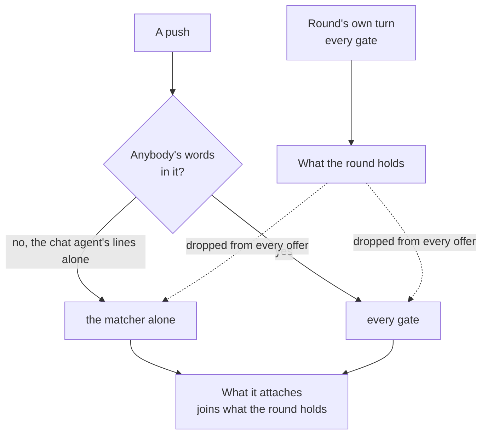

# Reference selection

What a chat turn is given to read beside the conversation, and who chooses it. The pieces themselves
live in the brain, and the system documents among them are the ones the deployment ships; this document is
the road that decides which of them a turn carries.

- **Every turn of the chat agent is selected for,** whatever brought it: the selection is composed by the one
  window every turn passes (the receiver's `docs/bmo-window.md`), a quiet instruction's turn and a keepalive touch
  alike.

## What a turn's lines are

- **A turn's lines are everything it brought:** the room's new words, each as its sender and text,
  and each quiet instruction as a line of the chat agent's own. A console talk's lines are what the owner said
  and the subject they said it about.
- **The gates read the turn's lines.** A turn with no line at all — a keepalive touch, the words
  before a fold — asks no gate.
- **`people-search`, `room-rules` and `library-knowledge` also read the message the turn follows on
  from,** as one line in the same shape standing ahead of the turn's own: the message the turn
  replies to where one of its messages replies outside it, and otherwise the room's message just
  before it. A short answer — 「yes」, 「leave the rest~」 — says nothing on its own, and a gate reading
  it alone judges every candidate by the candidate's own line, so the same few pieces attach to
  every such turn.
  - **Only its closing 300 characters are read,** opened by `…` where it was cut: a short answer
    answers what a message ends on — its question or its proposal — and a whole answer of the chat agent's
    would push the turn's own words out of what Laya reads.
  - **The narrowing never reads it.** A piece is kept for what the turn says; an item or a keyword
    the message before it named keeps nothing.
  - **A turn of the chat agent's own lines alone has none,** since it answers nobody.
  - **Each gate declares whether it reads it,** and `system-documents` does not: the line moves what
    a checkpoint picks, and only a gate whose gold labels are read better with it than without it
    reads it. Over two seeds each, `library-knowledge` and `room-rules` were; `system-documents` was
    better on one seed and worse on the other.
  - **A gate that reads it is answered on Laya by a checkpoint trained on turns that carry it.** One
    trained without it reads the extra line as part of the turn and judges a short answer by what it
    answered, which is not what its labels taught it.
- **A turn of the chat agent's own lines alone asks no `system-documents`.** A job's state, a deployment's
  notice, a document's update notice — nobody's words, only facts the chat agent recorded — is relayed,
  never answered out of the system's own documents or the lore: over five days of the gate's own
  model, 122 such inputs picked nothing, while a Laya checkpoint, trained on turns where somebody
  spoke, reads their system words as a question about the system and attaches `structure` to four
  in five. A console talk is somebody speaking. The other gates are still asked on such a turn:
  a room's rules and its knowledge may govern how a fact is relayed.
- **A turn of the chat agent's own lines alone asks `people-search` only about the pieces tied to an
  item those lines name.** A job's state names its item, and the piece that follows that item is
  what relaying it can use. The rest of what the lines carry — the words of a job's state record,
  a watch's note, the text of an updated document, the owner named as the one to be told — is the
  system's own vocabulary rather than anybody's matter, and a piece kept for a keyword or a name
  standing in it is kept for what the chat agent wrote. Nobody has spoken on such a turn, so nobody is
  there for the person rule to keep a piece for.
- **The matcher reads the room's recent messages and the turn's lines,** and it is asked on every
  turn that has rows to offer it, lines or none.

## Words pushed into a working round

Words that reach a round while its turn works go into that turn (the agency's `docs/agent-control.md`, 「Words
that arrive while a turn is working」), and the window selects for them too. That selection is made
for what the pushed words bring, not for the round again.

- **What the round holds** is every piece its own turn was handed and every piece a push it took
  added since, by path.
- **No gate is offered a piece the round holds.** Those rows are taken out of each library before
  the narrowing runs, so a gate left with nothing is not asked, as a gate with no library is not. The
  matcher is offered only the rules the round has not attached.
- **A push of the chat agent's own lines alone** — a job's state, a deployment's notice, any quiet
  instruction with no person's words beside it — asks the matcher alone. `system-documents` is not
  asked over the chat agent's lines alone anywhere (above), and `people-search`, `room-rules` and
  `library-knowledge` pick for what people said, which the round's own turn has already been judged
  for.
- **A push carrying anybody's words** asks every gate, over what the round does not hold.
- **What the push attaches joins what the round holds,** so a later push never picks it again. Nothing the round holds goes into the turn a second time, standing
  sheets and memories included.
- **A round's own turn is selected as any turn is,** whatever opened it — a message, or quiet
  instructions alone, which asks every gate but `system-documents`.
- **Each gate declares when the chat agent's lines alone ask it** — never; on a turn they open but not
  in a push; or on such a turn over what the item rule alone keeps — and the road reads the
  declaration rather than the gate's name.

## Whose turn it is

- **Every turn is one designated agent's,** and everything below is read for that agent: its own
  memories, and of the fragment rows only those it owns and those marked for every agent
  (the agency's `docs/agent-ownership.md`). Another agent's rows are never candidates, before any narrowing.
- **Each gate runs with the turn's agent's own settings** — its model, route, time limit and the rest
  a gate's options hold (`docs/gates.md`) — so the same road serves every designated agent and each is
  tuned apart.
- **The budgets and the safety line are the road's,** the same for every agent's turn.

## What attaches without a gate

- **The room's standing memories** — its rows that wait on no condition, and the errands whose event
  has come — attach on every turn of that room. No model chooses them: the room is a fact the prompt
  builder already holds (the brain's `docs/memories.md`).
- **The rows the turn's events wake** attach by the event alone (the brain's `docs/memories.md`, 「A row with an
  event」).
- **The standing sheet of everyone who spoke this turn** attaches for the same reason: what the brain
  knows of that person in this room, as the brain renders it from its facts — their facts about no room and
  their facts about this room, one line a fact, the most important first (the brain's `docs/design.md`,
  「A person is a subject」). The gate reads it through the brain's rendering of the person's subject with
  the room's subject as its room, and through nothing else: the brain keeps no sheet as a row, and no
  memory of type `sheet` is ever read (`docs/boundary-api.md`, 「bmo-brain」).
  - **A sheet is held to 14,000 characters** by its lines from the top, so what is cut is the least
    important; a person the brain knows no fact of in the room has no sheet.
  - **Its path is the room's and the person's,** `rooms/<room>/people/<user id>/sheet.md`, since the same
    person reads differently in two rooms.
  - **It is the turn's agent's own,** read from that agent's brain; an agent keeping no long-term memory is
    given none, never the chat agent's.
- **A user's own thread** attaches on every turn of their private room once the multi-user model
  is in force: what that user and the chat agent said to each other in the group rooms they are in over the
  last seven days, under the path `threads/user-<id>`, the newest kept under its ceiling (the
  receiver's documents). It is loaded once per version like
  every document here, and it is not counted against the safety line, as a sheet is not.
- **No summary of the TODO is ever attached.**
- **The reference block** is attached before the message blocks as a `Reference for this message
  (N): ... END OF REFERENCE` block — the same shape as the message blocks, so reference text can
  never pass for something a person said.
- **The memories are counted against the safety line below; the sheets are not.** Nothing bounds how
  many rows a room may hold, so they join the turn's total like everything a gate picked. A sheet is
  held to its own ceiling (above).

## The gates and what each reads

- **The three reference gates** are `system-documents`, `room-rules` and `library-knowledge`, and
  the person-book search runs beside them over an index of its own. The situation-rule matcher runs
  beside them too, on candidates of a different kind.
- **Every candidate is a fragment row.** What a library offers a room is the rows of its kind
  standing for that room and readable by the turn's agent, narrowed by the code to what the turn can be about (below), and the index
  a gate reads is those rows written out as lines, in the order their entries stand
  (the brain's `docs/fragments.md`).
- **`system-documents`** — two libraries at once: the system's own reference documents, each naming
  a system document the deployment ships (`docs/reference-index.md`), and, in a room that reads the lore,
  the lore pieces the agent's brain holds — one library a section, the brain's lore layers in their order,
  each piece in its place within its layer and read through the brain (the brain's `docs/design.md`,
  「Persona and lore」; `docs/boundary-api.md`, 「bmo-brain」). A room that reads no lore is offered none of
  it.
- **`room-rules`** — the room's own rulebook, read for that room and no other.
- **`library-knowledge`** — the knowledge pieces this room may see: the rows that name this room and
  the rows that name none, which are the shared ones (the brain's `docs/knowledge.md`).
- **`people-search`** — the people the agent's brain knows facts of, one candidate a person, less those
  who spoke this turn, whose sheets already attach. A candidate's slug is `person-<user id>` and its index
  line the name the brain knows the person by, else their number; picked, it attaches that person's sheet
  in this room as a speaker's attaches, under the same path and the same ceiling. A person whose sheet in
  the room renders as nothing attaches nothing.
- **`situation-rules`** — the room's standing memories that carry a condition, and the global ones
  that reach it, offered as their conditions alone. It is not one of the three: its candidates are
  rows rather than documents drawn from an index, it asks two questions of each rather than one, and
  it reads the turn in the room shape. What it shares with them is this road's character line and
  this road's verdict record (the brain's `docs/memories.md`).
- **They run side by side** in the gate's reference selection, each with its own instructions,
  route row and time limit. One failing costs the others nothing, and the provider chosen for one
  never moves another.
- **Their seed:** each is seeded on the registry's provider — the registration its tier maps to there —
  with Haiku (`claude-haiku-4-5-20251001`) as its Claude model, one road each (the agency's `docs/own-llm.md`),
  thinking off: picking slugs needs none, and a run that thinks takes ten to fifty seconds instead
  of two.
- **Every message line a gate reads carries its sender's id,** and the person-book search is told
  that a person document is indexed by a member's user id, so the speaker's own document and the
  document of anyone the messages are about are attached when knowing the person would change the
  answer.
- **A gate offered no candidates is not asked**, so a room without a rulebook, without knowledge of
  its own or without the lore pays nothing for the gates it has no library for.
- **One name follows a gate everywhere.** The key a gate runs under is the id its specification, its
  distilled data and its checkpoints use (`docs/laya-gates.md`), so nothing between the data and the
  runs has to translate.

## What the code narrows before a gate is asked

- **No gate is handed a whole library.** The rows a room may see are narrowed by code first, and a
  gate is asked only about what is left. The same narrowing picks the pieces an editor is handed
  whole before it writes (the brain's `docs/fragments.md`).
- **What the narrowing reads:** the turn's messages, who sent them, and the rows' own columns —
  owner, items, keywords, status and confirmed day. It asks no model.
- **What keeps a candidate**, in the order they are tried:
  1. **item** — the piece is tied to an item number the messages name (`#758`, or the number with the
     room language's counter word after it).
  2. **keyword** — one of the keywords the piece's writer gave stands in the messages. A Latin word
     is matched whole, a word of a script that joins its particles to the word, Korean among them, as it
     stands in the text. A title is never matched word by word:
     it says what the piece is and when it is needed, which is the gate's to read, and the words
     every turn carries would keep a piece on every turn.
  3. **person** — on a piece about somebody, that person spoke this turn or the messages name them,
     by their id, their display name or a name their Address piece carries; and the piece is open,
     or its matter ended in the last three days — a matter that just finished is still talked about.
     A piece about nobody in particular passes this rule on the same terms.
- **Over the chat agent's own lines alone, a gate that declares it is narrowed by the item rule
  alone** (above, 「What a turn's lines are」): a keyword or a name in those lines keeps nothing.
- **What drops a candidate:** nothing kept it. So a piece about somebody neither speaking nor named,
  and a piece whose matter is done, reach a gate only when the turn names their item or their words.
- **No count caps what a gate is asked about.** Every candidate the rules keep is asked about: Laya
  asks in as many calls as it takes (`docs/laya.md`, 「The client」), and a gate's own model reads
  the whole narrowed index.
- **The narrowed set keeps the index's order:** the gate reads its candidates in the order their
  entries stand.
- **A gate the narrowing leaves nothing is not asked**, the same as a gate with no library.
- **What is recorded:** one row per gate narrowed for in the offers record — the gate, the room,
  the message, the round, how many candidates the libraries held, how many were asked about, how
  many each rule kept, how many a cap dropped — always none, since no cap holds a gate — the slugs
  asked about in order, and the rules a candidate could be kept by where fewer than all of them
  could. It is kept and swept the way the verdict record is.
  - **A gate the narrowing leaves nothing has its row too,** asked about none and with no slugs, so
    the `SKIP: no candidates` it leaves can say how many candidates there were before the narrowing and
    by which rules it narrowed: the console stands both on that verdict (the web unit's `docs/web.md`).
- **Measured by** `bmo reference narrowing`, which puts stored turns through the
  narrowing again against the table as it stands and counts what each gate would be asked about: each room's
  latest messages the reference record holds verdicts on, each read through the receiver.
- **Why the code and not the gate:** a gate reading every piece of a large book spends its time and
  its budget on pieces the turn has nothing to do with, and every candidate asked about costs Laya
  a question and the model a line of its index.
## What the three reference gates are asked, and what they answer

- **One question per candidate, answered yes or no.** A gate is given its own library's lines, one
  for each fragment row it is offered, and the turn's messages, and answers for every candidate it
  was offered.
- **A no is an answer, not a blank.** The answer names every candidate, so what a gate rejected is
  recorded as a rejection rather than as an absence.
- **Everything answered yes attaches**, up to the safety line. Nothing is ranked and no count limits
  how many pieces one turn may carry.
- **The answer's shape is the last thing a gate is told.** Its instructions are the system prompt; the
  request carries its index and the turn's messages, and closes on the gate's own answer file
  (`prompts/<gate>/answer.md`): the messages named as what the gate judges rather than something to answer,
  and the shape it answers in said once more. A road whose program sets a prompt of its own around the gate's
  instructions still has the shape follow the messages, so its model judges the index rather than answering
  the room. The person-book search and the situation-rule matcher close their requests the same way, each in
  its own shape.
- **An answer that does not cover its candidates is not read at all.** A candidate left unanswered, a
  slug that was never a candidate, one candidate answered twice, or any line that is not a verdict — a
  sentence, a preamble, a code fence — makes the whole answer a failure, and the judgement reads
  `UNREADABLE` with the answer as its detail (`docs/gates.md`, 「What a turn records」).
- **A failed gate hands over its own index instead.** No answer, a timeout and an unreadable answer
  all attach that one library's index, written out of the same narrowed rows it was asked about, so the session still sees what
  it could have asked for — that gate's index alone, the others untouched. It is attached under the
  path of the index file those entries were read from, so the version a session was sent once is
  told by what it was sent rather than by which road built it.
- **A selection problem never blocks a reply.** Where the road itself throws, the prompt goes out
  with no reference at all rather than not going out.
- **The person-book search keeps its own shape.** It names the pieces the turn needs, most relevant
  first and at most four of them, or none; how it picks is its own instructions'. What it shares
  with the three is the road around it — it runs beside them, falls back to its index the same way,
  and declares a probe of the same shape.

## The safety line

- **Each gate has its own allowance**, counted in characters of attached text: 24,000 for
  `system-documents`, 12,000 for `room-rules`, 12,000 for `library-knowledge`, 12,000 for
  `situation-rules`. The room's standing memories have 12,000 of their own on the same footing. A
  piece that does not fit what is left of its allowance is passed over, and the pass is logged with
  its name and its size.
- **One turn carries at most 30,000 characters on these gates' word together.** The allowances add
  to far more than that on purpose: a quiet turn lets one gate spend freely, and the total is what
  holds several loud ones at once — and it stands below what any two of them could spend, so it
  bites before a turn is carrying everything two gates would allow.
- **The total is applied once, after the answers are in.** The gates run in parallel, so a
  counter shared between them while they run would settle differently depending on which answered
  first.
- **What goes first when the total bites:** library knowledge, then system documents, then room
  rules; memories are held longest, matched and standing alike. A rule the room agreed to governs an
  answer rather than informing it, and what the chat agent promised and what the owner set govern it more still.
  Within one kind the largest piece goes first, so a turn keeps as many pieces as it can, and the
  name breaks a tie so the same turn always drops the same piece.
- **The person-book search keeps an allowance of its own**, 18,000 characters, and is not counted
  against the three. It is a separate gate over a separate index; the two lines together bound what
  any turn attaches on a gate's word.

## Loaded once per session

### One full load per version

- **Every document the reference attaches goes to a chat session in full once per version**, and as a
  one-line mark on every later turn of that session that attaches the same version. That is all of them:
  the standing memories, the standing sheets, a piece the person-book search picked, a system document, a
  lore piece, a room rule, a knowledge chunk, a situation rule, and an index handed over in place of pieces.
- **Why:** a chat session is a continuing conversation, so a document loaded once stays in that session's
  context and is read on later turns too. Sending the same text again buys nothing but its size.
- **What a version is:** the attached text itself. One changed character is a new version, and a new version
  goes in full again. An index filtered for one room is a different version from the same file filtered for
  another.

### What stands on every turn

- **Only the body is replaced by the mark.** What says where a reference came from stands on every turn,
  whether the document went in full or as a mark:
  - the chat id and the room's title, which every turn prompt carries in its own head;
  - the document's path, on the line that heads it in the reference block. A person-book document's path
    holds the user id whose document it is.
- **The mark is that heading line with `(already loaded)` after the path**, and nothing else: the chat and
  the path it would repeat already stand on the page.
- **How the session reads a mark:** from the version already in its own context.
- **What a mark means is said once, in the chat agent's system prompt** (the agency's `prompts/agents/chat/manual.md`,
  where the reference block is described), together with the rule that the reference outranks the
  session's own memory. The turn's reference block carries neither sentence.
- **Budgets count the full text.** The allowances above and the person-book search's are measured where the
  picks are made, before it is known which of them will go as marks.

### The record

- **What was loaded is recorded per session in the brain** (its `/sessions/loads`), one line per session,
  document path and version.
- **When:** after the session answered the request that carried the full text, under the name of the session
  that answered. A mark points at a text the continued session holds, so a session answering under a new name
  is recorded with only what went out in full.
- **Failures record nothing,** so the next turn sends the same version in full again.
- **Survives restarts:** the record is the brain's.

### Full or mark is decided late

- **At prompt-building time** it is not known whether the session will simply continue: just before the
  request it may be summarised and handed over, or the road may change.
- **So each document goes into the prompt wrapped**, and the comparison with the record happens at the last
  point, where it is settled which session the request continues.
- **No session to continue:** a request with none, and every request on a sessionless road, carries every
  document in full and records nothing.

### When the record empties

- **New sessions:** a newly opened session, a session summarised and handed over, and one opened anew because
  the road or model changed have no record under their names, so they load everything from the start.
- **Folding:** a fold keeps the session's name and loses the detail, so its record is deleted the moment it
  is folded.
- **Room switches:** restating the room's context on a switch empties nothing.
- **The room's context shares the record.** Each room's context block stands in it under a path of its
  own, `room-context/<chatId>`, versioned by the block's fingerprint, so a room returned to later in the
  session is restated by a one-line mark rather than in full (the receiver's `docs/unified-bmo.md`, 「The system prompt
  and the room switch」). A fold empties it with the rest.
- **A changed document:** the moment a reload notice is queued for a document the reference attaches, every
  session's record of that path is deleted, so no session is left marked as holding a version of it. The
  next turn that attaches it sends the current version in full.

### Rooms sharing one session

- **Only the room's own picks stand on its turn,** full or mark, so a room-only document never stands on
  another room's turn in either form.
- **The record holds whole paths,** so one room's document can never be read as another's.
- **A shared document is one version wherever it went in full.** A system document loaded on one room's
  turn stands as a mark on another room's turn. A person's sheet is not shared: it is read per room, under
  the room's path.
- **An index is filtered per room,** so after a switch that room's version goes in full once.

### Notices carry only the path

- **A notice about a changed document the reference attaches names it and carries no text**: what the session
  remembers of it is stale, and the current version comes in full with the next turn that attaches it. So
  the new version is neither loaded twice, by the notice and by the reference, nor missed.
- **Which documents those are**, read off the path:
  - in the brain: a knowledge chunk and the knowledge index, and everything under a room's `rules/` and
    `people/`, a person's sheet in the room among them. A lore piece is the brain's too,
    under its memory's path, and a changed piece is a new memory under a path of its own;
  - shipped: the system reference index. A system document itself is announced to no session at all, so it
    needs no rule here.
- **Every other document's notice** carries its current text.

### What the log and the console show

- **The selection line names what was put forward** — `reference: chat <id> selected …` — before the session
  is settled.
- **The send line says which went in full and which as a mark**, once the request is opened for its session:
  `reference: chat <id> in full: …; already loaded: …`.
- **The turn's own log writes each reference document as a context line in the state it went in**:
  `attached` where the full text went, `held` where the mark did. The room's context carries `held` where
  its mark went and nothing where it went in full; the stretches of the room's record read back carry
  neither.
- **A document that went as a mark is not counted as attached.** The console's documents-read count leaves it out,
  and the list under it marks each document with which of the two it was (the web unit's `docs/web.md`).

## Work beyond a turn

- **A job, a search and a browse are handed the knowledge their own words call for,** by the same
  `library-knowledge` gate a turn asks, so a fact the chat agent keeps or a rule every room keeps reaches the work
  without anybody copying it into the work's text (the brain's `docs/knowledge.md`, 「Facts of the machines」).
- **What it is asked about:** the knowledge the room the work reports to may see — the rows naming
  that room and the shared ones, read for the chat agent — narrowed by the code for the work's own lines
  and asked about one candidate at a time, on Laya as the gate's mode says. Nothing else a turn carries
  attaches: no memory, sheet, room rule or system document.
- **The work's lines:**
  - a job: its item's title and request as its requester's line, or the job's own text as a line of the
    bot's where no item stands behind it;
  - a search: its question as a line of the chat agent's;
  - a browse: its task as a line of the chat agent's, without the login offered apart from it and with every
    credential shape masked.
- **Where the block stands:** in the reference shape, `Reference for this job (N): … END OF REFERENCE`,
  opened by one line saying the pieces are what the chat agent's memory holds as true now; after the job's text
  and before its trailer, and after the request in a search or a browse.
- **Held as a turn's gate is:** its allowance bounds what attaches, and a gate that gave no reading
  hands over its index. A failure of the road hands over nothing, and the work goes on without it.
- **What is recorded:** nothing of what the gate read or judged for a piece of work is written — no
  verdict, Laya pair or judgement — so none of the work's words are kept with them; the job's journal and the
  search's and the browse's logs name the pieces attached, and the pieces' counts are raised as a turn's
  are.
- **Measured on 10 October 2026,** with 28 requests written by hand in the owner's private room against the
  rows then standing (21 candidates after the narrowing), each labelled with the pieces it needs — 18
  needing a fact or a common rule, 10 needing none — on the checkpoint then serving the gate: Laya
  attached 6 of the 19 needed pieces and 16 not needed, and left 9 of the 10 that needed none with
  nothing. The facts of the machines were attached for 3 of the 8 requests about them. With the
  index lines rewritten the same day, the same checkpoint attached 11 of the 19 and 13 not needed.
- **Measured again on 12 October 2026** on the same requests, the 18 of the 19 needed pieces that are
  not optional: the checkpoint now serving the gate, trained on work labels distilled from a teacher
  (`docs/reference-data.md`, 「Distilled work labels」), attaches 11 of the 18 and none not
  needed, leaves all 10 clean, and attaches 12 pieces over 150 of the owner's recent requests. Over the
  held-out jobs of the reference data it finds 6 of the 13 pieces the judge found needed, and on the ten
  job prompts of 10 October it attaches pieces to eight.

## What is recorded

- **One row per candidate** for every run of the three: the gate, the room, the message, the slug,
  and what the LLM answered for it. Where Laya was asked, its answer for the same candidate sits on
  the same row. The situation-rule matcher leaves its rows here too, two per rule it was given —
  one for each of its questions, named by the rule and the question — since one row holds one
  yes or no.
- **The person-book search leaves rows on the same road**, with one difference that follows from
  its shape: its model is asked for the pieces it wants rather than for a verdict on each one, so
  what it named is written down as a yes and what it passed over is left unsaid rather than written
  down as a no. Laya, which is asked one yes/no per piece, answers for all of them.
- **The row says whether the candidate reached the prompt.** A yes the turn's character line then
  dropped is not an attachment, and the row keeps the two apart, so what a turn attached and what it
  merely wanted are both readable afterwards.
- **What attached is counted on the fragment's own row** — its hit count and the time it last
  attached, so a piece's standing is readable without walking the per-candidate record
  (the brain's `docs/fragments.md`). A person's sheet is no row, so a sheet attached counts nothing.
- **The row is written whether or not Laya ran.** What it records is the LLM road's own answer, so a
  turn taken while the Laya server was unreachable still leaves every candidate's verdict behind.
- **What it is for:** these judgements are what a gate's own model is taught and measured on, and a
  rejection is as much of that data as a pick.
- **The two sides reach the row apart.** The model answers as the turn runs and Laya answers after
  it has gone on, so whichever arrives first makes the row and the other fills it in. Neither waits
  for the other to exist.
- **What the record keeps:** the newest hundred thousand rows of each gate, none older than a year.
  It is swept when the gate starts and every few thousand rows written, as the pair record is.
- **What each gate was offered is recorded beside it**, one row per gate narrowed for: the candidates in
  the order the gate read them, and what the narrowing kept and dropped to get there (above). A
  candidate the person-book search passed over is therefore still readable as offered, which is
  what a gate's training reads a no from.
- The one-line-per-run judgement record and the Laya verdict record stand beside it as they are
  (`docs/laya.md`).

## Replaying a stored turn's inputs

- **What a gate would be handed today for a turn already answered** is read with
  `bmo reference inputs`: each line of its standard input names a room, the messages the
  turn answered, and the quiet instructions it was handed as its prompt's quiet-instruction block
  carries them, and each
  line it writes is, for every gate the narrowing leaves something to, the Laya input that gate's
  probe makes of them — the state and one question per candidate — with each candidate's index line
  beside it, and the instructions it read repeated back. A gate left nothing is left out, as it is
  not asked.
- **It is the live road's own code.** The turn's messages are read through the receiver, and its lines are
  written by the same functions a turn run writes them with. The message it follows on from is the line the
  input names as `answered` where it names one, as the receiver's envelope carries it on the live road; its
  speakers are its senders but the chat agent, whose number in the room the receiver says; and the narrowing and
  the probes are the ones every turn goes through, against the fragment table as it stands. A turn one of whose
  messages the receiver does not keep is answered as missing. A turn of the chat agent's own
  lines alone asks only the gates that declare such a turn asks them, narrowed as they declare — the
  same declaration the live road reads (「What a turn's lines are」). A rewritten index line or a
  changed narrowing shows in the next replay without anything else being told.
- **A piece of work is replayed the same way:** a line may name a job's item — its title, its request
  and its requester — or a search's question in place of messages, and is answered with the input the
  knowledge gate is handed for that work alone (「Work beyond a turn」): its lines written in the shape the job and
  search runners write them in, narrowed and asked as the work's own gate run
  narrows and asks. The work it read is repeated back.
- **A piece asked for by gate and slug** comes back with its index line and its body, looked up in
  everything the room offers that gate rather than only in what the narrowing kept, since a piece
  that attached on the turn may be one the narrowing leaves out today. Its body is read where the live road
  reads it: a shipped piece under the shipped folder, any other through the brain.
- **Nothing is asked of a model and nothing is written.** It is what the training tooling trains the four
  gates' Laya checkpoints on, so they learn the input the gates are handed rather than a copy of it
  (`docs/reference-data.md`).

## Watching what attaches

- **Every hour the gate counts,** for each of the four gates over the last day, the turns the gate
  was asked and how many of them attached each piece, out of the verdict record.
- **A piece is past the line** when it attached on more than 30% of its gate's turns over the day,
  once the gate has been asked at least twenty times, and on more than 30% of the turns in the
  latest half of that day as well.
- **Why the latest half too:** a fix — an index line rewritten, a gate taught again, a road that
  stops asking a gate — changes what attaches from the turn it goes live, while the day's count
  still holds the turns before it. A piece past the line only on the earlier half has already come
  down, and raising it would send a job after a fix that is already working.
- **Why 30%:** a piece attached that often is almost always one whose index line is hung on the
  words every turn carries, and every turn that carries it pays for its text.
- **A piece past the line is raised as a row, not told about.** The watch raises a row through bmo-job
  (`POST /todos/raised`) — the watch named as what raised it, the gate, the piece, both shares and what the
  job is to do written as its judgement — and tells the chat agent in the owner's room through the
  receiver's owner notice, which the agent takes as it takes a row a job raised: approve it and launch it
  at once (the agency's `prompts/agents/chat/procedures/todo.md`). The
  job it launches finds whether the index line or the gate's judgement is at fault, fixes that,
  and measures the share again on the day's inputs before and after.
- **One row per piece at a time.** While the row last raised for a piece is neither done nor
  deleted, the piece raises nothing more; once it is closed and the piece is still past the line,
  the next pass raises a new one.
- **Once a day at most per piece.** A piece raised is left alone for a day, so the watch looks at
  it again the next day and not every hour.

## The filter beside each gate

- **Each of the four declares a probe**, so Laya can be asked one yes/no per candidate whatever
  shape the LLM answered in (`docs/laya.md`). The four read one probe shape, told apart by the gate
  it is asked for. The situation-rule matcher declares a probe of its own, of a different shape,
  since it asks two questions of each candidate rather than one.
- **Every candidate a gate is offered is asked about,** in as many Laya calls as it takes, and each
  is settled on its own: at the gate's τ, Laya answers the candidates it is sure of and the gate's
  own model is asked about the rest alone (`docs/laya.md`, 「A gate settled one question at a time」).
  A long turn is asked by its newest messages that fit one call (`docs/laya.md`, 「Fitting an input」),
  so no turn is too large for Laya.
- **The mode and τ of a gate are its own row**, and choosing them is the owner's. The profile default of
  all four is `shadow`, as the situation-rule matcher's is, where Laya is asked and answers nothing:
  the gate's own model decides the turn and the pair is kept for the agreement. A gate whose mode is
  off, or whose server is unreachable, runs on its LLM alone and nothing about the selection changes.
- **Each of the four may be put on Laya** instead, in its provider cell (`docs/laya.md`, 「A gate whose
  provider is Laya」). Laya then answers every candidate and its answer is the selection, whatever its
  confidence; no LLM is asked beside it. A turn Laya gives no answer for is recorded with its failure
  and asked of the gate's fallback LLM once, as the gate runs off Laya; one neither answers wants
  nothing that turn — neither pieces nor its index attach from it.
- **On Laya, an index line's conditions are the checkpoint's to learn, not to read.** The LLM reads
  "only when …, not merely because the word appears" and follows it; a checkpoint answers the rate
  its training taught it for that question. What a Laya gate attaches is therefore set by the
  checkpoint's training — its labels and how its answers are balanced (`docs/reference-data.md`
  and `docs/laya-server.md`) — and a rewritten index line changes it only
  through the next training.

## What it picks and what it costs, measured

`bmo reference compare` takes real stored turns, puts the same messages to the three gates, and sets what
they answer beside what an earlier pick recorded on that very turn. The stored runs are the agency's run log's,
which lists no agent's runs to another unit, so they are handed to it as a file, one run a line as the log kept
it — its room, when it ended, its prompt and its answer — and each run is timed by the gate's own judgement
record. The figures below are the commands' own runs.

- **The front of a turn** is the wall clock of the three gates in parallel, which is what a turn waits
  for: 3.09 s in the middle and 4.05 s at the ninth tenth over 65 stored turns. A turn waits for the
  slowest of three small calls.
- **The two roads offer the same turn the same thing.** `bmo reference roads` puts every
  room the receiver keeps and every room the reference record names through both: the
  candidates each gate is offered out of the fragment rows, and the candidates the index files
  themselves name. The index file it reads is the system documents' own, under the shipped folder, so the
  row road is read as a room that reads no lore: the lore and the other libraries are the brain's, which it
  serves as rows alone, so the other gates are named unavailable and compared no further.
- **What attaches and what the answer used, per piece.** `bmo reference waste` sets every
  piece's attachments out of the verdict record beside the use judge's word on them (`docs/reference-data.md`): how often it was attached, how often the answer used it, the share it
  was carried for nothing and the tokens that cost, with each gate's time. A piece's size is its body as the
  live road reads it now. A turn's own prompt is the usage record's, which no unit keeps, so it is said to be
  unavailable. Over the record from
  2026-09-23 to 2026-09-24 (265 turns): 698 thousand tokens carried, 553 thousand of them not used;
  the structure document alone attached on 215 turns and used on 24.
- **The same turns on today's road.** `bmo reference replay` puts judged turns through
  the road again — each turn's message read through the receiver, the rows as they stand, the narrowing, the
  gates on their own routes — and sets what attaches now beside what attached then. The road writes down nothing of what it offered,
  judged, attached or released on such a pass; the gates' own runs leave their log as any run does. On 100 judged turns the road as it stands attaches
  144 pieces where the record shows 290, the structure document on 22 turns where the record shows
  80, and about 1,450 tokens a turn on the gates' word where the record shows 2,600. The replay reads a piece's status as it is today, so a matter that has
  finished since a turn counts as finished on that turn too.
- **On the live road, with the person-book search beside them**, a real turn of the owner's room
  took 5.6 s for all four gates together on an idle service. On a busy one — the minutes-long spell
  the deployment's own text model has (the agency's `docs/own-llm.md`) — a gate stands until its time limit
  and ends without a verdict: measured right after a restart, two of the four ended at their time limit
  and each attached its own library's index alone. One gate losing its verdict costs one library, never
  every kind at once.
