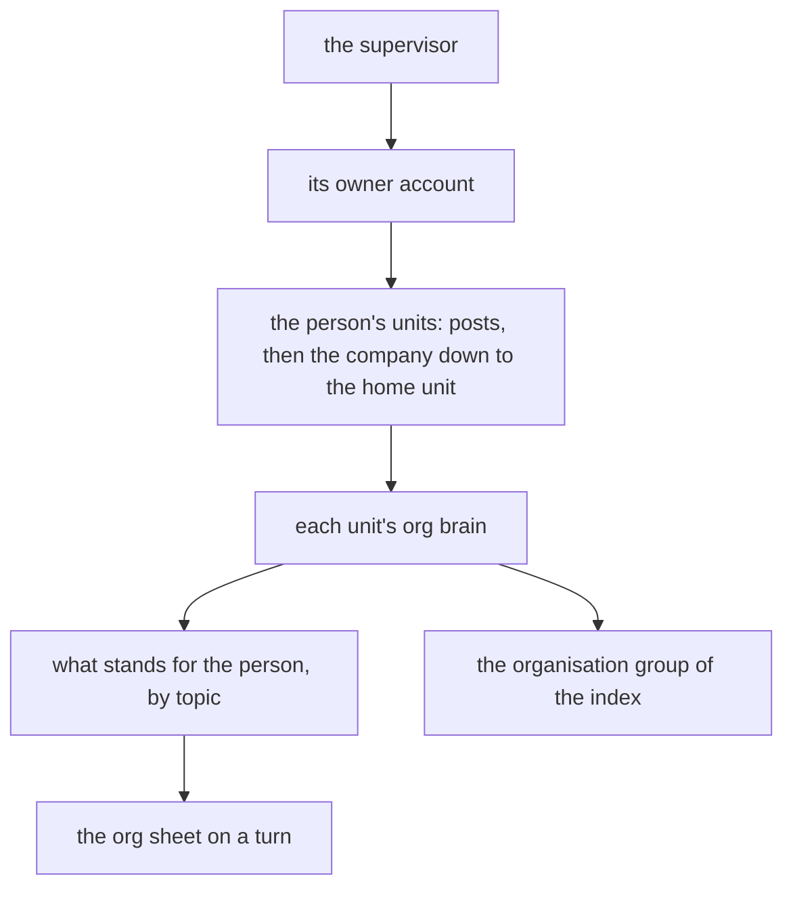

# Reference selection

What a chat turn is given to read beside the conversation, and how the agent reads the rest of its brain. The
pieces themselves live in the brain, and the system documents among them are the ones the deployment ships.

- **No model chooses a turn's reference.** `POST /reference/selected` carries what attaches by a fact of the row
  alone, and asks no gate.
- **The agent chooses what it reads** from the brain's index, which a turn names as each group's count of unread
  entries, through the index, piece and search routes and the tools that call them (「The index an agent reads」).

## Whose reference it is

Every account has supervisors of its own, each with a brain of its own, and a supervisor's reference never shows
another supervisor's memories, rooms or people, of its own account or another.

- **A reference is one supervisor's, read from its own brain** and, beside it, from the org brains of the units the
  person it serves belongs to (「What an organisation hands its members」); no other brain is read. The supervisor is
  the agent the caller
  names: the situation's agent on a chat turn, the envelope's `agent` on a turn with no situation, and `agent` on
  the index, a piece and a search. A turn with no situation is a supervisor's instruction outside any room, a
  job's first prompt or its double's, and names the supervisor it is read for in `agent`; an envelope carrying both
  names one agent in each, and one naming two is refused.
- **Nothing is read for an agent nobody names.** A turn whose envelope names no agent, by its situation or its
  `agent`, and an index, a piece or a search asked with no `agent` are refused, and never answered from the chat
  agent's brain.
- **The supervisor's account decides the brain.** The gate asks the agency who owns the supervisor (its
  `ownerAccount`, `docs/boundary-api.md`, 「bmo-agency」), and reads the one brain filed under that account and the
  supervisor's name (the brain's `docs/design.md`, 「Whose a brain is」): the account's key is the owning user's id.
- **A supervisor of no account,** the deployment's own, and an agent the agency holds no supervisor of, are read
  from the one brain filed under their name in any account. A name that stands on brains of more than one
  account reads none of them: the gate never picks one.
- **No brain, no memory index.** An agent the brain keeps no brain for is handed nothing from a brain on a turn,
  org brains among them, and its index answers no group at all; a piece of it is not found and a search finds
  nothing.
- **The room narrows, never widens.** A room picks among the supervisor's own rows, those about that room or about
  no room, and the people its own brain knows facts of; no room named brings in a row of another agent's brain. So a
  supervisor reads its own rooms' memories and people alone. The org brains are read by the person the supervisor
  serves, never by the room, and hold no memory about a person.
- **The system documents meant for every supervisor** are the shipped reference documents `docs/reference-index.md`
  lists, and no other. A note about the deployment's machines, its credentials or the owner's own work is never one
  of them: it is a memory of the owner's brain, and reaches the owner's supervisor alone. The `system-documents`
  group's lore is the supervisor's own brain's.

## What an organisation hands its members

An org brain holds what holds for everyone in one unit of an organisation, a company or a unit under it (the brain's
`docs/design.md`, 「Org brains」). A supervisor's reference reads the org brains of the units the person it serves
stands in, so what a company, a division or a team says of itself reaches every member's agent.

- **Whose organisation it is.** The person is the supervisor's owner, its `ownerAccount` (「Whose reference it
  is」). A supervisor of no account, an owner the account service places in no unit, and a deployment whose
  settings name no account service read no org brain: the turn carries no org sheet and the `organisation` group
  stands empty.
- **The person's units, the farthest first.** The account service answers the person's home unit with the path
  from the company down to it, and the posts they hold in other units of the company, each with its own path
  (`docs/boundary-api.md`, 「The account service」). The units are named in the order the brain reads them by: first
  the units of the posts' paths that stand on no other path named, the posts in the order answered and each path
  from the top down, then the company and each unit under it down to the home unit. So the home path wins a topic
  over a post, and a nearer unit over a farther one.
- **A unit's org brain** is the brain of the kind `org` filed under the company's number as its account and the
  unit's number as its agent, each written as its digits. A unit the brain keeps no org brain for is passed over.
- **What stands for the person** is the brain's answer for those org brains in that order (the brain's
  `GET /org-topics`): for each topic, the memories of the one unit whose word on it holds, the farthest holding a
  locked one, else the nearest holding one. A proposal and an episode never stand, and an org memory with no topic
  stands for nobody: it is read through the index alone.
- **Read for the room's audience.** An org memory may be internal-only, kept from a room where someone outside the
  company sits (the brain's `docs/design.md`, 「Org brains」), so every org brain is read for one of two audiences:
  `external` where someone outside the company of the supervisor's owner sits in the room, `internal` where everyone
  there is of it. The caller names it, the receiver on a turn's envelope (`docs/api.md`, 「Reference」). An envelope
  naming none is read `external` where it carries a situation, a room's chat turn, and `internal` where it carries
  none, a turn read in no room. An index, a piece or a search naming none reads the room's audience as the receiver
  answers it for the supervisor, asked only where an org brain is read, and `external` where the receiver cannot say
  (`docs/boundary-api.md`, 「bmo-receiver」).
- **What `external` leaves out:** every org memory marked internal-only, and every one the brain does not mark
  either way. What stands for the person is asked of the brain for that audience, which leaves them out once each
  topic's unit is decided, and the gate leaves out any it still answers; the `organisation` group, its pieces and a
  search over it leave them out too, so a piece of one is not found. `internal` leaves nothing out.
- **The org sheet** is one entry, under the path `organisation/sheet.md`, of the source `memory`: a head line saying
  what it is, then one line a standing memory, its number, its unit's name, its topic, a mark where it is locked,
  and its words. The lines go in the brain's order, the farthest unit first and the home unit last, each topic's
  memories by importance.
- **The org sheet is held to 2,000 characters.** The head line always stands. Where the lines do not all fit, they
  are kept one at a time while they fit, a locked one first, then the nearer unit's, then the more important, the
  brain's order breaking a tie; the lines kept stand in the brain's order. Nothing standing, or no line fitting,
  carries no org sheet. Like a person's sheet it is held to its own ceiling and is not counted in the turn's total.
- **The `organisation` group** of the index is every other live org memory of the person's units: the brain's
  active rows of their org brains that are neither a proposal nor an episode, the unit's order and then the brain's,
  less those the org sheet carried and those of a topic another unit's word holds. An entry's slug is `org-<memory
  id>`, what it holds the unit's name and the first line of its words, when to read it the memory's recall
  condition, and its path `organisation/<unit>/<memory id>`. A piece is the memory's words under the name of the unit
  it is from, so the agent tells which unit said what where two disagree.

## What a turn is given

- **The head of the standing sheet of everyone who spoke this turn,** what the brain knows of that person in
  this room as the brain renders it from their names and facts, every name first and then the most important
  facts, held to the sheet's ceiling, under the path `rooms/<room>/people/<user id>/sheet.md`, the turn's agent's
  own; a person the brain knows no name and no fact of in the room has none.
- **The room's due memories,** the errands whose event has come, the latest come first and at most three, as one
  entry under `memories/<room>`; a turn on which nothing is due carries no memories entry.
- **The rows the turn's events wake,** by the event alone (the brain's `docs/memories.md`, 「A row with an
  event」).
- **The org sheet,** what the organisation of the person the supervisor serves holds for them on every topic, read
  for the room's audience (「What an organisation hands its members」); a supervisor of no organisation has none.
- **Nothing else.** No room rule, no knowledge, no lore, no other person's sheet and no undue memory attaches to a
  turn: each stands in the index, for the agent to read where the turn needs it.
- **Every turn is one designated agent's,** the agent its situation names, else its `agent`, and everything is
  read from that agent's own brain and the org brains of the person it serves (「Whose reference it is」). An agent
  keeping no brain is given no sheet and no memory, never the chat agent's.
- **The sheet's head is every name line first, then the eight most important fact lines,** the policy's count,
  as the brain renders the person's subject with the room's subject as its room (the brain's `docs/design.md`,
  「A person is a subject」). The name lines are what the person is called, one line a live name, those about this
  room ahead of those about no room; the policy's count cuts the fact lines alone, so a head never leaves out a
  name. The fact lines are the person's facts about no room and their facts about this room, one line a fact, the
  most important first. The head is held to 14,000 characters by its lines from the top. The brain keeps no sheet
  as a row, and no memory of type `sheet` is read. The rest of a speaker's facts reach the agent through its own
  reading of the index.
- **The memories go as one entry,** under `memories/<room>`: a head naming it and how many open rows the room
  holds, one line a row — its number, kind, when it was written and moved, whom it is for, the item it was left
  open by and its words — and a closing line saying how many more stand and how the agent lists them. The entry
  carries data alone: how it is read, how an item is checked off and how a state is moved stand in the room block
  the session already carries (the receiver's `docs/bmo-window.md`, 「What every turn carries」).
- **What a turn carries together is held to 30,000 characters,** the memories entry and the woken rows; the rows
  the events wake are held to 12,000 between them, and a row that does not fit is passed over and logged with its
  name and size. Over the total the largest piece goes first, the path breaking a tie. A sheet is held to its own
  ceiling and is not counted.
- **The reference block** stands before the message blocks as a `Reference for this message (N): ... END OF
  REFERENCE` block, the shape of the message blocks, so reference text never passes for something a person said
  (the receiver's `docs/bmo-window.md`).

## The index an agent reads

| Route | Query | Answer |
|---|---|---|
| `GET /reference/index` | `session?`, `room`, `agent`, `audience?` | `groups`, each `group`, `unread`, `hint` and `entries` (each `slug`, `holds`, `readWhen`, `path`) |
| `GET /reference/pieces/{slug}` | `room`, `group`, `session?`, `agent`, `audience?` | `slug`, `group`, `path`, `text` |
| `GET /reference/search` | `q`, `room`, `limit?`, `agent`, `audience?` | `entries`, each `slug`, `group`, `holds`, `readWhen` |

- **Six groups, in this order:** `system-documents` (the lore of the agent's brain, in a room that reads it; the
  brain holds no row of a shipped reference document, so no index lists one), `room-rules` (the room's rules and
  its situation rules), `knowledge`, `people` (everyone the brain knows facts of in the room), `room-memories`
  (the room's standing memories) and `organisation` (the org memories of the person the agent serves beyond its org
  sheet, read for the room's audience, 「What an organisation hands its members」). Every other group is the named
  agent's own brain's (「Whose reference it is」), and the audience changes nothing of it; an agent keeping no brain is
  answered no group at all.
- **An entry** is the row's `slug`, what it `holds`, when to read it, `readWhen`, and its `path`, the path a piece
  read of it is recorded under among the session's loads, which is how a caller names what a session read. A knowledge piece's or a
  rule's title is split where it says when it is needed — at "; needed", "; consulted" and their kin up to the
  "when" that follows — what stands before being `holds` and the rest `readWhen`; a title that says no such thing
  is all `holds`, with `readWhen` null. A situation rule holds its action and is read when its condition holds; a
  memory holds its words and is read when its condition holds; a person holds their name, and is read when they
  speak or are spoken of; an org memory holds its unit's name and its words, and is read when its recall condition
  holds.
- **`unread`** counts a group's entries whose path the session's loads do not hold (the agency's
  `GET /session-loads/{sessionId}`); with no session named, every entry is unread. **`hint`** is one sentence saying how many of the group's entries changed in
  the last three days, and null where none did.
- **A piece** is read by its slug within its group: its path and its whole text, a person as their sheet held to
  its ceiling, a memory and a situation rule as the row carries them, an org memory as its words under its unit's
  name. Where `session` is given, the piece is
  recorded among the session's loads at its version (the agency's `PUT /session-loads/{sessionId}`), so the next
  index counts it read. A slug the group does not hold is 404 `not-found`.
- **A search** matches the words of `q` against every group's entries, their slugs, what they hold and when they
  are read, with no model; the entries holding the most of the words come first, at most `limit`, 8 where absent
  and never more than 24.
- **The tools.** `gate/reference_index`, `gate/reference_piece` and `gate/reference_search` call the three routes
  for an agent, under the one capability `gate.reference` (`docs/api.md`, 「The tools a tool host places」).

## Loaded once per session

### One full load per version

- **Every document the reference attaches goes to a chat session in full once per version**, and as a
  one-line mark on every later turn of that session that attaches the same version: the memories entry, the
  standing sheets, the org sheet and the woken rows.
- **Why:** a chat session is a continuing conversation, so a document loaded once stays in that session's
  context and is read on later turns too. Sending the same text again buys nothing but its size.
- **What a version is:** the attached text itself. One changed character is a new version, and a new version
  goes in full again. An index filtered for one room is a different version from the same file filtered for
  another.

### What stands on every turn

- **Only the body is replaced by the mark.** What says where a reference came from stands on every turn,
  whether the document went in full or as a mark:
  - the chat id and the room's title, which every turn prompt carries in its own head;
  - the document's path, on the line that heads it in the reference block. A person-book document's path
    holds the user id whose document it is.
- **The mark is that heading line with `(already loaded)` after the path**, and nothing else: the chat and
  the path it would repeat already stand on the page.
- **How the session reads a mark:** from the version already in its own context.
- **What a mark means is said once, in the chat agent's system prompt** (the agency's `prompts/agents/chat/manual.md`,
  where the reference block is described), together with the rule that the reference outranks the
  session's own memory. The turn's reference block carries neither sentence.
- **The total counts the full text,** measured before it is known which entries will go as marks.

### The record

- **What was loaded is recorded per session in the brain** (its `/sessions/loads`), one line per session,
  document path and version.
- **When:** after the session answered the request that carried the full text, under the name of the session
  that answered. A mark points at a text the continued session holds, so a session answering under a new name
  is recorded with only what went out in full.
- **Failures record nothing,** so the next turn sends the same version in full again.
- **Survives restarts:** the record is the brain's.

### Full or mark is decided late

- **At prompt-building time** it is not known whether the session will simply continue: just before the
  request it may be summarised and handed over, or the road may change.
- **So each document goes into the prompt wrapped**, and the comparison with the record happens at the last
  point, where it is settled which session the request continues.
- **No session to continue:** a request with none, and every request on a sessionless road, carries every
  document in full and records nothing.

### When the record empties

- **New sessions:** a newly opened session, a session summarised and handed over, and one opened anew because
  the road or model changed have no record under their names, so they load everything from the start.
- **Folding:** a fold keeps the session's name and loses the detail, so its record is deleted the moment it
  is folded.
- **Room switches:** restating the room's context on a switch empties nothing.
- **The room's context shares the record.** Each room's context block stands in it under a path of its
  own, `room-context/<chatId>`, versioned by the block's fingerprint, so a room returned to later in the
  session is restated by a one-line mark rather than in full (the receiver's `docs/unified-bmo.md`, 「The system prompt
  and the room switch」). A fold empties it with the rest.
- **A changed document:** the moment a reload notice is queued for a document the reference attaches, every
  session's record of that path is deleted, so no session is left marked as holding a version of it. The
  next turn that attaches it sends the current version in full.

### Rooms sharing one session

- **Only the room's own entries stand on its turn,** full or mark, so a room-only document never stands on
  another room's turn in either form.
- **The record holds whole paths,** so one room's document can never be read as another's.
- **A person's sheet is not shared:** it is read per room, under the room's path.

### Notices carry only the path

- **A notice about a changed document the reference attaches names it and carries no text**: what the session
  remembers of it is stale, and the current version comes in full with the next turn that attaches it. So
  the new version is neither loaded twice, by the notice and by the reference, nor missed.
- **Which documents those are**, read off the path:
  - in the brain: a knowledge chunk and the knowledge index, and everything under a room's `rules/` and
    `people/`, a person's sheet in the room among them. A lore piece is the brain's too,
    under its memory's path, and a changed piece is a new memory under a path of its own;
  - shipped: the system reference index. A system document itself is announced to no session at all, so it
    needs no rule here.
- **Every other document's notice** carries its current text.

### What the log and the console show

- **The selection line names what was put forward** — `reference: chat <id> selected …` — before the session
  is settled.
- **The send line says which went in full and which as a mark**, once the request is opened for its session:
  `reference: chat <id> in full: …; already loaded: …`.
- **The turn's own log writes each reference document as a context line in the state it went in**:
  `attached` where the full text went, `held` where the mark did. The room's context carries `held` where
  its mark went and nothing where it went in full; the stretches of the room's record read back carry
  neither.
- **A document that went as a mark is not counted as attached.** The console's documents-read count leaves it out,
  and the list under it marks each document with which of the two it was (the web unit's `docs/web.md`).
